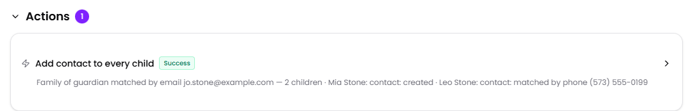

## When an action fires

Two modes, set by the packet's **Actions** toggle:

- **Immediate** — the action runs as soon as the step feeding into it is completed.
- **Require Approval** — nothing runs until you review the submissions and click **Approve**, at which point every action for that packet fires at once.

See [Approval mode](/packets/approval-mode/) for choosing.

## Actions behind a condition

An action sitting on a [condition](/packets/conditions/) branch only runs if the condition sends the family down that branch.

Conditions are evaluated against **everything the family has answered so far**, not just the most recent step. So a condition late in a packet can branch on an answer from step one, and the action behind it behaves accordingly.

## Order

Actions run one at a time, in the order of the flow: an action wired after another runs after it. Actions hanging off the same node run in the order they were added to the canvas.

Order matters because later actions can use the people earlier ones found or created. Chain **Create Family** → **Add Allergies** → **Link Share to Child**, set the last two to find the child by **Earlier step in this packet**, and they act on the child the first one made, with no second lookup. This carries across steps too: an action after form two can use the child an action after form one created. See [Finding people](/actions/finding-people/#earlier-step-in-this-packet).

:::caution[Create the record before you assign it]
**Assign Child to Classroom** needs the child to exist. Put **Create Family** or **Add or Update Child** earlier in the flow, or let the assignment find an existing child through their guardian.
:::

One action failing doesn't stop the others. Each records its own result.

## Checking what happened

Every run is recorded against the [share](/shares/admin/), with:

- **Status** — pending, running, success or error
- **Input** — the values the action actually ran with, after bindings were resolved
- **Output** — the response, or the error
- **Finished at**

Each run also shows a one-line summary: how the person was found (*"Matched by email jane@example.com"*, *"created"*), which fields were updated, and which were kept because **Overwrite existing data** was off.

An action set to [every child in the family](/actions/finding-people/#every-child-in-the-family) lists each child and what happened for them. Above, Grandma was created for Mia and then found by her phone number for Leo, so she's in Kinderly once, linked to both.

:::tip[The Input field is where you debug a binding]
When an action succeeds but produces something wrong — a child named after a parent, a blank date of birth — the Input record shows exactly what the binding resolved to. That tells you whether the problem is the binding or the form.
:::

## When something doesn't happen

Work through this order:

1. **Is the packet on Require Approval?** If so, nothing fires until someone approves. This is by far the most common cause.
2. **Is the action connected?** An action node with no line into it is never reached.
3. **Is it behind a condition?** If the condition went the other way, the action was correctly skipped.
4. **Check the run record.** An error status will say what went wrong.
5. **Check the bindings.** A required field bound to a question the family left blank can fail.
6. **"No guardian found" or "2 guardians match".** The action couldn't find exactly one person. Check the email or phone in Manage, merge the duplicate, or set the action to create the person when no one matches. See [Finding people](/actions/finding-people/).
7. **The run succeeded but a field didn't change.** Look for *kept* in the summary. **Overwrite existing data** is off, so the action only fills in blanks.

:::tip[Approval mode is the answer most of the time]
"Our welcome emails stopped" almost always means completed shares are sitting unapproved. Make sure someone owns that queue — the [Shares list](/shares/admin/) flags them with a **Needs Approval** badge.
:::

## Approving twice

Approve is guarded against double-firing, so a stray second click won't send everything again.

## Next

- [Parameter binding](/actions/parameter-binding/) — getting the inputs right.
- [Managing shares](/shares/admin/) — where run records live.
