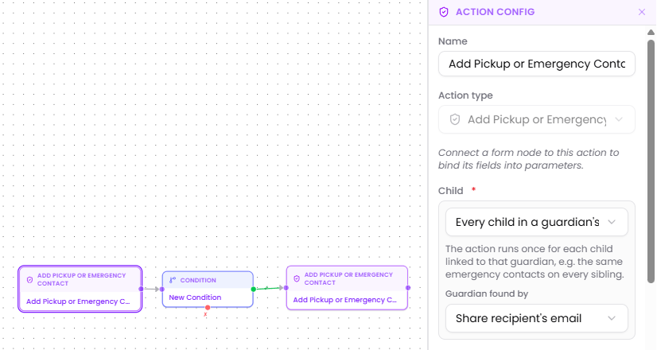

Most [actions](/actions/overview/) are about a person: link this packet to *the guardian*, add allergies to *the child*. Each of those actions has a **Find** setting that says how to pick that person out of [Manage](/manage/overview/).

## Ways to find a guardian or staff member

| Find by | Matches on |
|---|---|
| **Share recipient's email** | The email address the packet was sent to. The default for most actions, and needs no binding |
| **Email** | An email you bind to a form field or type in. Capitalization and stray spaces don't matter |
| **Phone** | A phone number. *(555) 123-4567*, *555.123.4567* and *+1 555 123 4567* all match, on either the main or secondary phone |
| **Earlier step in this packet** | Whoever an earlier action found or created. See [below](#earlier-step-in-this-packet) |
| **Name** | First and last name, ignoring capitalization. The least reliable option, since two people can share a name |

## Ways to find a child

Children don't have an email or phone of their own, so they're found through their family.

| Find by | Matches on |
|---|---|
| **Family of a guardian** | The children linked to a guardian, who is found by share recipient, email, phone or an earlier step. If the family has more than one child, add the child's first name to pick the right one |
| **Every child in a guardian's family** | All the children linked to a guardian. The action runs once for each child. See [below](#every-child-in-the-family) |
| **Earlier step in this packet** | The child an earlier action found or created |
| **Name** | First and last name, ignoring capitalization |

:::tip[Family of the recipient is the right default for most packets]
A medical update or a re-enrollment form sent to a parent finds their child without asking the parent to type anything the center already knows.
:::

## Every child in the family

Some packets are about the whole family, not one child. An emergency contact form a parent fills in once should add the same contacts to every sibling, without asking the parent to name each child.

Set the child to **Every child in a guardian's family** and pick how the guardian is found, usually **Share recipient's email**. The action then runs once for each child linked to that guardian. The run summary lists each child and what happened to them.

These actions offer it:

- **Add Pickup or Emergency Contact.** The contact is created once and linked to each child
- **Link Guardian to Child**
- **Enroll Child in Program**
- **Update Medical Record**
- **Add Address to Child**
- **Set Custom Field** and **Save Documents to Profile**, when they're set to a child
- **Link Share to Child**

**Assign Child to Classroom**, **Add Allergies** and **Add or Update Child** don't offer it, because siblings rarely share a classroom or allergies.

A guardian with no children linked is an error, and nothing is created. If the action fails for one child, it still runs for the others, and the run shows which child failed.

Since no single child is "the" child afterwards, **Earlier step in this packet** still points at whichever child it pointed at before.

## Earlier step in this packet

Actions run in the order of the flow, and each remembers who it found or created. Choose **Earlier step in this packet** and the action uses that person, with no second lookup:

**Create Family** → **Update Medical Record** (child: earlier step) → **Add Allergies** (child: earlier step) → **Link Share to Guardian** (guardian: earlier step)

This works across the steps of a packet too. An action after the second form can use the child an action after the first form created, even though the two ran at different times.

**Add Pickup or Emergency Contact** never becomes the "earlier" guardian, so a grandparent added as a pickup doesn't replace the parent for the steps after it.

## When no one matches

Each action has an **If no one matches** setting:

- **Stop and log an error.** Nothing is created, and the run says who it couldn't find. This is the default for actions that file things on someone's profile.
- **Create a new record.** The person is created from the name and contact fields you bind, then the action carries on. This is the default for **Create Family** and the **Add or Update** actions.

A child created through **Family of a guardian** is linked to that guardian automatically.

:::caution[Two matches is always an error]
If two guardians share the email, or two children in a family have the same first name, the action stops rather than guess. Filing a custody document on the wrong family is worse than asking you to look. The run shows *"2 guardians match email …"*. Merge or fix the duplicate in Manage, then approve or resubmit.
:::

Running the same packet twice doesn't create people twice. The second run finds the guardian and child the first one made.

## Overwrite existing data

Actions that write profile data have an **Overwrite existing data** toggle.

- **Off** (the default): the action only fills in fields that are blank in Manage. A family re-enrolling can't undo a phone number your office corrected.
- **On**: answers replace what's in Manage.

Either way, an empty answer never clears a field. An answer the action can't read, like a birth date of *"sometime in March"*, is skipped and shown as *couldn't read* in the run summary.

The run summary on the [share](/shares/admin/) lists what was **updated** and what was **kept** because overwrite was off, so you can tell an action that did nothing from one that wasn't allowed to.

| Action | What overwrite changes |
|---|---|
| **Add or Update Guardian / Child / Staff** | Profile fields. A staff member's email is never changed, because it's their app login |
| **Create Family** | The guardian's email and phone, the child's birth date and gender |
| **Link Guardian to Child**, **Add Pickup or Emergency Contact** | Relationship, pickup and primary settings on a link that already exists |
| **Assign Child to Classroom** | Whether a child already in a classroom is moved |
| **Update Medical Record** | Every medical field |
| **Add Allergies** | Severity and notes on allergies the child already has. New allergies are always added |
| **Set Custom Field** | A custom field that already has a value |
| **Add Address to Child / Guardian / Staff** | The existing address, instead of only its blank parts |

## Packets set up before these options

Actions saved before these options existed found people by first and last name. They keep doing that, now ignoring capitalization, until you open them and choose another way. A classroom or program picked by typed name keeps working too; the action's settings show a note asking you to pick it from the list instead.

## Next

- [Parameter binding](/actions/parameter-binding/) — feeding answers into these fields.
- [Execution](/actions/execution/) — reading the run summary.
