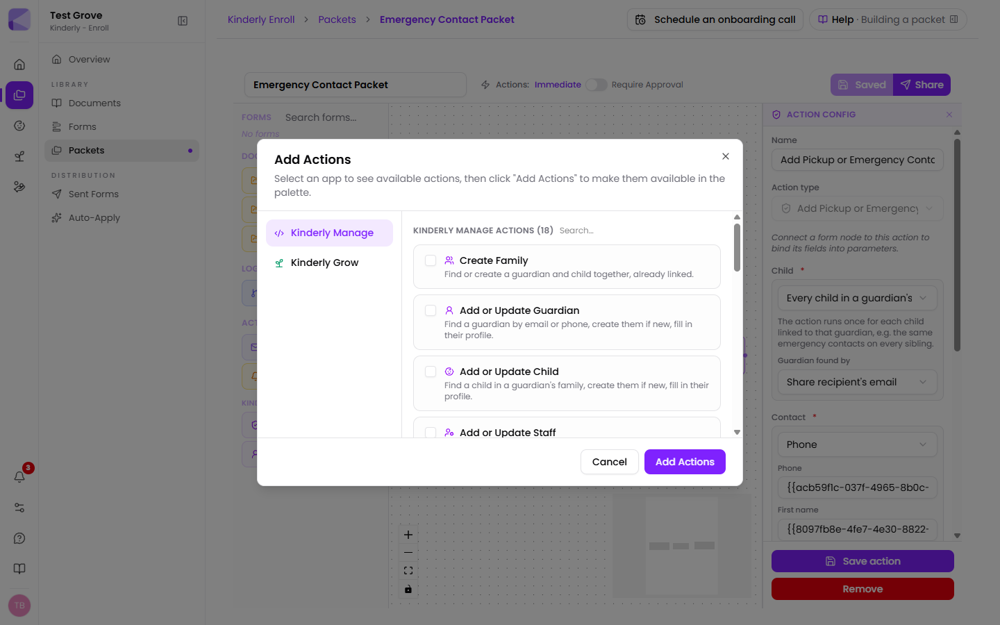
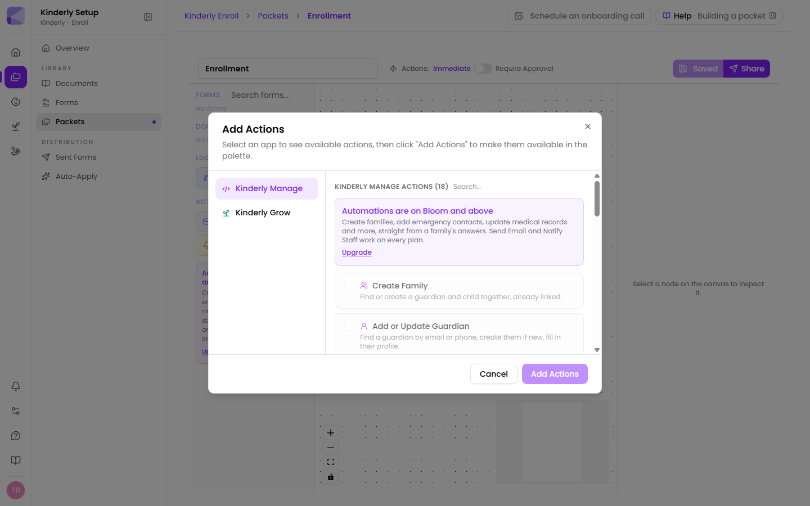

Actions are automation blocks you drop onto a [packet](/packets/overview/) canvas. When a family completes the step an action is connected to, the action runs.

Used well, this is what turns a signed enrollment packet into a fully created child record — without anyone retyping a name.

## Adding actions to your palette

**Send Email** and **Notify Staff** are available by default, on every plan. The rest are opt-in: click the **+** beside **Actions** in the packet palette, pick a vendor, choose the actions you want, and **Add Actions** makes them available to drag onto the canvas.

:::note[Automations are on Bloom and above]
Everything beyond Send Email and Notify Staff (creating families, updating medical records, adding emergency contacts, Grow cards and the rest) needs the **Bloom** plan or above. See [Plans](/billing/plans/). If a center moves to Sprout, packets keep their automations but they don't run. Each one shows *"Packet automations are on the Bloom plan and above"* in the run log instead, and starts working again after an upgrade.
:::

:::tip[Add only what this packet needs]
The palette is per-packet. Adding all twenty-odd to a packet that only sends a confirmation email just makes the list harder to read.
:::

## The Kinderly actions

**Communication**

| Action | What it does |
|---|---|
| **Send Email** | Sends an email to a parent, a staff member, or anyone else. Leave **To** empty to email the person the packet was sent to |
| **Notify Staff** | Sends a push and bell notification to all your administrators, or to one staff member you pick |

**People in [Manage](/manage/overview/)**

These find the person first, by email, phone or the packet's recipient, and only create a new record if no one matches. See [Finding people](/actions/finding-people/).

| Action | What it does |
|---|---|
| **Create Family** | Finds or creates a guardian and a child together, already linked. The quickest way to set up an enrollment packet |
| **Add or Update Guardian** | Finds a guardian by email or phone, creates them if they're new, and fills in their profile: phones, birth date, employer |
| **Add or Update Child** | Finds a child in a guardian's family, creates them if they're new, and fills in name, birth date and gender |
| **Add or Update Staff** | For staff onboarding packets: finds or creates the staff member and fills in phone, hire date, title, education and employment type. A new staff member is emailed a staff app login |
| **Link Guardian to Child** | Connects a guardian and a child, with relationship, pickup rights and primary guardian |
| **Add Pickup or Emergency Contact** | Adds an authorized pickup or emergency contact to a child, or to [every child in the family](/actions/finding-people/#every-child-in-the-family), creating the contact if they're not in Manage yet |

**Child records**

| Action | What it does |
|---|---|
| **Assign Child to Classroom** | Puts the child in a [classroom](/manage/classrooms/) |
| **Enroll Child in Program** | Enrolls the child in a [program](/manage/programs/), which starts billing |
| **Update Medical Record** | Fills in physician, preferred hospital, insurance, last physical and emergency treatment consent |
| **Add Allergies** | Adds allergies from a form answer. A comma-separated list or a multi-select both work, and "None" or "N/A" are ignored |

**Any profile**

| Action | What it does |
|---|---|
| **Set Custom Field** | Writes an answer into one of your custom fields on a child, guardian or staff member |
| **Save Documents to Profile** | Files the packet's completed documents on the person's Files tab, not just as a link to the share |
| **Add Address to Child** | Adds an address to the child, or fills in the blanks of the one they have |
| **Add Address to Guardian** | The same, for a guardian |
| **Add Address to Staff** | The same, for a staff member |

**Linking the paperwork**

| Action | What it does |
|---|---|
| **Link Share to Guardian** | Attaches the completed [share](/shares/overview/) to the guardian's profile |
| **Link Share to Child** | Attaches it to the child's file |
| **Link Share to Staff** | Attaches it to a staff member's profile |

**[Grow](/grow/overview/)** (listed under **Kinderly Grow** in the Add Actions dialog; the people and records actions are under **Kinderly Manage**)

| Action | What it does |
|---|---|
| **Add Card to Kinderly Grow** | Creates a [pipeline](/grow/pipeline/) card, with optional tasks and a default assignee |
| **Move Grow Card** | Moves the family's card to another column, for example to **Enrolled** when the packet comes back |

## What this makes possible

Chain them and a completed enrollment packet can, on its own:

1. Create the family: guardian and child, linked
2. Add the second guardian and an emergency contact
3. Add the family's address
4. Fill in the medical record and allergies
5. Assign the child to a classroom
6. Enroll them in a program, starting billing
7. File the signed documents on the child's profile
8. Move their Grow card to **Enrolled** and email the family a welcome note

That's the whole of enrollment admin, done from data the family typed once.

:::tip[This is the highest-value thing in Kinderly, and the least obvious]
Most centers use packets to collect signatures and then key the answers into Manage by hand — which is the error-prone part, and the part that takes the afternoon. Wiring up these actions once removes that step permanently.
:::

:::caution[Test on yourself before pointing it at families]
Record-creating actions write real data into Manage. Send the packet to your own email first, complete it, and check what appears — including that names and dates landed in the right fields. A misbound field creates a hundred wrong records much faster than a person could.
:::

## When actions run

Controlled by the packet's **Actions** setting — **Immediate** or **Require Approval**. For anything creating records or starting billing, use Require Approval. See [Approval mode](/packets/approval-mode/).

## Next

- [Parameter binding](/actions/parameter-binding/) — feeding answers into actions.
- [Execution](/actions/execution/) — what happens when one runs.
