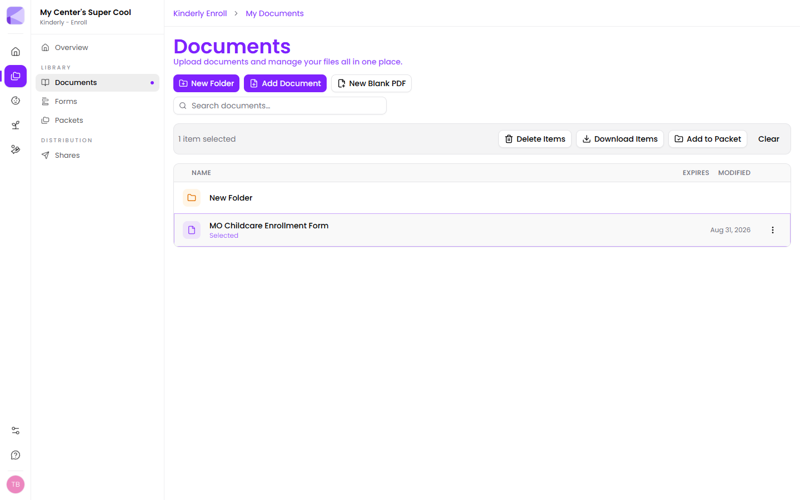
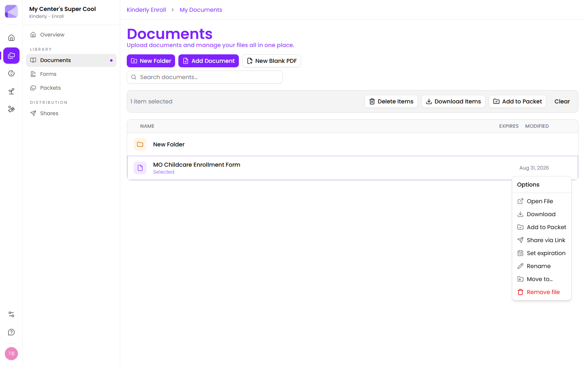

## Uploading

**Add Document**, or drag files straight onto the library. To upload into a folder, open the folder first — files land wherever you currently are. You can select several files at once.

### What you can upload

| Type | What happens |
|---|---|
| **PDF** | Opens in the full [viewer](/documents/viewer/) — add signature and text fields, include it in packets, share it for signing |
| **Photos** (JPEG, PNG, WebP, GIF, HEIC) | Turned into a PDF automatically, so a phone photo of an immunisation record can be signed and shared like any other document |
| **Word** (.docx) | Converted to a PDF — you get to check the result before it saves |
| **Spreadsheets** (Excel, CSV, OpenDocument) | Stored and readable in the library, sheet by sheet |
| **Text** (.txt, .md) | Stored and readable in the library |
| **PowerPoint and OpenDocument presentations** | Stored and downloadable |

Only PDFs can carry signature fields, go into packets, or be shared for signing — everything else is stored, readable and downloadable. If you need a spreadsheet or a presentation signed, save it as a PDF from the app you made it in and upload that.

### Word documents

When you upload a `.docx`, Kinderly converts it to a PDF in your browser and shows you the result before saving anything. Text, headings, lists and tables come across. Page layout, headers and footers, images and anything inside a text box may not.

If the preview doesn't look right, choose **Keep the Word file instead** to store the original untouched, or **Cancel** — then open it in Word, use **File → Save As → PDF**, and upload that instead. That's also the route for older `.doc` files, which can't be converted here.

:::tip[iPhone photos]
Photos from an iPhone are usually HEIC files, which most browsers can't read. If a photo won't upload, open **Settings → Camera → Formats** on the phone and choose **Most Compatible**, or email the photo to yourself first — that converts it to JPEG.
:::

## Folders

**New Folder** creates one. Double-click a folder to open it; the breadcrumb at the top shows where you are and gets you back.

## Working with a file

The library works the way the file browser on your computer does:

- **Click** to select. Click again to deselect. Ctrl-click (⌘-click on a Mac) picks out several.
- **Double-click** to open — a file in the [viewer](/documents/viewer/), a folder into its contents.
- **Right-click** a file or folder for its options, right where your pointer is — the same list as the **⋮** button at the end of the row.
- **Right-click empty space** for **New Folder**, **Add Document** and **New Blank PDF**, without going back up to the toolbar. Whatever you make lands in the folder you're looking at.

Click a file to select it. A bar appears with actions that work on everything you've selected:

- **Delete Items**
- **Download Items**
- **Add to Packet** — drop straight into a packet without going to the packet builder
- **Clear** — deselect

For actions on a single file, use the **⋮** menu at the end of its row:

| Option | What it does |
|---|---|
| **Open File** | Opens the [viewer](/documents/viewer/) |
| **Download** | Saves a copy to your computer |
| **Add to Packet** | Adds it to a packet as a step |
| **Share via Link** | Sends it to a family on its own — see [Sending a share](/shares/sending/) |
| **Set expiration** | Gives the document an expiry date |
| **Rename** | Changes the filename |
| **Move to…** | Moves it to another folder |
| **Remove file** | Deletes it |

:::tip[Add to Packet from here saves a round trip]
If you're already looking at the document you want to include, adding it to a packet from this menu is quicker than opening the packet builder and hunting for it in the palette.
:::

## Expiry dates

**Set expiration** marks when a document stops being current. The date shows in the **Expires** column of the library.

This is about *your* copy going stale — not about cutting off access to a share. It's for the paperwork that has a shelf life:

- Insurance certificates
- Staff background checks and clearances
- Licensing certificates
- Immunisation records

:::tip[Expiry dates turn your library into a renewal reminder]
Set an expiry on every certificate that has a renewal date and the Expires column becomes a to-do list. Without it, an expired insurance certificate looks exactly like a current one.
:::

:::caution[Two different kinds of expiry]
A **document** expiry (here) flags that your file is out of date. A **[share](/shares/sending/)** expiry stops a family's link working. Setting one doesn't set the other.
:::

## Searching

The search box filters by filename. Worth keeping in mind when naming things — "2026 Enrollment Form" is findable, "scan_0043.pdf" isn't.

## Deleting

Deleting removes the file from your library.

:::caution[Check for packets first]
If a document is a step in a packet, deleting it breaks that step. Before removing anything, make sure it isn't part of a packet you still send.
:::

## Next

- [The document viewer](/documents/viewer/) — adding fields and signing.
- [Packets](/packets/building-a-packet/) — using documents as steps.
