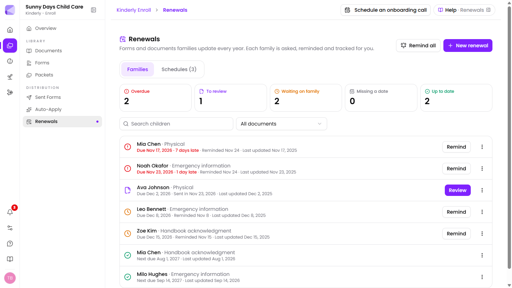

Emergency forms, physicals, permission slips and handbooks to sign all need a fresh copy every year. **Renewals** asks each family ahead of time, reminds them until it's done, and shows you who is up to date.

:::note[Bloom and above]
Renewals is part of the **Bloom plan and above**. If you move down to Sprout, your schedules are kept, but nobody is asked or reminded until you upgrade again.
:::

## Setting one up

Open **Enroll → Renewals** and press **New renewal**.

1. **What**: choose what families send.
   - **A form**: one of your [forms](/forms/overview/). It opens with the family's last answers filled in.
   - **A photo or file**: for a physical, immunization record or insurance card. Kinderly makes a short form for it, with a file and the date on the document. You can edit it in Forms. If the child already has the document on file, the family can [update that copy](#updating-a-copy-on-file) instead.
   - **A PDF to sign**: one from your [Documents](/documents/overview/). Families sign [the same copy again](#pdfs-signed-again-each-year) each year.
2. **Who**: everyone, or certain programs, classrooms or children. Children you add later are included automatically.
3. **When**: what the due date follows.
   - **Enrollment date**: the anniversary of the child's first program start date.
   - **Child's birthday**.
   - **Same day for everyone**, such as August 1.
   - **A year after the last one**. For a photo or file, it's a year after the date on the document.

   Also choose how far ahead families are asked (30 days unless you change it), whether to **ask everyone for a fresh copy now**, and whether you **review each update before it counts**.
4. **Review**: see how many children are covered, who would be asked straight away, the first dates, and anything missing.

:::caution[Check start dates first]
If a child has no program start date, the day they were added to Kinderly is used. After an import, that can be the same day for everyone. The Review step tells you how many children this affects.
:::

Packets can't be renewed, because their actions would run again. Use the form or PDF inside the packet.

## What families do

When the date gets close, the document appears in the [Parents app](/mobile/parent-app/#paperwork) under **Documents → To fill out**, with a notification and an email. The email has a link and a PIN for parents who don't use the app.

- **Forms** open with the family's last answers for that child. They change anything that's different, or press **Nothing changed? Go to the signature**, then sign and submit. Signatures, agreements, payments and files are never filled in from last year.
- **Photos and files**: they press **Update this copy** if there's one on file, or take a photo or choose a file. Then they enter the date on it.
- **PDFs**: the first time, they fill in and sign a blank one, or a copy already on file. After that they [sign the same copy again](#pdfs-signed-again-each-year).

One update covers the child. Any parent in the family can do it, and it's done for all of them. Case workers and emergency contacts aren't asked.

Reminders go out around 9 am in your center's timezone: when it opens, 7 days before, on the day, and then 1, 7, 14 and 30 days after, and every 30 days from there. A family with several documents or children gets one message.

## PDFs signed again each year

Some forms have a signature line for each year, like an enrollment form with **First annual update** and **Second annual update**. With a PDF renewal, the family opens the same copy every year instead of getting a new one.

- **What stays**: earlier signatures, initials and the dates next to them. These can't be changed.
- **What they can change**: their other answers, in the PDF's own fields or in fields you placed in Kinderly. They can also press **Add text** to write anywhere.
- **Signing**: they sign the next signature field, or press **Sign** and place a signature on the next line. If they don't sign on the page, they sign a **Record of update** page added at the end. It can't be sent in unsigned.

It's the same entry in [Sent Forms](/shares/overview/) and on the child's profile, open again. Until the family sends it in, you still see last year's copy. Then the new one replaces it.

Kinderly tells which fields are part of a signature by their names, such as **Date**, **Date signed**, **Initials** or **Parent signature**. A date on a signature line should be named **Date**, with a number if there's more than one.

A newer file on the child's profile with a matching name is used instead, as a new request. So is a different document you choose. To give families a blank PDF every year, turn off **Let families update the copy on file**.

## Updating a copy on file

For photos, files and PDFs, a family can start from a document the child already has. This is on unless you turn off **Let families update the copy on file** on the first step of the renewal.

**How it's found.** Kinderly looks for a PDF or photo whose name matches the renewal's. The child's name, dates and words like "signed", "copy" or "form" don't matter, so **Mia Lopez - Physical Exam (signed) 2025.pdf** matches **Physical exam**. The newest match is used. It looks at:

- Files on the child's profile
- Documents the family filled in and sent back, including last year's update
- Files on a parent's profile, only when every parent on the child has that file. If a parent has more than one child, the file's name must also say which child.
- For a photo or file, a document you [auto-apply](/documents/auto-apply/) to the child, filled in from scratch

**What the family can do.** They fill in any fields the PDF has, and press **Add text** to write anywhere else, in blue. They sign even when nothing changed. For a photo or file, the signature goes on a **Record of update** page at the end, so nothing already on the page can be covered. For a PDF renewal, they can sign on the page.

A photo, file or document from another request isn't changed. The update is kept as a new one.

**Checking and choosing.** The Review step says how many children have a match. Each row on the **Families** tab shows its **Copy on file**. To use a different one, open **⋮ → Choose copy on file** and pick a document, **Start fresh**, or **Match by name**. This is how to use a file named something like **scan0032**. Your choice applies to this update. If the family's request was their same copy from last year, choosing something else sends a new request and leaves that copy as it was. Next year starts from what the family sent.

Forms don't use this. They already open with the family's last answers.

## When one is overdue

The family and your administrators are told. You get a notification, an email and a push to administrators in the staff app the first time each one is overdue. Nothing is blocked: the child can still be signed in, and the family can still submit it late.

## Keeping track

The **Families** tab lists every child and document.

| Status | Meaning |
|---|---|
| **Overdue** | Past its due date |
| **To review** | The family sent it and it's waiting for you |
| **Waiting on family** | Asked for, not due yet |
| **Up to date** | Nothing to do until the next date |
| **Missing a date** | The child has no birth date or program start date. Add it, or choose a due date. |

Press **Remind** on a row, or **Remind all** for every family with something waiting. The **⋮** menu has the rest:

- **Ask now**: ask before the usual date.
- **Received on paper** or **Record an update**: enter the date on the document. Use this to enter when each child last updated something, so the schedule counts from there.
- **Change due date**: for this update only.
- **Choose copy on file**: what the family starts from. See [Updating a copy on file](#updating-a-copy-on-file).
- **Skip this time**: the next one still comes around.
- **Undo last change**: takes back a recorded or skipped update.
- **View request** and **View last update**: open what was sent.

## Reviewing updates

Press **Review**, then **View what they sent**. Check the date on the document and press **Accept**, or press **Ask for a change** and say what's wrong. The family is told right away. A form or file comes back as a new request that starts from what they sent. A PDF they sign each year opens again as it was before this update, with what they typed filled in, so they can sign it correctly.

## Pausing and deleting

On the **Schedules** tab, turn a schedule off to stop asking and reminding. Requests already sent stay open. **Delete** also withdraws unanswered requests. Updates already sent in stay in [Sent Forms](/shares/overview/) and on the child's profile: one for each year, or one copy for a PDF that's signed again.

Withdrawing a renewal's link in Sent Forms skips it for this year. If it's a PDF the family signed before, that copy stays.
