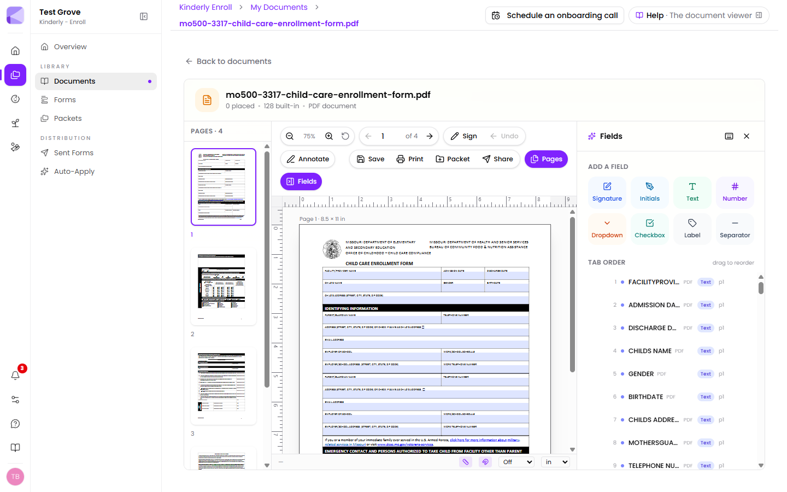
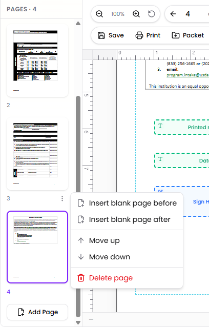
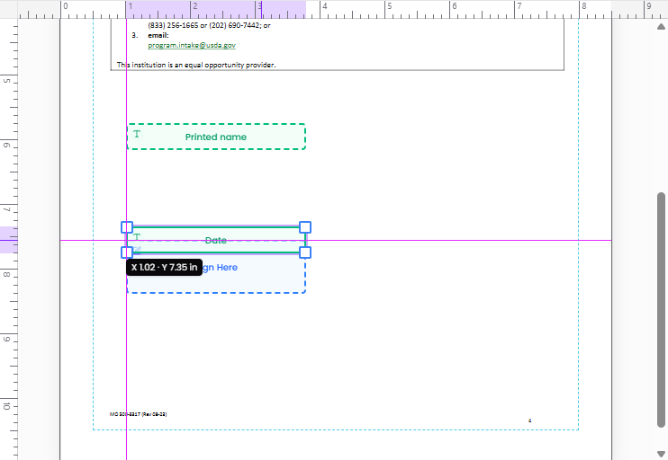
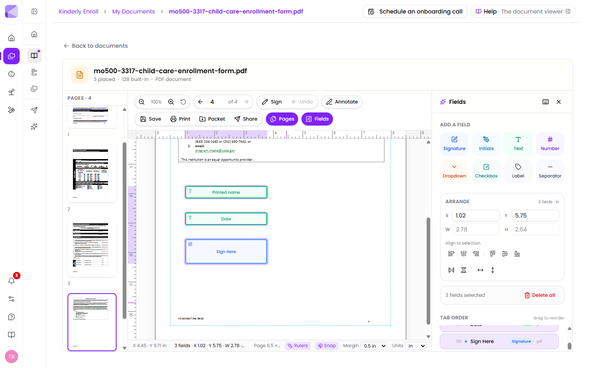

Opening a document gives you more than a preview — it's where you turn a flat PDF into something a family can fill in.

The editor described on this page is for PDFs. Spreadsheets, text files and presentations open in a read-only view instead, with a **Download** button — they can't carry fields. If you need one of them signed, save it as a PDF from the app you made it in and upload that. Photos and Word documents are [converted to PDF when you upload them](/documents/managing-files/#what-you-can-upload), so they open here like any other PDF.

## Reading the header

Under the filename you get a running count, e.g. *"0 placed · 128 built-in · PDF document"*.

- **Built-in** — fillable fields that already existed in the PDF. Kinderly finds these on its own.
- **Placed** — fields *you've* added on top.

:::tip[Check the built-in count before placing anything]
A government form uploaded in its fillable version can arrive with a hundred-plus fields already detected. Placing your own on top of those is duplicated effort. Open the Fields panel and look at what's already there first.
:::

## The toolbar

**Top row** — zoom out, zoom level, zoom in, reset zoom; page back / page number / page forward; **Sign**; **Undo**; **Annotate**.

**Second row** — **Save**, **Print**, **Packet**, **Share**, **Pages**, **Fields**.

## Pages

**Pages** opens a strip of page thumbnails down the left. Click one to jump to it.

- **Reorder** by dragging a thumbnail up or down, or use **Move up** and **Move down** in its menu (the **⋮** under it).
- **Add a blank page** with **Add Page** at the bottom of the strip, or **Insert blank page before** or **after** from a page's menu. A blank page is the same size as the page next to it, so it prints like the rest.
- **Delete a page** from its menu. Kinderly asks you to confirm first and tells you how many fields are on it.

Fields you've placed move with their page. Fields on a deleted page are deleted with it, along with any packet auto-fill set up for them. A built-in field with boxes on more than one page keeps the boxes on the pages that stay.

:::caution[Page changes rewrite the file]
Adding, moving and deleting pages change the PDF in your library straight away, wherever it's used: shares, packets and printouts. A family partway through a share will see the new pages. Responses already sent back are kept as their own copies and don't change. Deleting a page can't be undone. To get it back you'd need to upload the original PDF again. If you have unsaved signatures or filled-in values, save first, because changing the pages reloads the document and clears them.
:::

## Adding fields

Click **Fields** to open the panel, then pick a field type and place it on the page:

| Field | For |
|---|---|
| **Signature** | A full drawn signature |
| **Initials** | Initialling each page, as some agreements require |
| **Text** | Free text |
| **Number** | Numeric entry |
| **Dropdown** | Pick from a list you define |
| **Checkbox** | A tick |
| **Label** | Static text you add — not filled in by the family |
| **Separator** | A visual divider |

A field you've just placed is selected, ready to move into position.

## Lining fields up

The editor works much like a design tool, so a form can look tidy without nudging boxes by eye.

**Rulers and the page edge.** Rulers run along the top and left of the page, measured from its top-left corner, so you can judge margins at a glance. The page itself has a solid outline, so you can always see where the paper ends. A field that hangs off the edge is outlined in red, since that part won't print. The bar under the page shows where your cursor is and the exact position and size of whatever is selected.

**Selecting several fields.** Shift-click (or Ctrl-click) to add fields to a selection, or drag a box on an empty part of the page to select everything it touches. Drag any selected field and the whole group moves together.

**Snapping.** As you drag, fields snap to the edges and centers of other fields, to the page's edges and center, and to the margin guide. A pink line shows what it snapped to. Hold **Alt** while dragging to place a field freely, or switch **Snap** off in the bar under the page. Hold **Shift** to move in a straight line.

**Exact positions.** With fields selected, the **Arrange** box in the Fields panel shows their position (**X**, **Y**) and size (**W**, **H**). Type a value to move or resize precisely. The **Units** switch under the page picks inches, millimeters or points.

**Align and distribute.**

- With **one** field selected, the align buttons line it up with the page: centered across it, against the left edge, and so on.
- With **several**, they line the fields up with each other: left edges, centers, tops.
- **Distribute** spaces three or more fields evenly.
- **Match width** and **Match height** make every selected field the same size as the one with the thicker outline, the last one you clicked.

**Margin guide.** Pick a margin under the page (for example 0.5 in) to show a dashed guide that far in from every edge. Fields snap to it, which is an easy way to keep everything inside a printer's safe area.

### Keyboard shortcuts

Press **?** in the editor, or the keyboard button in the Fields panel, for the full list.

| Keys | Does |
|---|---|
| Arrow keys | Nudge the selection 1 point (Shift: 10) |
| Ctrl+A | Select every field on this page |
| Ctrl+D | Duplicate |
| Delete | Delete the selection |
| Ctrl+Z / Ctrl+Shift+Z | Undo / redo a move, resize or alignment |
| Alt+A / Alt+H / Alt+D | Align left / centers / right |
| Alt+W / Alt+V / Alt+S | Align top / middles / bottom |
| Alt+Shift+H / Alt+Shift+V | Distribute horizontally / vertically |
| Esc | Deselect, or stop placing a field |

On a Mac, use ⌘ for Ctrl and ⌥ for Alt.

:::note[Undo covers moving and sizing]
Ctrl+Z undoes moves, resizes and alignment. It doesn't bring back a deleted field. Place a new one instead.
:::

## Tab order

The **Tab Order** list shows every field in the order a family will move through them when pressing Tab. Each entry shows its name, type, and page.

Drag to reorder.

:::tip[Fix the tab order on any multi-column form]
PDF field order often follows how the file was built, not how it reads. On a two-column form that can mean tabbing from a name box straight to something halfway down the other side. Families filling this in on a phone feel it immediately. A minute spent dragging the order straight saves a lot of confused half-finished forms.
:::

## Removing built-in fields

Some PDFs come with fields you don't want — a box in the wrong place, or one meant for the agency rather than the family. Hover over a built-in field in the **Tab Order** list (they're marked **PDF**) and click the bin icon. Kinderly asks you to confirm before anything changes.

Removing a built-in field deletes it from the file itself, so it's gone wherever the document goes: shares, packets and printouts. If a packet was set to fill that field in from a form answer, that link is removed too, and Kinderly tells you how many.

:::caution[Removing a built-in field can't be undone]
The only way to get it back is to upload the original PDF again. If you haven't saved your signatures or filled-in values yet, save first — removing a field reloads the document and clears anything unsaved.
:::

## Signing

**Sign** lets you draw a signature with mouse or finger and place it.

**Undo** removes the last stroke rather than clearing everything — so a wobbly line doesn't mean starting over. (In this editor, `Ctrl+Z` undoes field moves instead; use the **Undo** button for strokes.)

## Annotating

**Annotate** adds notes and marks on top of the document.

## Saving

**Save** writes changes back to the file in your library, replacing what was there.

:::caution[Save overwrites the original]
There's no separate "save a copy". If you want to keep a clean blank version, duplicate the file before adding fields — download it and re-upload under a different name.
:::

## Sending it out

- **Share** — send this document to a family on its own. See [Sending a share](/shares/sending/).
- **Packet** — add it to a packet as one step. See [Building a packet](/packets/building-a-packet/).

Fields you've placed travel with the document, so families get exactly what you set up.

## On phones

Families often open documents on a phone. The viewer opens at a zoom level chosen so the document is readable without sideways scrolling, panning works by dragging, and signing works with a finger.

:::tip[Preview your own document on a phone before you send it]
A signature box that's comfortable on a laptop can be a tiny target on a phone. If a document is going to lots of families, it's worth checking once.
:::

## Next

- [Managing files](/documents/managing-files/) — organising your library.
- [Sending a share](/shares/sending/) — getting it to families.
