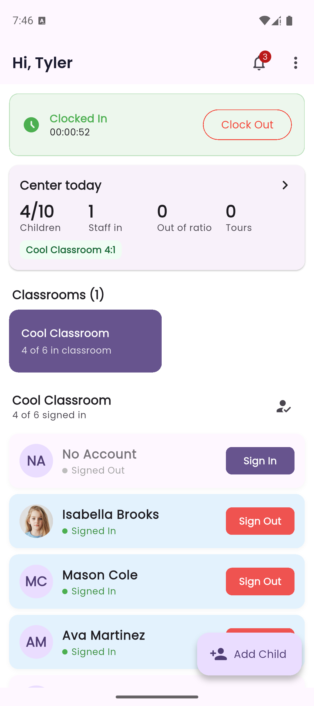
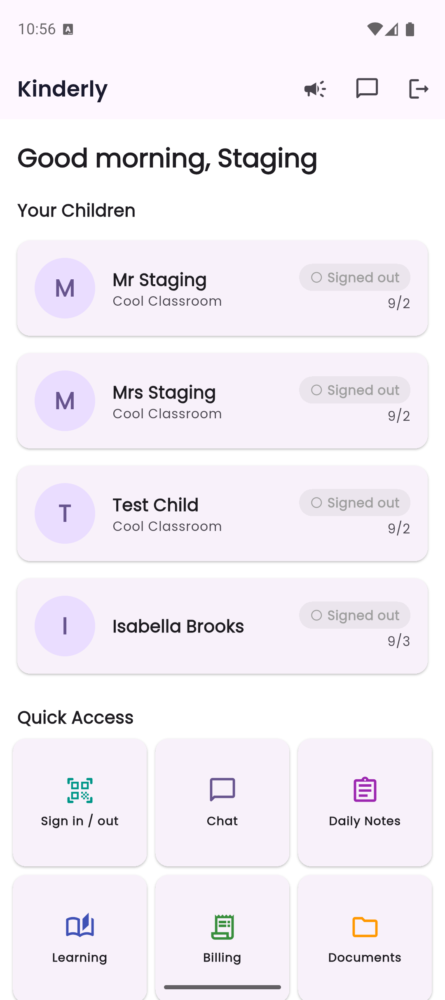

This guide takes you from a new account to a center running on Kinderly: your center set up, families in the **Parents** app, and staff in the **Teachers** app. Most centers get through it in an afternoon, and none of it has to be done in one sitting.

| Step | Where | What you end up with |
|---|---|---|
| 1. [Sign up](#1-sign-up) | go.mykinderly.com | Your account and plan |
| 2. [Run the setup wizard](#2-run-the-setup-wizard) | Opens after signup | Center details, a website, an enrollment packet |
| 3. [Set up rooms and programs](#3-set-up-classrooms-and-programs) | Manage → Classrooms, Programs | The shape of your center |
| 4. [Add your families](#4-add-your-families) | Manage → Settings → Import Data | Children and guardians |
| 5. [Add your staff](#5-add-your-staff) | Manage → Staff | Staff records, and each one invited to the Teachers app |
| 6. [Get families the Parents app](#6-get-families-the-parents-app) | A guardian's **App Access** tab, or the import | Families signed in on their phones |
| 7. [Turn on payments](#7-turn-on-payments) | Manage → Billing | Families paying tuition in the app |
| 8. [Try it as a parent](#8-try-it-as-a-parent) | Your own phone | Confidence that it all works |

## 1. Sign up

Sign up at **go.mykinderly.com/signup** with your name, your center's name, your email and a password, then enter the 6-digit code we email you.

Next, Kinderly asks how many children you care for and what you want to do with it, such as going paperless with enrollment, billing families or running the Food Program. Your answers are used to suggest the cheapest plan that covers all of it. Each plan says which of your picks it leaves out, so you can choose with your eyes open. You can skip the question and pick a plan yourself. [What you get](/getting-started/what-you-get/) compares the plans in full.

- **Sprout** is free and needs no card.
- **Bloom** and above ask for a card, and include a free onboarding call with our team. Book it on the last step of signup, or later from inside the app. Centers that take the call are usually up and running within days.

Signup also lets you invite co-workers who'll use Kinderly on the web, such as a co-director or office manager. You can skip this and do it later under **Settings → Teams**. Teachers who only need the phone app are added in [step 5](#5-add-your-staff) instead.

## 2. Run the setup wizard

When signup finishes, Kinderly opens the [setup wizard](/manage/settings/#setup-wizard). It's in three parts:

1. **Get live**: your center's information, a website, your documents, and an enrollment packet, so you have one link you could send a family today.
2. **Run the center**: schedule, meals, auto sign-out, billing, integrations and importing your roster.
3. **Grow**: your inquiry pipeline and funding profile.

Every step is optional. Anything you skip stays on the **Setup checklist** on your dashboard, and **Launch Setup Wizard** under **Manage → Settings** brings the wizard back.

:::tip[Fill in the tax fields while you're there]
**Center Information** has your **Tax ID (EIN/TIN)** and **Provider Number (DVN)**. They're printed on the tax statements families download from the Parents app, and every family needs them at the same time each January.
:::

## 3. Set up classrooms and programs

Create your [classrooms](/manage/classrooms/) with their ages and ratios, and your [programs](/manage/programs/), such as full-time, part-time or before- and after-school care. Do this **before** you add children. Children are assigned to classrooms and programs, so if those already exist, the import can put everyone in the right place on the way in.

## 4. Add your families

Pick whichever fits where your records are now:

- **From a spreadsheet or another system**: **Manage → Settings → [Import Data](/manage/settings/#data-tools)** takes an Excel or CSV file of children, guardians and staff. It reads exports from Brightwheel, Procare and Playground as they are.
- **From paper forms**: **Add Child ▾ → Scan Document** reads an enrollment form and creates the child and every parent and contact on it. See [Scan a document](/manage/scan-documents/). Bloom and above.
- **By hand**: **Manage → Children → Add Child**, then link their [guardians](/manage/guardians/).

:::caution[Check the guardian email addresses]
A guardian's email is their Parents app login, where their shared forms go, and where notifications are sent. A typo doesn't cause an error; that parent just never hears from you. Use **Guardians & Contacts → Filters → Missing information → No email** to find who's missing one.
:::

## 5. Add your staff

Add each staff member under **Manage → Staff → Add Staff ▾**, either by typing their details or with **Scan Document** on their new-hire paperwork. Assign them to a classroom so they count toward its ratio.

**As soon as you save a staff member, they're emailed an invitation to the Teachers app.** You don't need to do anything else. The email:

1. has a **Create my password** link, which works for 7 days;
2. has download buttons for **Kinderly for Teachers** on the App Store and Google Play;
3. tells them to sign in with their email and the password they just made.

:::caution[Staff from a spreadsheet import aren't invited]
Staff you bring in with **Import Data** get a record but no invitation. Open each one, go to the **App Access** tab and choose **Grant App Access**. **Manage → Staff → Filters → Staff app → No account** lists who still needs it.
:::

Staff get the Teachers app only. To let someone such as an office manager use Kinderly on the web as well, turn on **Give Dashboard Access** when you add them, or later from their page. That makes them an **Administrator**, so give it only to people who need it. See [Staff → Dashboard access](/manage/staff/#dashboard-access).

### What staff see

On the [Teachers app](/mobile/teacher-app/), staff:

- **clock in and out**, and see their hours for the week;
- see their **classroom roster**, with who is signed in, each child's allergies, and anything families said about today (out, running late, or someone else picking up);
- **sign children in and out**, and move them between rooms;
- write the **daily log** (meals, diapers, naps, photos, notes) that families see on their feed;
- get **out-of-ratio alerts** when a room is short-staffed;
- **message families**, and see their schedule and request time off.

Administrators also see the whole center from their phone: today's headcount and ratios, time-off requests to answer, packets waiting for approval, and new inquiries.

:::tip[A shared device at the front door]
If you'd rather staff and families sign in on one tablet by the door, put the Teachers app on it and use **Kiosk Mode**, protected by the **Kiosk Mode PIN** under **Manage → Settings → App Settings**. To stop staff clocking in from their own phones, turn off **Staff clock in / out from the app** in the same place.
:::

## 6. Get families the Parents app

Unlike staff, **families aren't invited automatically**. You choose when, so nobody gets an email before their records are ready. There are three ways to send the invitations:

- **Right after an import**: the last screen of **Import Data** has **Invite families to the Parents app**. **Send invitations** emails every guardian you just imported. Anyone without an email address, or who already has the app, is skipped, and the screen tells you how many of each.
- **When you add a guardian**: turn on **App Access** in the Add Guardian form. It switches on once the email address looks complete.
- **For one guardian later**: open their page, go to the **App Access** tab and choose **Grant App Access**.

The invitation is the same as the staff one, for **Kinderly for Parents**: create a password (the link works for 7 days), install the app, and sign in with their email.

### Following up

- **Guardians & Contacts → Filters → Parent app → No account** lists the guardians you haven't invited yet.
- On a guardian's **App Access** tab, **Password** shows **Not created yet** until they've followed the email. **Resend Setup Email** sends them a fresh link. Once they've created a password, the button changes to **Email App Link**, which sends just the download links.
- Under **Manage → Settings → App Settings → Parent App**, **Email link** sends the download links to any address, which is handy for a parent who's switched phones.
- If a link has expired, the parent can ask for a new one from the page the link opened. They don't need to contact you.

:::tip[Put the app in your enrollment packet]
Families who join later need the app too. Grant **App Access** when you add them, and mention the app in your welcome email or handbook, so it's part of enrolling rather than a separate job.
:::

### What families see

On the [Parents app](/mobile/parent-app/), families:

- see each of their children, and whether they're **signed in or out** right now;
- scroll the **daily feed** of meals, naps, diapers, photos and notes, and save **photos**;
- tell you a child will be **out**, **running late**, or that **someone else is picking up**;
- read your **posts**: announcements, closings and events;
- fill out and sign **paperwork** you send, without needing a PIN, and update yearly documents;
- see **invoices** and pay them, save a card or bank account, turn on **auto-pay** and download **tax statements**;
- sign **incident reports** and see the **medication** their child was given;
- **message** the center.

You control some of this under **Manage → Settings → [App Settings](/manage/settings/#app-settings)**. Two settings start **off**, and are worth deciding on before families arrive:

- **Parents can message teachers**: whether a parent can start a conversation, rather than only reply to yours.
- **Sign-in and sign-out notifications**: whether families are told when their child is signed in or out, and by whom.

Turn on **Parent QR sign-in** in the same place to print a poster, or show it on your [lobby display](/manage/lobby-display/). Families tap **Sign in / out** in the app and scan it at drop-off.

## 7. Turn on payments

You can bill families straight away and record what they pay by cash or check. For families to **pay in the app**, finish **Start Billing** on the [Billing](/manage/billing/#turning-on-payments) page and choose the weekday your payouts arrive. Then set up [billing accounts and programs](/manage/billing/#billing-accounts), so invoices go out on their own.

## 8. Try it as a parent

Before the first real family, see it from their side:

1. Add yourself as a guardian of a test child, using a personal email address that **isn't** your Kinderly login.
2. Grant yourself **App Access**, follow the email, and sign in to the Parents app on your phone.
3. [Send yourself](/shares/sending/) your enrollment packet, post an announcement, and log a daily note in the Teachers app.

In about ten minutes you'll have seen exactly what a family sees, and caught anything confusing before a parent does. Archive the test child when you're done.

## Getting help

- **Help**, in the top-right corner of every page, opens the guide for the page you're on.
- **Ellie**, the assistant in the corner, answers questions about Kinderly and your own records.
- On Bloom and above, your **onboarding call** is the quickest way through all of this. If you skipped it during signup, you can book it from inside the app.
- Email [support@mykinderly.com](mailto:support@mykinderly.com) at any time.

## Next

- [What you get](/getting-started/what-you-get/): plans and limits.
- [Teacher app](/mobile/teacher-app/) and [Parent app](/mobile/parent-app/): everything each app does.
- [Notifications](/getting-started/notifications/): what Kinderly will tell you about.
