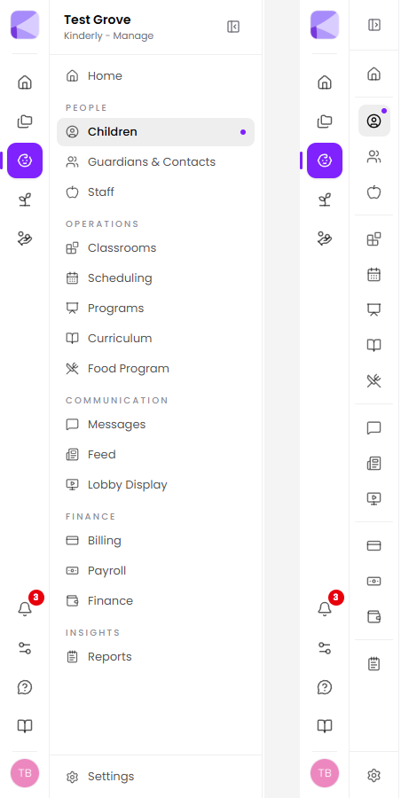
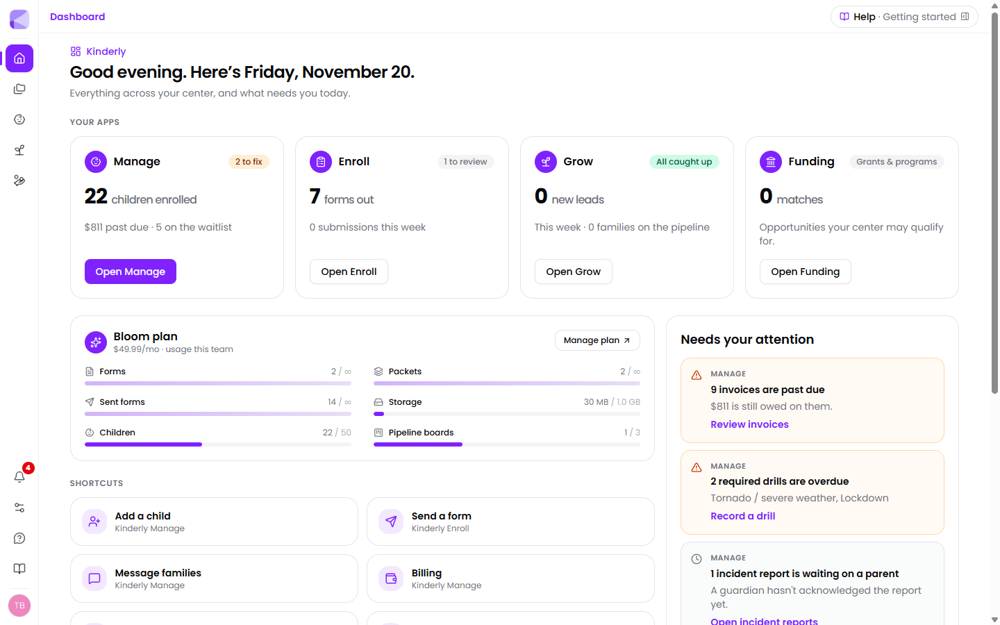
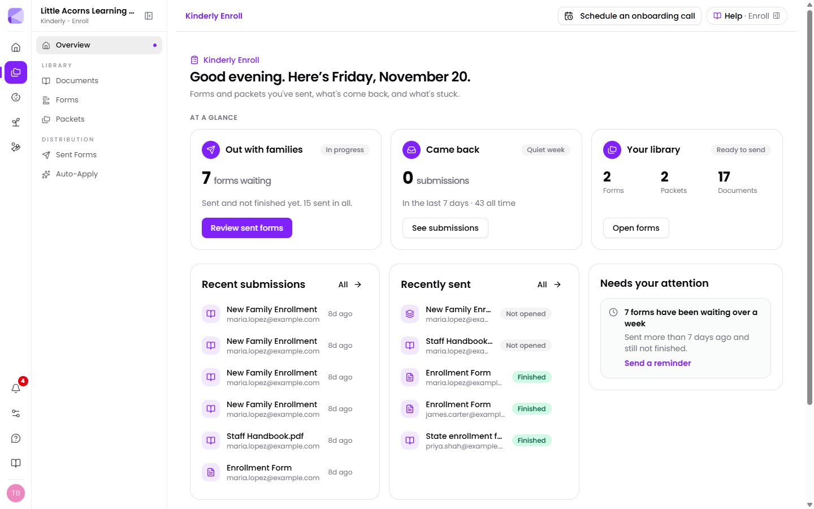

Kinderly is childcare management built around the paperwork and admin that eats your week — enrolling families, chasing signatures, keeping records straight, filling places, and finding funding.

It's four products under one login. You don't have to use all of them.

## The four parts

| | What it's for |
|---|---|
| **[Enroll](/forms/overview/)** | Build forms and documents, bundle them into packets, and send them to families as secure links. This is where the paperwork lives. |
| **[Manage](/manage/overview/)** | The day-to-day running of your center — children, guardians, classrooms, staff, programs, scheduling, attendance, messages and family billing. |
| **[Grow](/grow/overview/)** | Filling your places: a website for your center, virtual tours, and an inquiry pipeline to track prospective families. |
| **[Funding](/funding/overview/)** | Finding and tracking grants and funding opportunities, with deadlines and application records in one place. Paid plans only. |

Switch between them from the icon rail down the left-hand side. Each part has its own menu beside the rail. To give the page more room, click the button at the top of that menu to shrink it to icons; hover over an icon to see its name. Kinderly remembers your choice in every part.

Enroll, Manage and Grow are on every plan including the free one. See [What you get](/getting-started/what-you-get/).

## The dashboard

Signing in lands you on the dashboard. It has a card for each app (Manage, Enroll, Grow and Funding) with its headline number and a button into it. Beside them is **Needs your attention**, which collects everything across your center that needs someone to act: past-due invoices, overdue drills, expiring certifications, forms stuck with families, follow-ups past their date. Each row says which app it came from and links straight to the fix. When nothing needs you, it says you're all caught up.

Below that are shortcuts to the screens people open most, your plan's usage bars and any [pinned reports](/manage/reports/). The usage bars are the quickest way to see where you stand: children against your plan's cap, document storage, forms, packets, shares and pipeline boards.

Each app also has its own home page laid out the same way, with cards at the top, the day's detail in the middle, its own **Needs your attention** list and shortcuts:

- **Manage**: children here today, staff clocked in, past-due billing and the waitlist, with every room checked against its ratio for who's signed in right now.
- **Enroll**: forms out with families, what came back this week and your library, with recent submissions and sends.
- **Grow**: your website's status, new leads and visitors this week, and tours and follow-ups coming up.
- **Funding**: what you qualify for, your open applications and your profile, with grants closing soon.

## Where to start

If you're new, the fastest way to feel the value is to send one thing to one family:

1. **[Build a form](/forms/building-a-form/)** from a template — a few minutes.
2. **[Send it](/shares/sending/)** to yourself first, so you see exactly what a family sees.
3. **[Review what comes back](/shares/admin/)**.

Once that clicks, everything else is a variation on it.

:::tip[Send the first one to yourself]
Before a real family gets anything, send a share to your own email. You'll see the email, the PIN screen, the form on your phone, and the submission landing on your side — the whole loop in about five minutes. It's the single best way to understand the product, and it catches anything confusing before a parent hits it.
:::

## Ellie

Ellie is Kinderly's built-in assistant. It shows up throughout the app — drafting a form from a description, searching your shares in plain English, and answering questions about your data. Ellie is included on every plan.

## Help while you work

The **Help** button in the top-right corner of the screen opens the guide for the page
you're on, in a panel beside it, so you can read and follow along without losing
your place. Links inside a guide, such as **How payroll works** next to a page's
title, open in the same panel.

The panel follows you: move to another page and it switches to that page's
guide. Use **Search the help docs** at the top of the panel to look up anything
else. On a smaller screen the panel covers the page instead of sitting beside it.

## Next

- [What you get](/getting-started/what-you-get/) — plans and limits.
- [Account setup](/getting-started/account-setup/) — getting configured.
