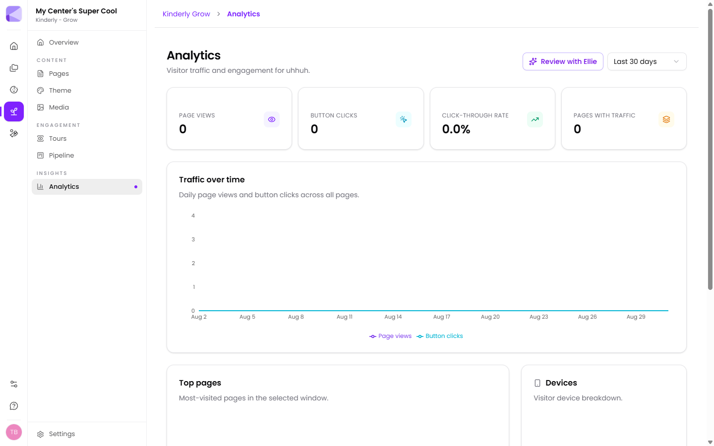
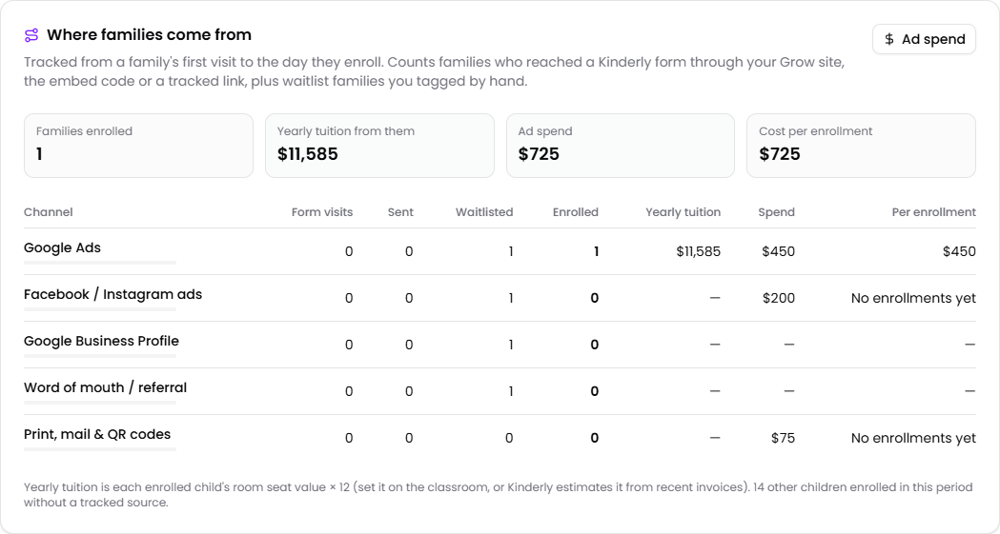
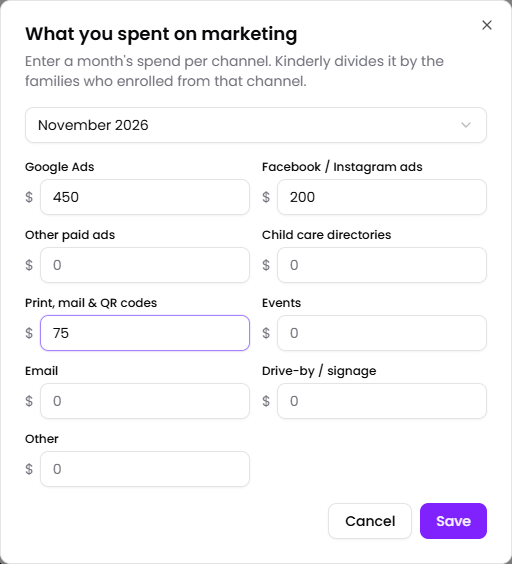

**Grow → Analytics** shows traffic and engagement for your site over the last 30 days.

## The headline numbers

- **Page views**
- **Button clicks**
- **Click-through rate**
- **Pages with traffic**

## The breakdowns

- **Traffic over time** — daily page views and button clicks
- **Top pages** — most visited in the window
- **Devices** — what visitors are browsing on
- **Top button clicks** — where people are actually clicking
- **Top referrers** — external sources sending traffic

**Review with Ellie** asks the assistant to interpret the numbers rather than leaving you to read charts.

## Where families come from

Page views tell you people visited. **Where families come from** tells you which marketing produced enrolled children, and what each one cost.

For each channel (Google Ads, Facebook / Instagram ads, Google search, Google Business Profile, child care directories, email, print and QR codes, events, word of mouth and more) it counts:

- **Form visits**: families who opened one of your Kinderly forms
- **Sent**: those who submitted it
- **Waitlisted**: families added to your [waitlist](/manage/waitlist/) from that channel
- **Enrolled**: children enrolled from it
- **Yearly tuition**: what those enrollments bring in a year, from each room's seat value (see [Waitlist → What an open seat costs](/manage/waitlist/#what-an-open-seat-costs))
- **Spend** and **Per enrollment**: once you enter what you spent

Kinderly tracks a family from their first visit. It reads the link they arrived on (its UTM tags or ad click) or the site that sent them, and keeps that source with them through the form, the waitlist and enrollment. Families are tracked when they reach a form through:

- your **Grow site** (any button or Kinderly form section that opens a form)
- the **embed code** on your own website, or a **tracked link** (both on the form's page under Sent Forms, see [Putting a form on your website](/shares/sending/#putting-a-form-on-your-website))
- a waitlist family you tagged with **How did they hear about you?** when adding them by hand

Families who reached you some other way, such as an emailed link or a walk-in nobody tagged, aren't counted. The card tells you how many enrolled children had no tracked source.

**Campaigns** lists the campaign names on your tracked links and ads (the `utm_campaign` tag) with their visits, waitlist families and enrollments, so you can compare one ad or flyer against another.

### Entering ad spend

Choose **Ad spend**, pick a month, and type what you spent on each channel. Kinderly divides it by the children enrolled from that channel. Enter 0 to clear a month.

:::tip[Cost per enrollment beats cost per click]
An ad that costs $4 a click and enrolls nobody is worse than one that costs $12 a click and fills an infant seat worth $15,000 a year. This is the number to move budget on.
:::

## Google Business Profile

With [Google Business Profile](/integrations/google-business/) connected, a card shows how often your listing was seen on Google Search and Maps, and how many people called, clicked through to your website or asked for directions. Without it, the card links you to connect it.

## What to actually look at

**Click-through rate** is the one that matters. Page views tell you people arrived; CTR tells you the page persuaded them to do something. A page with high views and low CTR is being found and then failing.

**Top button clicks** tells you which call-to-action works. If "Book a tour" is clicked ten times more than "Inquire now", make the inquiry button say "Book a tour" too.

**Devices** is usually decisive. Most families browse childcare on a phone. If your traffic is overwhelmingly mobile, that's the layout that matters — check your pages there.

**Top referrers** shows where families come from. "Mostly direct" means word of mouth and people typing your name in — which is a compliment, but also means your site isn't being *found* by people who don't already know you.

:::tip[Compare the tour page's views against inquiry clicks]
That ratio is the single most useful number in Grow. Lots of tour views and few inquiries means the tour isn't ending in a clear next step — usually a weak or missing call-to-action.
:::

:::caution[Small numbers aren't trends]
A center's site might get a few dozen visits a week. At that volume one afternoon of a parent browsing repeatedly can look like a spike. Look at the shape over a month, not day to day.
:::

## Daily digest email

To get yesterday's numbers without opening Kinderly, turn on the **Daily digest email** under [Grow → Settings](/grow/settings/#daily-digest-email). Each morning everyone on your team gets an email with the site's visits, top pages, button clicks and where visitors came from, plus any open seats and what they're worth a month. It's off until you turn it on, and you can switch it off the same way.

## Plan availability

The analytics dashboard and the daily digest aren't included on the free tier. See [What you get](/getting-started/what-you-get/).

## Next

- [Page sections](/grow/page-sections/) — improving what analytics shows you.
- [Pipeline](/grow/pipeline/) — where inquiries go.
