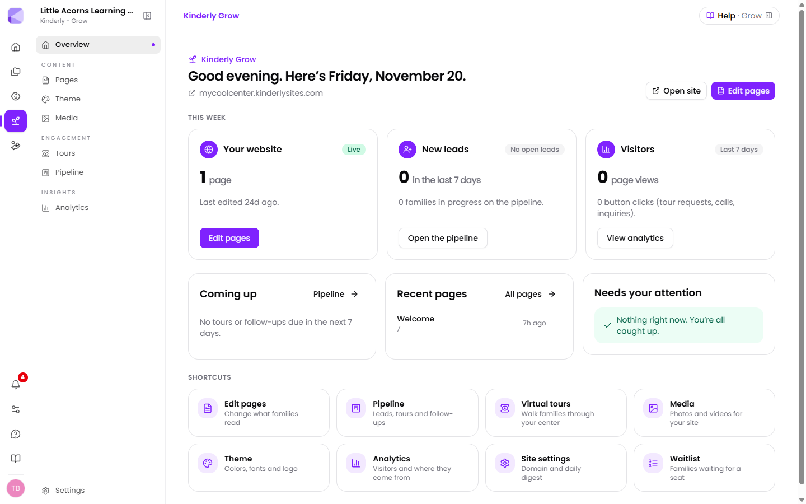

Where [Enroll](/forms/overview/) handles the paperwork and [Manage](/manage/overview/) runs the day, **Grow** is about filling your places: being found, making a good impression, and tracking prospective families until they enrol.

## The Grow home page

**Overview** opens on your website's address, with **Open site** and **Edit pages** beside it.

- **This week**: three cards. **Your website** (live or not, how many pages, when it was last edited), **New leads** (inquiries in the last 7 days and families in progress on the pipeline) and **Visitors** (page views and button clicks over the last 7 days).
- **Coming up**: tours and follow-ups due in the next 7 days.
- **Recent pages**: the pages you edited last.
- **Needs your attention**: a site that isn't live yet, changes you haven't published, a custom domain that isn't connecting or is still being set up, and families past their follow-up date.
- **Shortcuts** to pages, the pipeline, tours, media, theme, analytics, site settings and the [waitlist](/manage/waitlist/).

## What's in it

**Content**

- **[Sites and pages](/grow/sites/)** — a real public website for your center, on its own address.
- **[Page sections](/grow/page-sections/)** — the building blocks you assemble pages from.
- **[Theme](/grow/theme/)** — colors, fonts and button styling across the whole site.
- **Media** — the image library your pages draw on.

**Engagement**

- **[Virtual tours](/grow/tours/)** — walk families through your space in photos.
- **[Pipeline](/grow/pipeline/)** — track inquiries from first contact to enrolled.

**Insights**

- **[Analytics](/grow/analytics/)** — who's visiting, what they read, what they click.

## How it fits together

The parts are designed to chain:

1. A family finds your **site**.
2. They take a **virtual tour** without having to book anything.
3. They fill in an inquiry **[form](/forms/overview/)** embedded straight into a page.
4. That creates a card on your **pipeline**.
5. You move them along until they enrol, then hand over to [Enroll](/packets/overview/) for the paperwork.
6. **Analytics** tells you which pages actually produced inquiries.

:::tip[The embedded form is the join]
A site that only lists a phone number leaks inquiries — people browse at 10pm and don't ring. Embedding a Kinderly form directly in the page means the inquiry arrives while they're interested, and lands in your pipeline automatically.
:::

## What you need to know first

**Sites have drafts.** Edits save to a draft. Nothing families see changes until you publish. See [Sites and pages](/grow/sites/).

**Your address.** Every site gets a free `kinderlysites.com` address, and on Bloom and above you can connect your own domain. See [Grow settings](/grow/settings/).

**Plan limits apply.** Website pages, virtual tours and pipeline boards are all capped by tier, and the free tier has no virtual tours or analytics. See [What you get](/getting-started/what-you-get/).

## Next

- [Sites and pages](/grow/sites/) — building your website.
- [Pipeline](/grow/pipeline/) — tracking inquiries.
