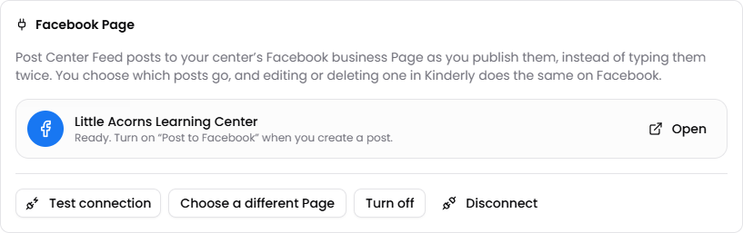

Most centers have a business Page on Facebook, and it's often where families look first. Connect it and you can send a [Center Feed](/manage/feed/) post to your Page while you publish it, instead of typing it twice.

Nothing goes to Facebook on its own. You choose each post.

## Connecting your Page

1. Go to **Manage → Settings → Integrations** and find **Facebook Page**.
2. Click **Connect Facebook** and sign in with a Facebook account that manages your center's Page.
3. When Facebook asks which Pages Kinderly can use, tick your center's Page and allow posting.
4. Back in Kinderly, choose the Page and click **Save and turn on**.

The account you connect needs permission to create posts on the Page. If the Page is greyed out in the list, ask one of the Page's admins to give you that access on Facebook.

## Posting

- **New posts:** turn on **Post to Facebook** in the composer. The post goes to your Page as soon as you publish. If it has photos, **Include photos** lets you choose whether they go too.
- **Older posts:** use **Share → Post to** *your Page* on the post.

A post on your Page shows **On Facebook** in the feed, with a link to it.

- **Editing** the text in Kinderly updates it on Facebook. Photos on Facebook can't be changed after posting.
- **Deleting** a post in Kinderly deletes it from your Page too.
- **Videos** aren't sent. They stay in Kinderly; only photos go to Facebook.
- **Recurring events** can't be posted to Facebook. One post per date would flood your Page.

:::caution[Your Page is public]
Anyone can see your business Page. Only include photos of children when their families have agreed.
:::

## Facebook groups

Facebook doesn't let apps post into groups. That applies to every app, not just Kinderly. For a parents' group, use **Share → Share to a Facebook group** on a post. Kinderly copies the post and opens your group so you can paste it in. See [Sharing to a Facebook group](/manage/feed/#sharing-to-a-facebook-group).

## If posting stops working

Facebook can end Kinderly's access if the person who connected changes their Facebook password, loses their role on the Page, or removes Kinderly in their Facebook settings. A post then shows an error saying to reconnect. Go to **Settings → Integrations → Facebook Page**, click **Disconnect**, then connect again.

## Next

- [Feed](/manage/feed/): writing and managing posts.
- [Google Business Profile](/integrations/google-business/): post updates to Google too.
