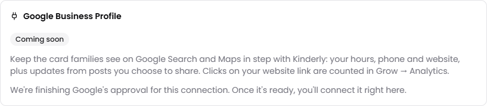

:::note[Coming soon]
This connection is waiting on Google's approval. Until then, its card under **Manage → Settings → Integrations** and on **Grow → Analytics** says **Coming soon**. Everything below describes how it will work.
:::

Most families look you up on Google before anything else, and the card they see there (hours, phone, website, recent updates) is your **Google Business Profile**. Connect it to Kinderly and you keep one copy of those details instead of two.

## What stays in step

| From Kinderly | On your Business Profile |
|---|---|
| Open and close times and operating days, from **Manage → Settings** | **Hours** |
| Your center's contact phone | **Phone** |
| Your published [Grow site](/grow/sites/) | **Website** |
| Posts you mark **Share to Google** in the [Center Feed](/manage/feed/#sharing-to-google) | **Updates** (events show as event updates with their date and time) |
| A description you write on the settings card (optional) | **Description** |

Each one can be switched off. Kinderly only sends what changed since the last sync.

The website link is tagged so families who click it from Google are counted as **Google Business Profile** in [Grow → Analytics → Where families come from](/grow/analytics/#where-families-come-from).

:::note[What Kinderly leaves alone]
- **Your address.** Changing an address can send a listing back through Google's verification and take it offline for days, so edit it on Google yourself.
- **Reviews.** Kinderly doesn't read or reply to them.
- **Photos on updates**, unless you turn on **Include post photos**. A Business Profile is public, and center posts often show children. Only turn it on if your photo consent covers it.
:::

## Setting it up

Go to **Manage → Settings → Integrations → Google Business Profile**.

1. **Connect Google.** Sign in with the Google account that manages your listing and allow Kinderly to manage it.
2. **Choose your listing.** If that account manages several, pick the one for this center.
3. **Choose what to sync**, and add a description if you want Kinderly to keep it.
4. **Save and turn on.**

Kinderly syncs every night. **Sync now** sends changes straight away, and **When to sync → Only when I click Sync now** stops the nightly run. **Turn off** pauses syncing and keeps your settings. **Disconnect** forgets the sign-in. Updates already on Google stay there.

Only posts written after you first choose a listing can be shared, so turning this on never pushes your whole post history to Google.

## Seeing how families find you

Once connected, [Grow → Analytics](/grow/analytics/#google-business-profile) shows how often your listing was seen on Google Search and on Maps, and how many people called, clicked through to your website or asked for directions. Google's numbers run about three days behind.

## If something goes wrong

- **"This Kinderly environment hasn't been granted Google Business Profile API access yet."** Google has to approve every app that manages Business Profiles. Until Kinderly's approval is in place, connecting works but syncing doesn't. Nothing is wrong on your side.
- **"This Google account doesn't manage any Business Profiles."** You signed in with a different Google account than the one that owns the listing. Disconnect, then connect again with the right one.
- **"Google refused the saved sign-in."** Someone removed Kinderly's access in the Google account. Disconnect and connect again.

Failed syncs also show in **Integration health** on the same page and raise an **Integrations** notification.

## Next

- [Center Feed](/manage/feed/) — writing the posts you share.
- [Analytics](/grow/analytics/) — where families come from.
