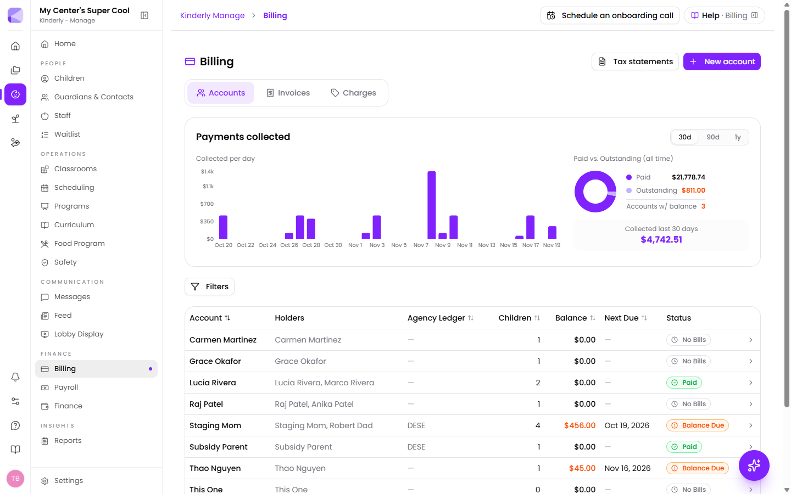
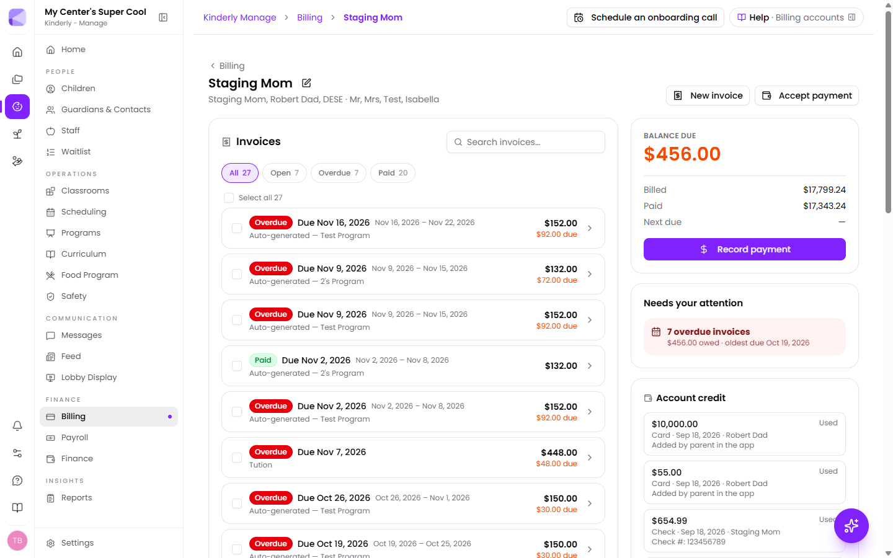
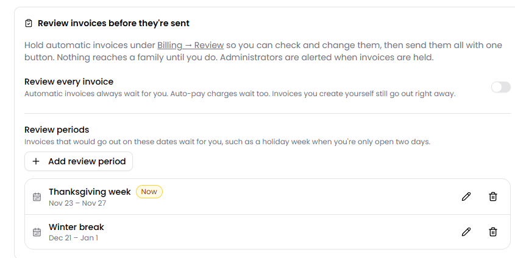
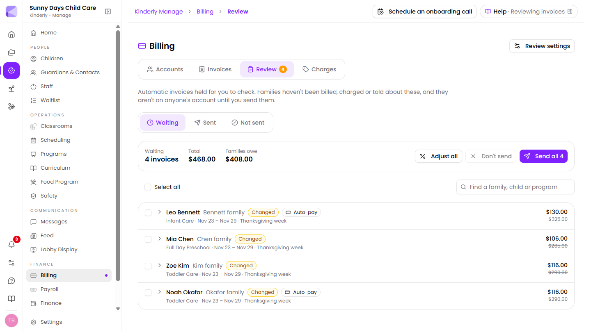
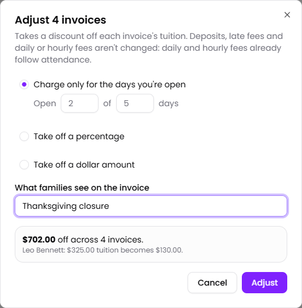
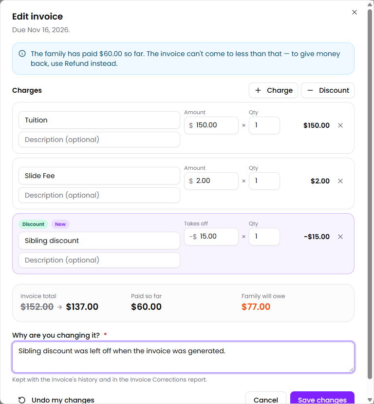
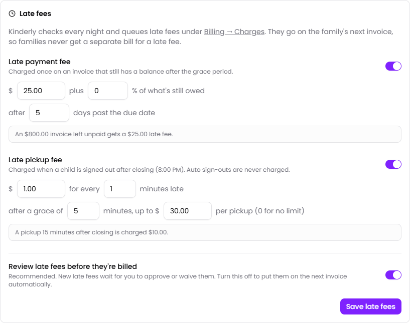
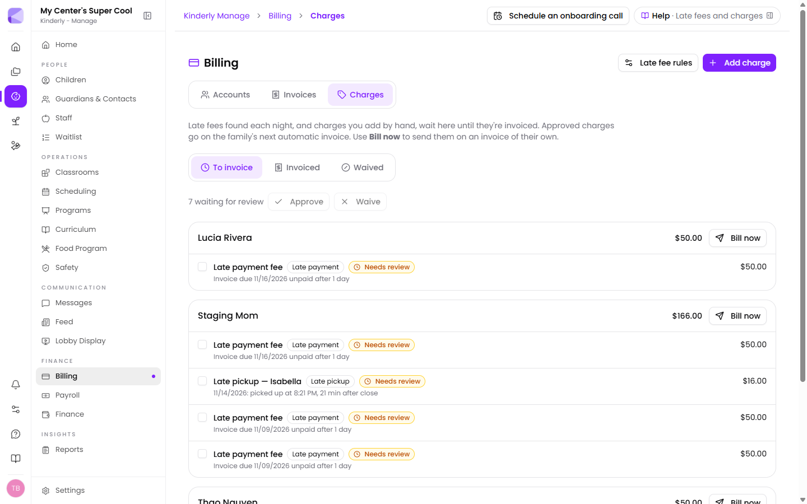

Billing handles money coming **in** from families. (Your own operating spend is [Finance](/manage/finance/).)

## Turning on payments

Until you complete setup, a banner offers **Start Billing**. Completing it lets you charge guardians via saved credit cards or bank accounts.

You can run billing without it — issuing invoices and recording what families pay by cash or transfer — but families can't pay in-app.

### Payout day

The money families pay online is sent to your bank once a week. You pick the weekday, Monday to Friday, during setup (in the onboarding wizard's billing step or under **Settings → Billing**). If you don't pick one, it's Friday. You can change it any time under **Settings → Billing**.

A payout includes the payments that have cleared by that day. A card payment usually clears in about two business days, and a bank payment takes a few business days longer, so a payment made the day before your payout day goes out the following week.

## Fees and discounts

Each online payment carries the payment processor's fee — 2.9% + 30¢ for a card, 0.8% (at most $5) for a bank payment — and Kinderly's platform fee of 0.3% + $0.25. Both come out of your payout.

If you want families to share the cost, set either or both under **Settings → Billing → Fees**:

- **Service fee on card and bank payments** — a flat amount, a percentage, or both. You can't know in advance how a family will pay, so the fee is added at the moment they pay by card or bank and appears on the invoice as its own line. Payments by cash, check or account credit never carry it, and neither does an agency.
- **Discount for paying by bank** — a percentage off payments made from a bank account. Bank payments cost you far less than cards, so this pays for itself.

Both apply wherever a card or bank payment happens: in the parent app, when you charge a saved card or bank account, on autopay, when you record a card or bank payment you took outside Kinderly, and on a form's [Payment field](/forms/field-types/#where-payment-field-money-goes). When you record one, enter the amount going toward the balance; the payment screen shows the service fee and the total to collect from the family. In the parent app, families choose how to pay first (a saved card or bank account, or a new one) and see the fee, any bank discount, and the total before they pay. They can also change which saved method is their default, which is the one autopay charges.

If you cancel a payment, its service fee and discount come off the invoice with it.

To see every fee for a period (processor, platform, service fees and discounts), run the **Payment Fees** report under **Reports → Finance**.

Card networks and some states limit fees for paying by card, and some require fees to be disclosed before payment. Check the rules that apply to you before turning the service fee on.

Bank payments take a few business days to clear. Until then the payment shows as pending and the invoice stays open. Once the money arrives the invoice is marked paid and the service fee and any bank discount appear on it.

## Billing accounts

A **billing account** is who gets the invoice. It can have several **holders** (both parents, say) and cover several children, so a family gets one invoice rather than one per child.

**New account** creates one. Children are attached from their own [record](/manage/children/#billing).

Billing has four tabs along the top: **Accounts**, **Invoices** (every invoice across all accounts), **Review** (automatic invoices [held for you to check](#reviewing-invoices-before-they-go-out), with a count of how many are waiting) and **Charges** (late fees and one-off charges waiting to be invoiced).

Opening an account shows its invoices on the left. On the right are the **balance due**, what's been billed and paid, the next due date, and a **Needs your attention** box listing overdue invoices, payments still processing and account credit that could pay an open invoice. Below that are the account's credit, the people who pay (**Who pays**), its children, and **Close account**.

:::tip[One account per family, not per child]
Siblings on one account means one invoice, one balance and one payment. Separate accounts per child means a family reconciling three payments a month and you chasing three balances.
:::

### Auto-pay

With auto-pay on, a family's invoices are charged to their default card or bank
account as soon as each one is issued. Families usually turn it on themselves in
the [parent app](/mobile/parent-app/#auto-pay). You can also turn it on for a
holder from the account page, under their payment methods, once they have a
saved card or bank account. Only do this when the family has authorized
automatic charges, for example on a signed enrollment form.

The account page shows who last turned auto-pay on or off and when. If the
payment method auto-pay charges is removed, auto-pay turns off. It never moves
to a different card on its own, so the family or you turn it back on.

## The dashboard

- **Payments Collected** — a per-day chart over 30 days, 90 days or a year
- **Paid vs. Outstanding** — all-time totals, and how many accounts carry a balance
- **Collected last 30 days**

## The accounts table

Each row shows the account, its holders, agency ledger, number of children, balance, next due date and status (e.g. **Balance Due**). Sort by any column; **Filters** narrows the list.

:::tip[Sort by balance to find the real problem]
Sorting by balance, largest first, shows you where the money actually is. Working chronologically through overdue accounts means spending equal effort on a $12 balance and a $1,200 one.
:::

### Agency ledger

Where a third party — a state subsidy or agency — pays part of a child's fees, that portion is tracked separately from what the family owes.

:::caution[Split the family and agency portions properly]
If an agency covers part of a place and you bill the whole amount to the family, you'll chase parents for money they don't owe. The agency ledger exists so the family's balance is genuinely what the family owes.
:::

You add, rename and remove agency ledgers under **Settings → Billing → Agency Ledgers**. If you don't have any yet, you can also create your first one while adding an **Agency / Ledger** holder to a billing account. Before you remove one, Kinderly tells you how many open billing accounts use it. Removing a ledger doesn't change those accounts: they keep billing the agency's share. It only stops the ledger being added to more accounts. To stop billing an agency for a family, remove it from that family's billing account.

## Invoices

The **Invoices** tab lists every invoice raised. Charges come from the [program](/manage/programs/) a child is enrolled in, with any **Program Fee Overrides** on the child's record applied automatically.

### Reviewing invoices before they go out

Automatic invoices normally go out on the program's billing day. You can have them wait for you instead, so you can check and change them before any family sees one. A common reason is a holiday week: you're open two days for Thanksgiving, and your policy is not to charge for the days you're closed.

Set it up under **Settings → Billing → Review invoices before they're sent**:

- **Review periods** hold invoices for a range of dates. Click **Add review period**, name it (the name shows on the invoices) and choose the first and last day. A period holds the invoices that would **go out** on those dates, whatever days they cover, and the dialog lists each program and the billing dates it catches. If a program's invoice for those days goes out earlier, such as a monthly program that bills on the 1st, it says so and tells you when the period would need to start.
- **Review every invoice** holds all automatic invoices, all the time.

Invoices you create yourself, and **Bill now** on the Charges tab, still go out right away.

While an invoice waits under **Billing → Review**, it isn't on the family's account. It isn't in their balance, the parent app, your reports or your accounting software, nobody has been emailed, and no saved card has been charged. Late fees and other charges that were due to go on it wait with it.

**You're alerted** when invoices are held: in the bell, by email, and by a push to administrators in the Staff app. Billing shows a banner until the queue is empty. If a review period ends with invoices still waiting, you get one reminder.

On the **Review** tab you can:

- **Expand an invoice** to see its lines, what an agency covers, and what the family will owe. Change its due date there.
- **Edit** one invoice: change, remove or add lines, just like [editing an invoice](#editing-an-invoice). Removing a late fee sends it back to **Charges**, where you can waive it.
- **Adjust** all of them, or the ones you've selected, at once. Choose **Charge only for the days you're open** (2 of 5 days, for example), a percentage or a dollar amount. It's taken off each invoice's own tuition as one discount line, named however you like. Deposits and late fees aren't changed, and neither are daily and hourly fees, which already follow attendance. Adjusting again replaces the last adjustment, and **Remove adjustment** takes it off.
- **Send all** with one button, or select some and send those. You'll see the total first, and how many families on auto-pay will be charged right away. A large batch keeps sending after you leave the page. Agency shares, account credit and auto-pay are worked out on the amount you send.
- **Don't send** invoices that shouldn't go out at all. The family isn't billed for that period, and the late fees and charges on it go back to **Charges** for their next invoice. Find it under **Not sent** if you want it back.

An invoice whose due date passed while it waited is due the day you send it, so it's never overdue when the family first sees it. If one can't be sent (its billing account was closed, for example), it stays under **Waiting** with the reason.

Directors can review, adjust and send from **Review invoices** in the Staff app too. Editing single lines is on the web.

### Invoice templates

If you raise the same charges by hand again and again, save them as a template
instead of retyping them. Templates hold line items: a name, description, amount
and quantity for each.

To make one, go to **Settings → Billing → Invoice Templates** and click **New
Template**. You can also click **Save as template** in **Create Invoice**, which
starts a template from the lines on that invoice.

To use one, open **Create Invoice** on an account and pick it from **Add from a
template**. Its items are added to whatever is already on the invoice, so you can
combine templates, and you can change or remove any line before you create the
invoice. Due date, period and note are still set per invoice.

Editing or deleting a template doesn't affect invoices you've already created.

### Editing an invoice

Open an account, expand the invoice and click **Edit** to fix a mistake on it: the wrong rate went out, a sibling discount was left off, or the family paid the right amount but the invoice still shows the full price. You can change a line's name, amount or quantity, remove a line, or add a **Charge** or a **Discount**. As you type, the dialog shows the invoice's total before and after the change and what the family will owe.

What you can change depends on whether the invoice has been paid:

- **Not yet paid, or partly paid.** Changes adjust what the family owes. The invoice can't come to less than the family has already paid, because that would mean giving money back. To do that, use [Refund](#refunds). If your change makes the total match what they've paid, the invoice is marked paid. For example, if a family paid $450 on a $500 invoice because their sibling discount was missing, add a $50 discount and the invoice is settled.
- **Paid, or with money refunded on it.** The charges are locked, because they've already been paid. Anything you add is a **note for your records**: it shows on the invoice in Kinderly under **For your records** and in the [Invoice Corrections report](/manage/reports/), but it's never added to any total, and families don't see it. Use it to record, say, that a paid invoice included a $50 sibling discount.

Every edit needs a reason. The invoice keeps an **Edit history** of who changed it, when, why, and what it did to the total.

To keep the books right, Kinderly won't let an edit:

- happen while a card or bank payment, or a refund, on the invoice is still processing
- take the invoice to $0 or less (void it instead)
- remove a card or bank fee line that came with a payment (cancel that payment instead)
- remove a one-time deposit the billing run has recorded as charged (set it to $0 to waive it, so it isn't billed again)
- overwrite a change someone else made while you were editing. If the invoice changed in the meantime, for example because a payment arrived, you're asked to reopen it and start again.

If a change moves the total by a lot (at least $500 and half the invoice), you're asked to confirm it, in case of a missing or extra zero.

:::tip[A paid invoice that was billed wrong]
If a family was overcharged and paid the full amount, editing can't fix that, because the money has already been paid. Issue a [refund](#refunds) for the difference, then add a note on the invoice explaining it.
:::

### Changing a due date

Open an account, expand the invoice and click **Change due date**. Use it when
you've given a family more time, or when an invoice was raised with the wrong
date on it. Only the date moves — the line items and the amount owed stay as
they are, and the invoice stops counting as overdue from the new date.

It's offered on invoices that still have a balance. A paid or voided invoice is
history and can't be moved.

### Voiding and deleting

**Void** cancels an invoice a family has already seen. It stays on the account,
marked **Void**, so the record of what was canceled survives. An invoice that
has received a payment can't be voided — cancel the payment first.

**Delete permanently** appears on voided invoices only. It removes the invoice
and its line items from the account entirely, for invoices that shouldn't be on
the books at all — a duplicate, or one raised against the wrong account.

:::caution[Delete is for mistakes, not for cancellations]
A deleted invoice leaves no trace: it disappears from the account's history and
from reports. If a family was ever sent the invoice, void it instead so the
cancellation is still on the record.
:::

If the invoice charged a one-time deposit or registration fee, deleting it frees
that fee to be billed again — voiding alone does not.

To clear several at once, tick the invoices in the list and click **Delete N
voided** in the bar that appears at the bottom of the screen. Only the voided ones in your selection are
deleted — anything still open or paid is left alone, so a selection you made to
email or download PDFs can't take live invoices with it.

## Refunds

Open an invoice in **All Invoices** and click **Refund**. There are three ways
to say how much:

| Choose | When |
|---|---|
| **The whole invoice** | You're giving back everything that was paid |
| **Selected line items** | Only part of what was billed is coming back — a supplies fee, say |
| **A specific amount** | You've agreed a figure that doesn't match any line |

Whichever you pick, Kinderly will never let you refund more than the invoice
actually received. The dialog shows the amount available, and it goes down as
you issue refunds.

**Card payments go back to the card.** If you refund against a payment that was
taken by card, Kinderly sends the refund through Stripe and the money returns to
the family's card. Anything else — cash, a check, a bank transfer — is recorded
as a refund you handled yourself; Kinderly keeps the record straight but doesn't
move the money.

A card refund can take a few days to land. Until it does it shows as **Pending**
and doesn't count against the invoice, so you can't accidentally refund the same
money twice while the first one is in flight.

:::caution[A refunded invoice reopens]
Refunding part of a paid invoice makes it unpaid again, with a balance equal to
what you gave back. That's deliberate — the family's balance should match what
your bank says. If the refund settles the matter and the family shouldn't owe
the invoice anymore, tick **Also void the invoice** in the refund dialog. The
invoice is then canceled instead of reopened. This option is off by default, and
it only works when you're refunding everything the invoice received.
:::

Refunds show on the invoice underneath the payments, and are subtracted from
tax statements automatically — see below.

### Refunds you issue in Stripe

You don't have to start a refund here. If you refund a charge from the Stripe
dashboard, Kinderly picks it up and records it against the same invoice, marked
**Refunded in Stripe**, and the invoice reopens exactly as it would have done.
The family's balance is the same number either way.

Two things to know. Kinderly only matches charges it took — a payment your
center collected in Stripe for something outside Kinderly is ignored, not
guessed at. And a refund that Stripe reports as pending stays pending here too
until it settles.

## Late fees

Kinderly can charge late fees for you. Set them up under **Settings → Billing → Late fees**:

- **Late payment fee**: a flat amount and/or a percentage of what's still owed, charged once on an invoice that still has a balance a set number of days after its due date.
- **Late pickup fee**: an amount for every few minutes a child is signed out after your closing time, after a grace period, with an optional cap per pickup. It needs your closing time under **Center Configuration**. Auto sign-outs are never charged.

Each night Kinderly checks for both and lists what it finds under **Billing → Charges**. A late fee is never charged twice for the same invoice or pickup, and a late fee on an invoice that's itself only late fees isn't charged at all. Switching late payment fees on doesn't reach back and charge invoices that were already long overdue.

With **Review late fees before they're billed** on (the default), new fees wait under **Charges** until you **Approve** or **Waive** them. Approved fees go on the family's next automatic invoice as their own lines, so families never get a separate bill for a late fee. To send them now instead, choose **Bill now** on the family. Directors can also approve and waive from **Late fees** in the Staff app.

**Add charge** on the same page adds any one-off charge, such as a field trip, to a family's next invoice.

If you use QuickBooks or Xero, late fees go to the income account you map to **Late fees**, or to tuition until you map one.

## Tax statements

Families download tax statements from the [Parents app](/mobile/parent-app/). These carry your **Tax ID (EIN/TIN)** and **Provider Number (DVN)** from [Settings](/manage/settings/).

Refunds appear on the statement as negative lines, in date order alongside the
payments, and are subtracted from the total. A family claiming a childcare tax
credit is claiming what they actually spent, so a statement that ignored refunds
would overstate their deduction.

:::tip[Fill in your Tax ID and Provider Number before January]
Parents need these for childcare tax credits, and they all want them at once. Left blank, the fields are simply omitted from the statement — and you'll spend January answering the same question by email.
:::

## Next

- [Programs](/manage/programs/) — where fees are defined.
- [Finance](/manage/finance/) — money going out.
