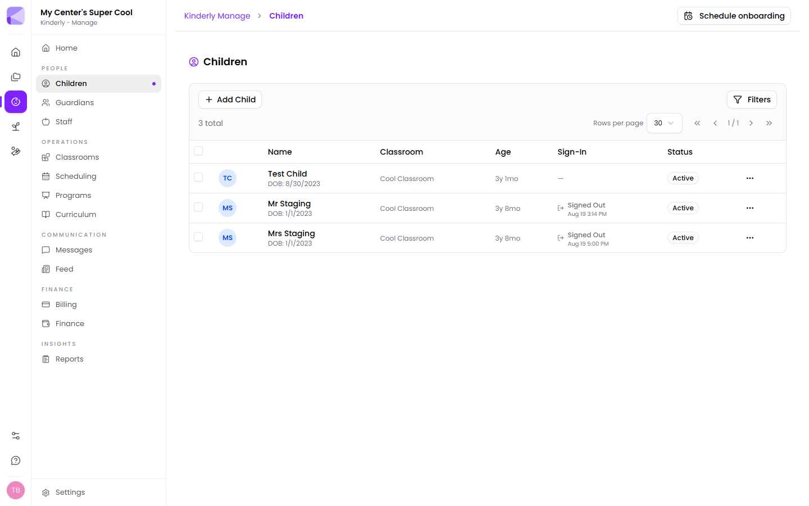
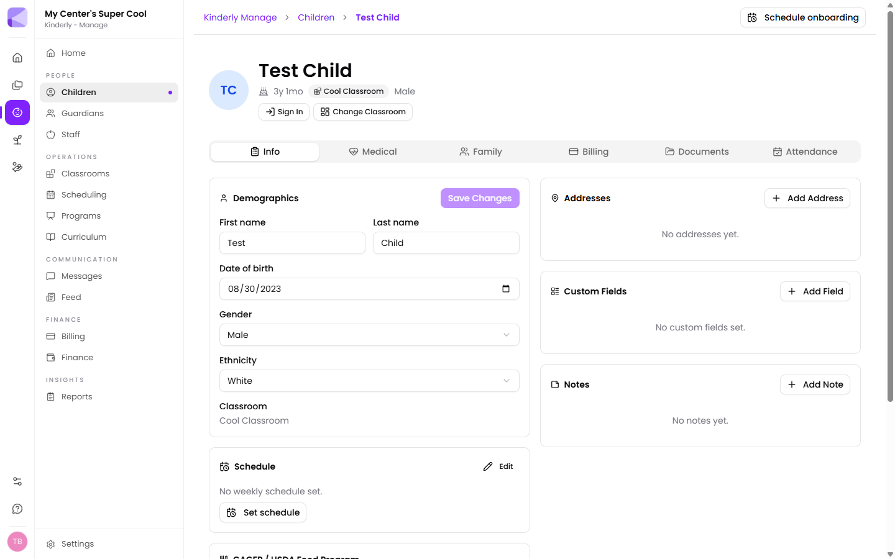
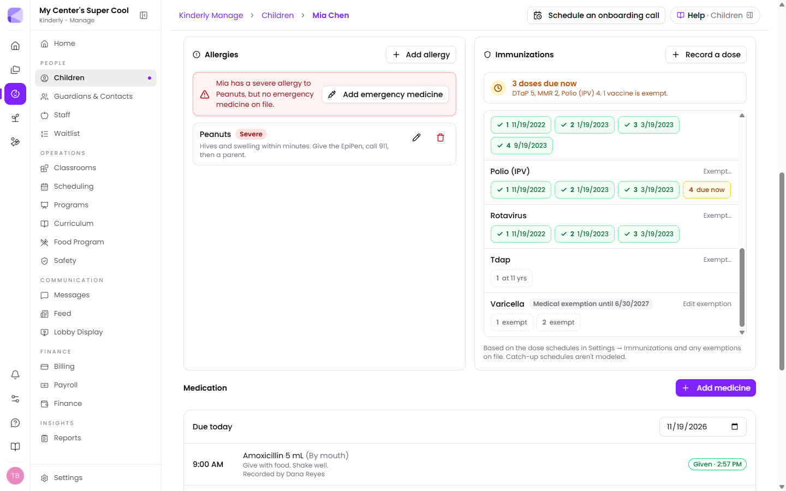

The child record is the center of Manage. Everything else — attendance, billing, reports, the [Parents app](/mobile/parent-app/) — reads from it.

## The list

**Manage → Children** shows everyone, with classroom, age, sign-in state and status.

- **Add Child ▾** offers two ways in: **Add Child** to type the details in, or **Scan Document** to [scan a paper enrollment form](/manage/scan-documents/) and let Ellie fill in the child and their family.

When you type a child in, the first step shows their age as soon as you enter a birth date, and marks the classroom whose ages fit (from each classroom's ratio bands). Picking a classroom is optional. Kinderly says if the child is outside a room's age range or the room is full, and how many children and staff the room will have with this child, against its tightest ratio. If a child with the same name, or the same last name and birth date, is already in Kinderly (archived ones included), a yellow banner shows them with an **Open** link, so a returning child isn't added twice. **Gender** and **ethnicity** are required (*Prefer not to say* is a gender option), here and on the child's Info tab.

In the Family step, a new adult whose email, phone or name matches someone already in Kinderly gets a **Link this guardian** button, which links that person instead of creating a copy.
- The **search box** filters by name as you type.
- **Filters** opens the full set of filters (below). Whatever's applied shows as chips under the toolbar; click a chip's **×** to remove it, or **Clear all**.
- Tick the checkboxes to act on several children at once: sign in or out, upload documents, assign a classroom, or [print a sheet for each](/manage/print-sheets/). **Assign Classroom** shows each room's count. Pick one to see the children already in it, and how full it will be afterwards. **Change Classroom** on a child's page uses the same dialog.
- The **⋮** menu on each row holds per-child actions.

### Filters

Pick as many as you like. Within one filter, any of the picked values matches (*Butterflies* or *Caterpillars*); across filters, a child has to match them all.

| Filter | Shows children who… |
|---|---|
| **Classroom** | are in any of the picked classrooms, or in *No classroom* |
| **Program** | are enrolled in any of the picked programs |
| **Age** | are an infant (under 1), toddler (1–2), preschooler (3–5) or school-age (6+) |
| **Gender** | match the picked gender |
| **Birthday** | have a birthday this month, next month, or in a picked month |
| **Allergies** | have any allergy, no allergies, or a specific one |
| **Missing information** | have no parent or guardian, no primary contact, no birth date, no address, no immunizations, or no classroom |
| **Status** | are active (the default) or archived |

Filters are kept in the page address, so a filtered list can be bookmarked or sent to a colleague.

### Archiving a child

Archive a child who has left from the row's **⋮** menu, or tick several and archive them together. Archived children drop out of the list, attendance and headcounts, and come back with **Restore**.

Before a child can be archived, nothing can still be treating them as enrolled. Kinderly won't archive a child who is:

- **in a billing account.** Remove them on their record's **Billing** tab, so the account stops being invoiced for them.
- **enrolled in a program.** Unenroll them from each one in the **Program** section of their record's **Info** tab, or from the program itself.
- **signed in.** Sign them out first.

If any of these still applies, Kinderly says which ones to fix.

:::tip[Find the records that need attention]
*Missing information → No primary contact* or *No parent or guardian* is a quick audit before a licensing visit.
:::

## The record

Opening a child gives you their photo, age and classroom, and a row of quick actions:

- **Sign In** (or **Sign Out**) for manual attendance.
- **Change Classroom**.
- **Print Sheet**, a [one-page sheet](/manage/print-sheets/) about this child.
- **Scan Document**, which [reads a paper form](/manage/scan-documents/) into this child's record, such as a doctor's note or an updated contact sheet.

Below that, six tabs.

### Info

- **Demographics** — name, date of birth, gender, ethnicity, classroom. The child's age shows under the birth date, with a note if it's outside their classroom's age range.
- **Schedule** — the child's expected weekly pattern. Set this and Kinderly can tell you when a child is here on an unscheduled day, or missing on a scheduled one. In the schedule dialog, **Mon–Fri**, **Mon, Wed, Fri** and **Tue, Thu** pick the days, and **Full day**, **School day** and **Mornings** set the hours for every day picked. The dialog adds up the days and hours each week, and flags a day that ends before it starts. If their program has daily or hourly fees, it estimates what those come to a month at this schedule.
- **CACFP / USDA Food Program** — program type (Free, Reduced, Paid, Base, Non-Needy), race/ethnicity for reporting, and IE form start and end dates. Pick **Good for 1 year** to fill in the end date. The form shows whether the IE form is valid, expiring within 30 days or expired, and asks for its dates when the child is Free or Reduced.

Each of these sections has a save bar at the bottom that lists what you've changed. **Discard** puts it back.
- **Addresses**, **Custom Fields**, **Notes**.

:::tip[Set the weekly schedule even for full-time children]
It feels redundant when a child is in five days a week, but the schedule is what powers the [Child Schedule Adherence report](/manage/reports/) and unscheduled-attendance flags. Without it, Kinderly has no expectation to compare reality against.
:::

:::note[CACFP fields are for food program claims]
If you claim under the USDA Child and Adult Care Food Program, these feed the [CACFP reports](/manage/reports/). If you don't participate, leave them alone.
:::

### Medical

- **Medical Information** — last physical, primary care physician and phone, preferred hospital, insurance provider and policy number, and an **Emergency Medical Treatment Consent** toggle. The last physical date shows how long ago it was and is flagged once it's over a year. While the consent toggle is off, a red line under it says so.
- **Allergies** — pulled from the list you define in [Settings](/manage/settings/). Type to find one, or add a new one right there. Pick **Mild**, **Moderate** or **Severe** and note the reaction and what to do. If a severe allergy has no emergency medicine on file, a red banner offers to add one (an EpiPen, given only when needed). Each allergy is also checked against the child's active medicines, and a match is flagged.
- **Immunizations** — each vaccine shows its doses as given, **due now**, **overdue**, or coming up at a given age, worked out from the child's birth date and the dose schedules in [Settings](/manage/settings/). A summary at the top says whether the child is up to date. Click a missing dose to record it with the vaccine and dose number already picked, or a given one to change or remove it. **Exempt…** on a vaccine records a medical, religious or personal-belief exemption, with an optional expiry. While it's in effect, that vaccine's missing doses show as *exempt* rather than due or overdue. After it expires they count again, and the vaccine is marked *Exemption expired*. Catch-up schedules aren't modeled.

:::caution[Emergency Medical Treatment Consent is a toggle, and it defaults to off]
This is the permission you'd rely on in an actual emergency. It won't fill itself in from a form a parent signed. Check it's set for every child.
:::

:::tip[Define allergies and immunizations in Settings first]
Both lists come from [Manage → Settings](/manage/settings/). Setting them up before adding children means everyone records "Peanut" the same way, instead of "peanuts", "nut allergy" and "PEANUT" — which is the difference between a filter that works and one that doesn't.
:::

### Family & Contacts

Every adult attached to this child: parents, guardians, grandparents, case workers and **emergency contacts**. Each one shows their relationship, contact details, and **Primary** / **Can Pick Up** flags. **Add Adult** links someone already in Kinderly or adds someone new. Common relationships are one click, and the rest are under **Other…**. When adding someone new, Kinderly checks for a match by email, phone or name and offers **Link this adult** instead.

A summary at the top counts the adults, who can pick up, and who has a phone and an email. It turns yellow and lists what's missing when no one can pick up, no primary contact is set, fewer than two adults have a phone, or no one has an email (so no one can use the parent app or get invoices).

Not everyone here is a guardian. Choose **Emergency Contact** as the relationship for the neighbor or friend who should be called but has no custody.

Two rules keep this tidy automatically:

- **Everyone can pick up by default.** A newly added adult has **Can Pick Up** ticked; untick it for anyone who mustn't collect the child.
- **There's always exactly one Primary.** The first adult added becomes primary. Making someone else primary moves it to them, and removing the primary passes it to the next adult.

**Siblings** lists other children at the center who share a parent or guardian with this child. Sharing only an emergency contact or a case worker doesn't make two children siblings.

:::caution["Can Pick Up" is the one to get right]
It's the flag that answers "is this person allowed to collect this child?". Being a guardian and being authorised for pickup aren't the same thing — custody arrangements, in particular, depend on the distinction. Because it's on by default, check it whenever you add someone who shouldn't collect.
:::

### Billing

- **Billing Account** — the account this child's fees go to. Assign an existing one or create a new one.
- **Program Fee Overrides** — change which fees apply to this child and at what amount. Applied automatically at billing time. A line at the top estimates what the child's program fees come to each month after overrides. Daily and hourly fees are worked out from their weekly schedule, if one is set. When you set a custom amount, **Take off 10%, 25% or 50%** fills it in from the program fee, and the dialog shows the old and new amount side by side. Common reasons (Subsidy, Scholarship, Sibling discount, Staff discount) are one click.

:::tip[Overrides beat separate programs]
For a staff discount or a sibling rate, override the fee on the child rather than creating a near-duplicate program. One program stays one program, and the exception lives where you'll actually look for it.
:::

### Documents

Files uploaded against this child, plus **Shared Documents** — [shares](/shares/overview/) linked to this child, so a signed enrollment packet is attached to the right record instead of sitting only in the Shares list. **Send** shares a form, packet or document with the child's primary guardian straight from here. **Link Share** attaches one you've already sent.

### Attendance

Every sign-in and sign-out, with time, who signed, notes and captured signature. **Add Entry** records attendance by hand for a missed sign-in.

## Next

- [Guardians & Contacts](/manage/guardians/) — the families behind the children.
- [Scan a document](/manage/scan-documents/) — enroll a family from their paperwork.
- [Settings](/manage/settings/) — allergy, immunization and custom-field lists.
