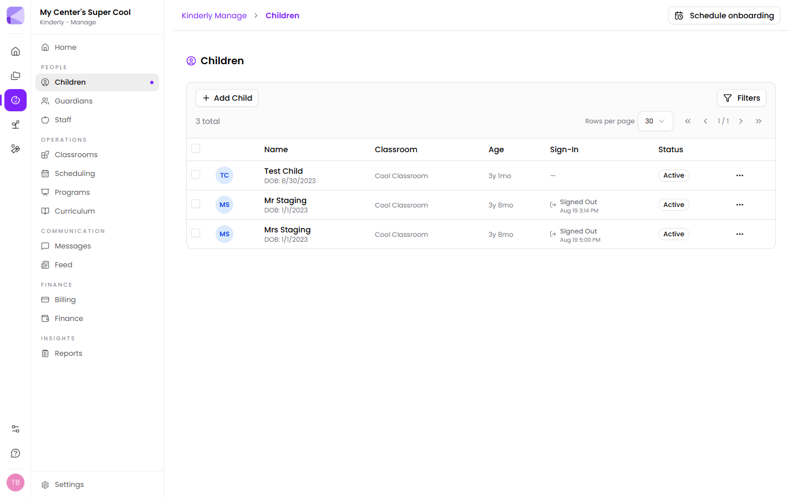
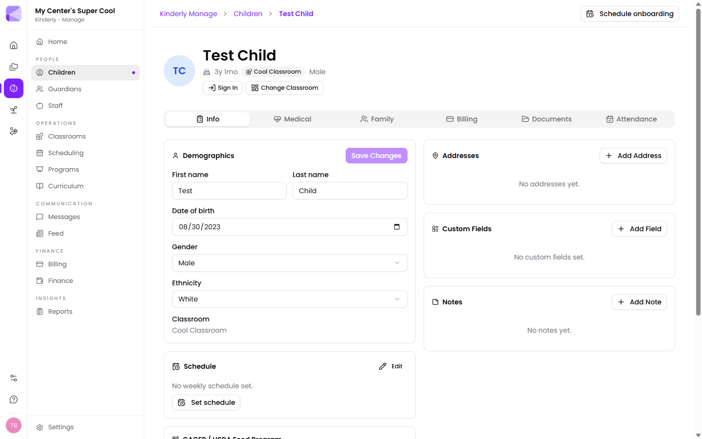
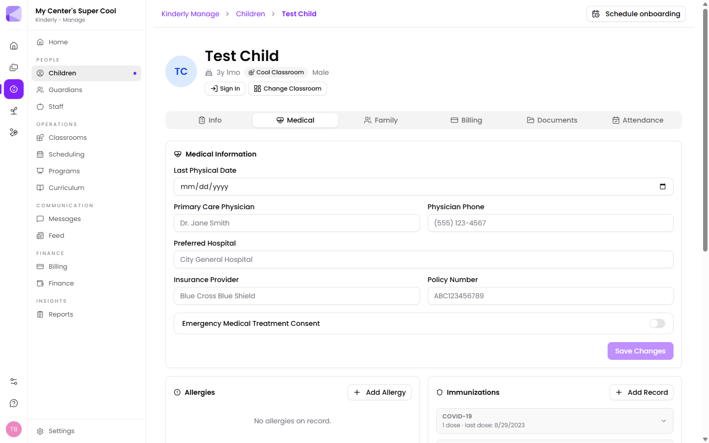

The child record is the center of Manage. Everything else — attendance, billing, reports, the [Parents app](/mobile/parent-app/) — reads from it.

## The list

**Manage → Children** shows everyone, with classroom, age, sign-in state and status.

- **Add Child ▾** offers two ways in: **Add Child** to type the details in, or **Scan Document** to [scan a paper enrollment form](/manage/scan-documents/) and let Ellie fill in the child and their family.
- The **search box** filters by name as you type.
- **Filters** opens the full set of filters (below). Whatever's applied shows as chips under the toolbar; click a chip's **×** to remove it, or **Clear all**.
- Tick the checkboxes to act on several children at once: sign in or out, upload documents, assign a classroom, or [print a sheet for each](/manage/print-sheets/).
- The **⋮** menu on each row holds per-child actions.

### Filters

Pick as many as you like. Within one filter, any of the picked values matches (*Butterflies* or *Caterpillars*); across filters, a child has to match them all.

| Filter | Shows children who… |
|---|---|
| **Classroom** | are in any of the picked classrooms, or in *No classroom* |
| **Program** | are enrolled in any of the picked programs |
| **Age** | are an infant (under 1), toddler (1–2), preschooler (3–5) or school-age (6+) |
| **Gender** | match the picked gender |
| **Birthday** | have a birthday this month, next month, or in a picked month |
| **Allergies** | have any allergy, no allergies, or a specific one |
| **Missing information** | have no parent or guardian, no primary contact, no birth date, no address, no immunizations, or no classroom |
| **Status** | are active (the default) or archived |

Filters are kept in the page address, so a filtered list can be bookmarked or sent to a colleague.

:::tip[Find the records that need attention]
*Missing information → No primary contact* or *No parent or guardian* is a quick audit before a licensing visit.
:::

## The record

Opening a child gives you their photo, age and classroom, and a row of quick actions:

- **Sign In** (or **Sign Out**) for manual attendance.
- **Change Classroom**.
- **Print Sheet**, a [one-page sheet](/manage/print-sheets/) about this child.
- **Scan Document**, which [reads a paper form](/manage/scan-documents/) into this child's record, such as a doctor's note or an updated contact sheet.

Below that, six tabs.

### Info

- **Demographics** — name, date of birth, gender, ethnicity, classroom.
- **Schedule** — the child's expected weekly pattern. Set this and Kinderly can tell you when a child is here on an unscheduled day, or missing on a scheduled one.
- **CACFP / USDA Food Program** — program type (Free, Reduced, Paid, Base, Non-Needy), race/ethnicity for reporting, and IE form start and end dates.
- **Addresses**, **Custom Fields**, **Notes**.

:::tip[Set the weekly schedule even for full-time children]
It feels redundant when a child is in five days a week, but the schedule is what powers the [Child Schedule Adherence report](/manage/reports/) and unscheduled-attendance flags. Without it, Kinderly has no expectation to compare reality against.
:::

:::note[CACFP fields are for food program claims]
If you claim under the USDA Child and Adult Care Food Program, these feed the [CACFP reports](/manage/reports/). If you don't participate, leave them alone.
:::

### Medical

- **Medical Information** — last physical, primary care physician and phone, preferred hospital, insurance provider and policy number, and an **Emergency Medical Treatment Consent** toggle.
- **Allergies** — pulled from the list you define in [Settings](/manage/settings/).
- **Immunizations** — dose counts and last-dose dates per vaccine.

:::caution[Emergency Medical Treatment Consent is a toggle, and it defaults to off]
This is the permission you'd rely on in an actual emergency. It won't fill itself in from a form a parent signed. Check it's set for every child.
:::

:::tip[Define allergies and immunisations in Settings first]
Both lists come from [Manage → Settings](/manage/settings/). Setting them up before adding children means everyone records "Peanut" the same way, instead of "peanuts", "nut allergy" and "PEANUT" — which is the difference between a filter that works and one that doesn't.
:::

### Family & Contacts

Every adult attached to this child: parents, guardians, grandparents, case workers and **emergency contacts**. Each one shows their relationship, contact details, and **Primary** / **Can Pick Up** flags. **Add Adult** links someone already in Kinderly or adds someone new.

Not everyone here is a guardian. Choose **Emergency Contact** as the relationship for the neighbor or friend who should be called but has no custody.

Two rules keep this tidy automatically:

- **Everyone can pick up by default.** A newly added adult has **Can Pick Up** ticked; untick it for anyone who mustn't collect the child.
- **There's always exactly one Primary.** The first adult added becomes primary. Making someone else primary moves it to them, and removing the primary passes it to the next adult.

**Siblings** lists other children at the center who share a parent or guardian with this child. Sharing only an emergency contact or a case worker doesn't make two children siblings.

:::caution["Can Pick Up" is the one to get right]
It's the flag that answers "is this person allowed to collect this child?". Being a guardian and being authorised for pickup aren't the same thing — custody arrangements, in particular, depend on the distinction. Because it's on by default, check it whenever you add someone who shouldn't collect.
:::

### Billing

- **Billing Account** — the account this child's fees go to. Assign an existing one or create a new one.
- **Program Fee Overrides** — change which fees apply to this child and at what amount. Applied automatically at billing time.

:::tip[Overrides beat separate programs]
For a staff discount or a sibling rate, override the fee on the child rather than creating a near-duplicate program. One program stays one program, and the exception lives where you'll actually look for it.
:::

### Documents

Files uploaded against this child, plus **Shared Documents** — [shares](/shares/overview/) linked to this child, so a signed enrollment packet is attached to the right record instead of sitting only in the Shares list.

### Attendance

Every sign-in and sign-out, with time, who signed, notes and captured signature. **Add Entry** records attendance by hand for a missed sign-in.

## Next

- [Guardians & Contacts](/manage/guardians/) — the families behind the children.
- [Scan a document](/manage/scan-documents/) — enroll a family from their paperwork.
- [Settings](/manage/settings/) — allergy, immunisation and custom-field lists.
