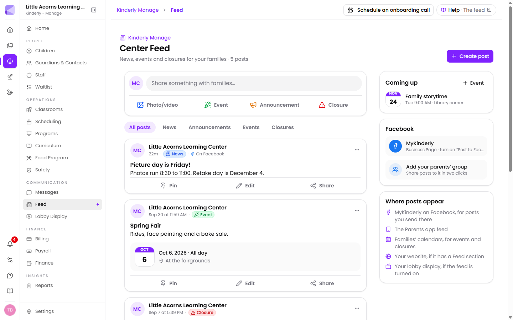

The **Center Feed** is what families see in the [Parents app](/mobile/parent-app/). It's for things everyone should know, as opposed to [Messages](/manage/messages/), which is for conversations with one family.

## Post types

| Type | For |
|---|---|
| **News** | General updates — a new staff member, a room refresh |
| **Announcements** | Things families need to act on or remember |
| **Events** | Something happening at a date and time |
| **Closures** | Days you're shut |

Filter tabs above the posts let you view one type at a time.

The column on the right shows what’s **coming up**: the next events and closures, with a repeating event listed once at its next date.

## Creating a post

Click **Share something with families…** at the top of the feed, or **Create post**, to open the composer. The **Photo/video**, **Event**, **Announcement** and **Closure** buttons under it open the composer with that type already picked. To edit, pin or delete a post, use the buttons along its bottom or the **⋯** menu in its corner. **Share** lists the places you can send it. Posts take **photos and video** — up to 20 attachments each, 200 MB per clip. Families see video play inline, with a still frame while it loads.

Staff can also post straight from the [Teachers app](/mobile/teacher-app/).

## Sharing to Google

With [Google Business Profile](/integrations/google-business/) connected, the composer has a **Share to Google** switch. A post with it on is posted that night as an update on your Google listing, and events appear as event updates with their date and time. Editing the post updates it on Google. Turning the switch off or archiving the post takes it down.

Your Business Profile is public, so keep posts meant only for current families off it.

## Posting to your Facebook Page

<!-- coming-soon:facebook-page — delete this comment and the note below when Meta approves the app -->
:::note[Coming soon]
Posting to a Facebook Page is waiting on Facebook's approval. Sharing to a Facebook group, below, works today.
:::

With your [Facebook Page](/integrations/facebook-page/) connected, the composer has a **Post to Facebook** switch, and an older post can go there from **Share → Post to** *your Page*. Posts on your Page show **On Facebook** in the feed. Editing or deleting a post here does the same on Facebook.

## Sharing to a Facebook group

Many centers keep a parents’ group on Facebook. Click **Add your parents’ group** in the **Facebook** card on the right of the feed, and paste the group’s link (copy it from your browser while you’re in the group). After that, **Share → Share to a Facebook group** on any post copies its text and opens your group in a new tab: paste it in, add photos if you want, and post. Kinderly also offers **Share to Facebook group** right after you publish.

Facebook doesn’t let any app post into groups, so you do that last step yourself. (Business Pages are different: see above.) The group link is remembered on the computer you added it from.

:::caution[Photos of children]
Only share children’s photos to Facebook when their families have agreed, even in a private group.
:::

## Pinning

A post can be **pinned** to stay at the top of the feed regardless of age.

:::tip[Pin sparingly]
One pinned post gets read. Four pinned posts are just a wall families scroll past. Pin the thing that actually matters this week and unpin it when it doesn't.
:::

## Events and closures

Events and closures carry dates rather than just being text, so families see them as *when*, not just *what*.

### Recurring

An event or closure can repeat: pick the weekdays and a date range and every occurrence is created for you, up to a year out. The feed collapses a series into a single row showing its cadence — *"Occurs every Tue & Fri"* — with the number of dates.

You can drop individual dates from a series, or delete the whole series in one click.

### All-day

Events and closures can be marked all-day, so a week-long closure reads as dates rather than times.

:::tip[Put your closure calendar in once, at the start of the year]
Public holidays, staff training days, the Christmas break — enter them as recurring or all-day closures in one sitting. Families can see the whole year, and you stop fielding "are you open on the 24th?" every December.
:::

:::caution[Closures here are separate from Settings]
Posting a closure to the feed tells families. The **Closed Holidays** list in [Settings](/manage/settings/) is what the system uses for operating days. Setting one doesn't set the other — for a genuine closure, do both.
:::

## Next

- [Messages](/manage/messages/) — talking to one family.
- [Parent app](/mobile/parent-app/) — where families read the feed.
