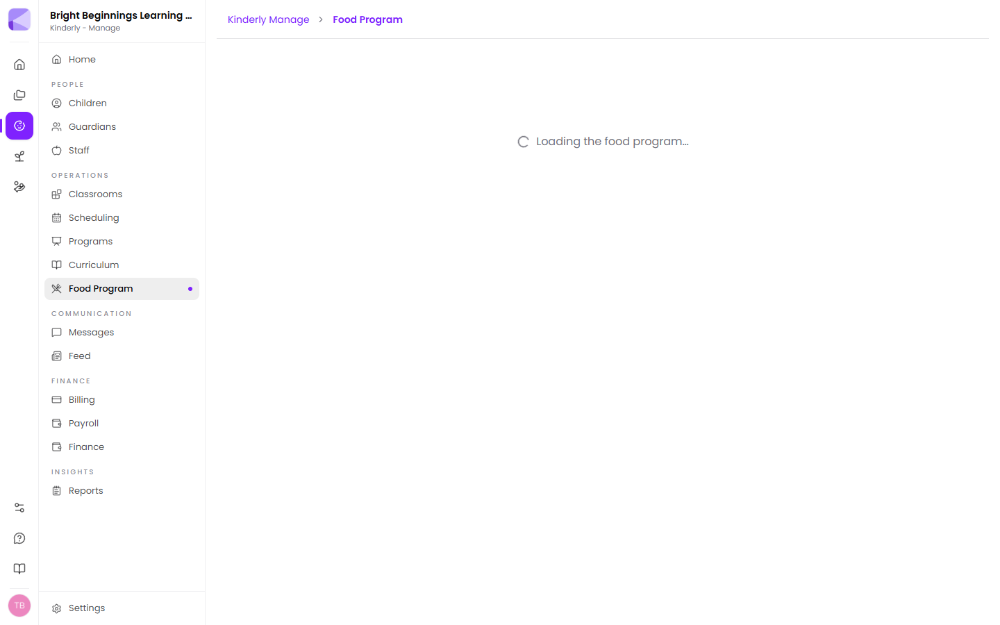
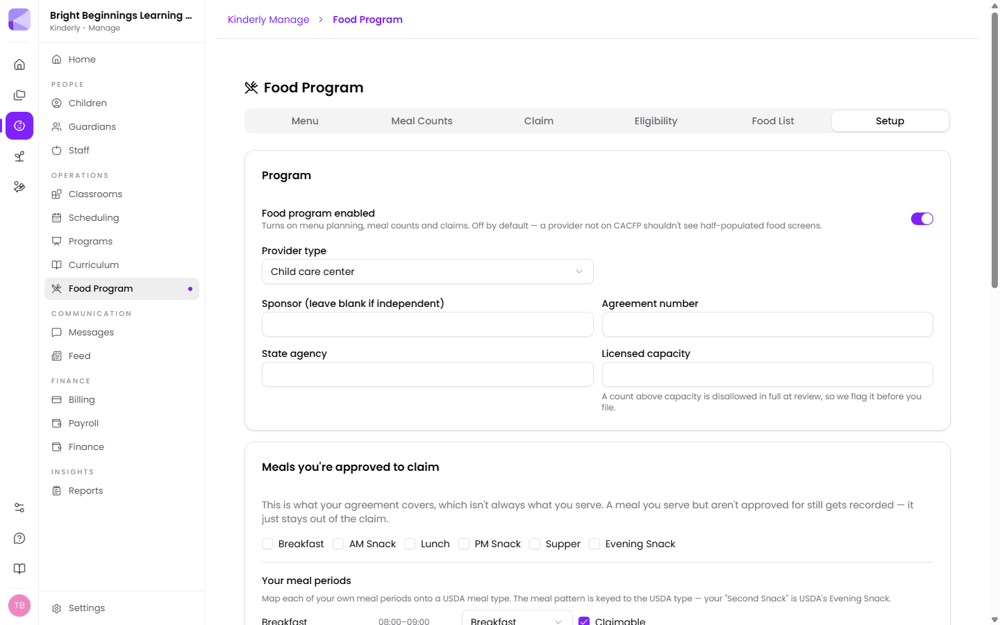
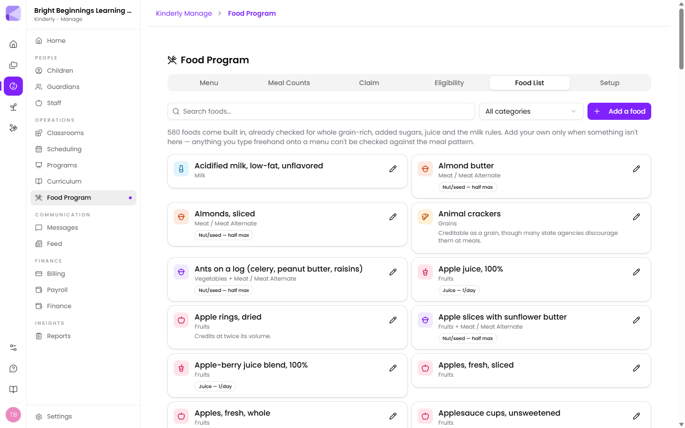
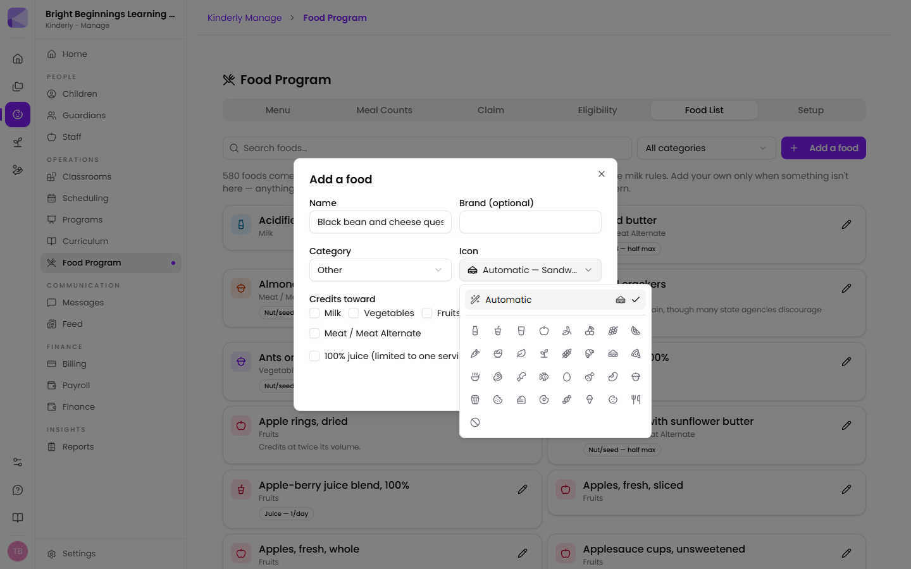
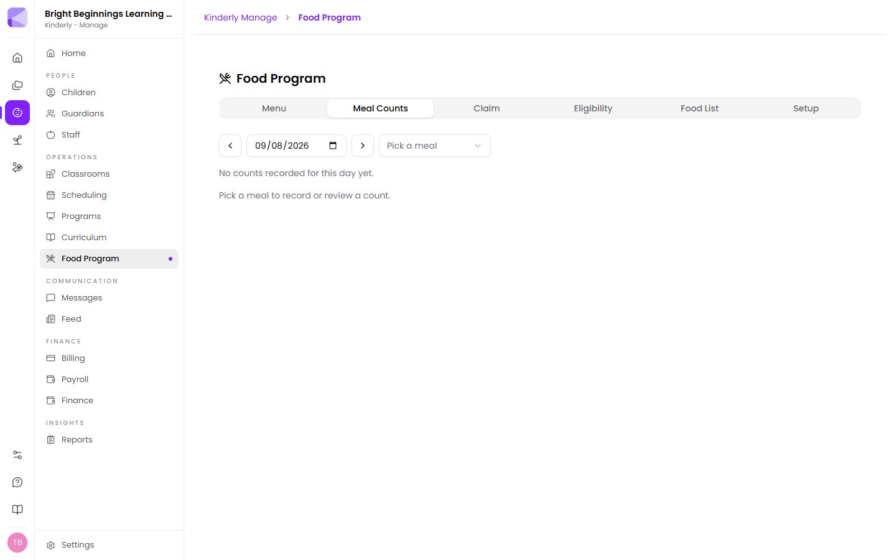
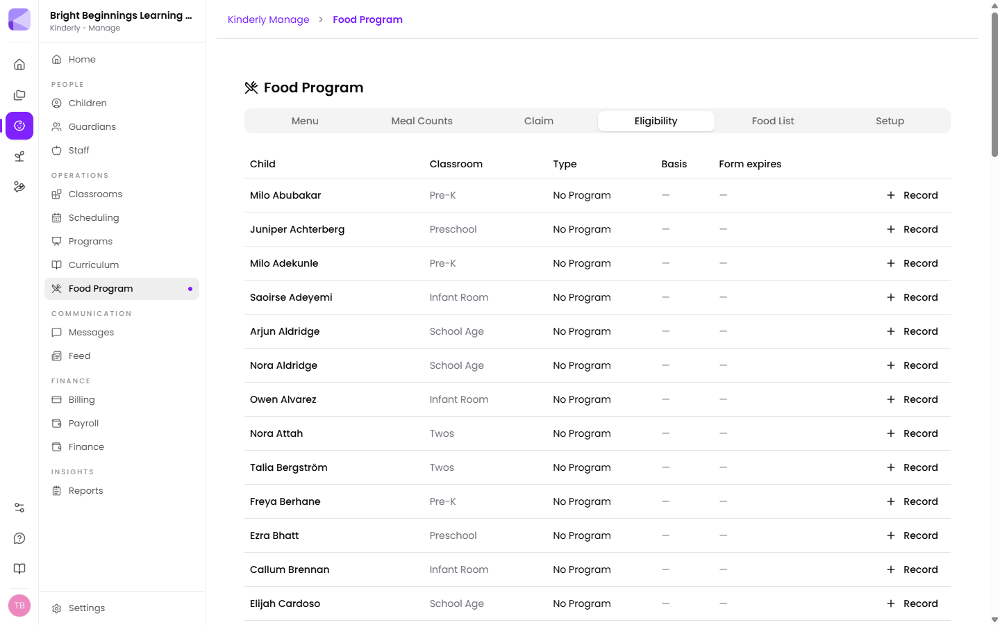
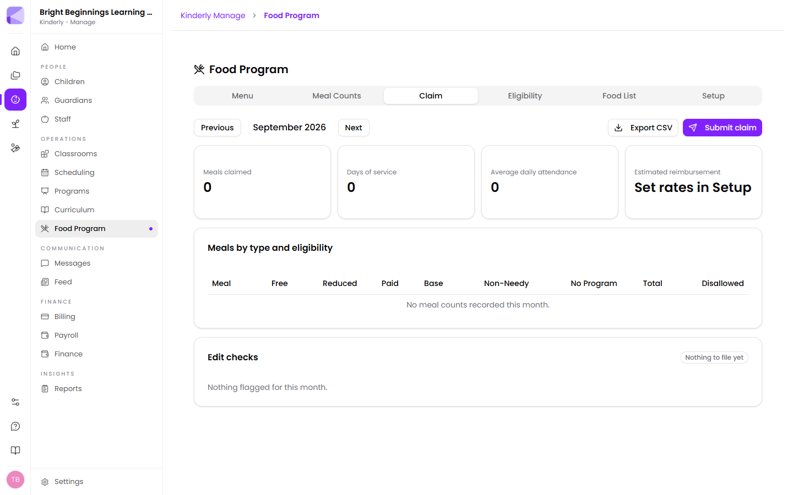

**Manage → Food Program** runs CACFP end to end: plan a menu that's checked
against the USDA meal pattern while you're still typing it, record meal counts
at the point of service, and file a monthly claim.

It works for child care centers and for family child care homes, which claim
differently — by tier, through a sponsor, with the provider's own children under
an extra rule.

## Turning it on

The Food Program is **off until you turn it on**, because a provider who isn't
on CACFP shouldn't have to look at half-filled food screens. Until then, the
page shows only the Setup form.

Setup is where you record what your agreement actually says:

- **Provider type** — child care center, or family child care home. Homes also
  pick a tier, which decides the rate every meal is paid at.
- **Sponsor**, **agreement number**, **state agency** and **licensed capacity**.
- **Meals you're approved to claim.** This is what your agreement covers, which
  isn't always what you serve. A meal you serve but aren't approved for is still
  recorded — it just stays out of the claim.
- **Your meal periods**, mapped onto the USDA meal types. Your "Second Snack" is
  USDA's Evening Snack, and the meal pattern is keyed to the USDA name.
- **Reimbursement rates**, which turn the claim's estimate into a real number.

:::note[Licensed capacity is worth filling in]
A count above your licensed capacity is disallowed in full at review. Kinderly
flags it before you file rather than after.
:::

### Counts and records

- **Lock counts after (hours)** — after this window a count can still be edited,
  but it's recorded as *reconstructed* rather than point-of-service, because
  that distinction is exactly what a reviewer is looking for. Set it to 0 to
  never lock.
- **Post meals to the family feed** — writes a daily note when a count is
  submitted. The note and the claim stay separate records, so a family-facing
  feature can never change what you claim.
- **Share menus with families** — publishes the planned menu to the Parents app.

## Planning a menu

The **Menu** tab plans one operating day at a time, with children and infants
kept apart because they follow different meal patterns.

Add foods to each meal period and Kinderly checks the pattern as you go —
whether every required component is present, whether the grain is whole
grain-rich, whether you've gone over the one-juice-a-day limit. **Apply a cycle**
fills a run of days from a menu you reuse.

There are two ways to get food onto a day, and they suit different moments:

- **Click a red slot.** When a meal is missing something, it shows up as a
  dashed **Fruit — required** slot in that meal. Click it and the food picker
  opens already filtered to what fills it.
- **Drag from the food list beside the meals.** Search or filter by component,
  then drag a food onto a meal — or straight onto a red slot, which fills it and
  sets what it counts as in one move.

Once food is on a day you can drag it around: move an item from lunch to snack,
or reorder items within a meal. To reuse a day, drag the grip beside the date
onto another day in the week strip — or use **Copy day to…** for the same thing
without a mouse. Either way the copy lands as a draft on that day for you to
review and save; it never overwrites what's already on the calendar by itself.

:::note[Days you haven't saved are marked]
An amber dot on a date means that day has edits you haven't saved yet. You can
move between days freely — Kinderly keeps the edits — and **Save 3 days** appears
when more than one day is waiting. A day that fails to save stays marked so you
can try again.
:::

:::caution[A meal with no menu of record is the easiest thing to lose at review]
The planner warns when an operating day has no menu, because meals served
without one are commonly disallowed — there's nothing to show the meal met the
pattern.
:::

Infants are handled separately on purpose. Breastmilk or iron-fortified formula
is the only hard requirement; solids are offered as each baby is ready.

## The food list

580 foods come built in, already checked for the things that actually get meals
disallowed: whole grain-rich, added sugars on cereal and yogurt, juice, and the
milk rules by age.

Every food carries an **icon and a colour for its component** — blue for milk,
pink for fruit, green for vegetables, amber for grains, orange for meat and meat
alternates, violet for combination dishes, teal for infant foods. A menu gets
scanned far more often than it gets read, and a column of shapes is quicker to
check than a column of names.

The badges are the part that decides a claim:

| Badge | What it means |
|---|---|
| **Whole grain-rich** | Meets the whole grain-rich requirement |
| **Whole grain unverified** | Nobody has checked this product's label yet |
| **Juice — 1/day** | Counts against the one-serving-a-day juice limit |
| **Nut/seed — half max** | Credits at most half the meat/meat alternate at lunch and supper |
| **Vegetable or meat alt** | A legume — counts as one or the other in a meal, never both |
| **Not creditable** | Credits toward nothing |
| **Yours** | A food your center added |

:::note[Non-creditable foods are in the list deliberately]
Search "granola bar" and you're told it credits toward nothing. An empty search
result reads as approval, which is the opposite of the truth.
:::

### Adding your own food

**Add a food** when something genuinely isn't in the list. Anything you type
freehand onto a menu can't be checked against the meal pattern at all, so a
real entry is always worth the extra minute.

The **Icon** box defaults to **Automatic**, which reads the name you've typed and
picks the glyph as you go — "Black bean and cheese quesadilla" becomes a
sandwich, "Refried beans, low sodium" becomes a bean. Pick one from the grid only
when you disagree. Leaving it on Automatic is the better answer for most foods:
the icon keeps up if you rename the food later.

:::tip[Editing a built-in food makes your own copy]
Saving a change to one of the 580 built-in foods creates your version, which
replaces it everywhere in your menus. That's how you correct a product a
manufacturer has reformulated without waiting for us to ship a fix.
:::

## Recording meal counts

The **Meal Counts** tab records who actually ate, meal by meal, on the day.

Pick a date and a meal, and you get the children to count. Kinderly marks the
ones who need a second look — a child whose income form has expired, or who
isn't signed in but is being counted for a meal. In a family child care home,
the provider's own children are flagged too, because they're subject to a
separate rule.

:::caution[Count at the point of service, not at the end of the week]
CACFP asks for a point-of-service count: taken as the meal is served. Counts
entered later still work, but they're recorded as reconstructed — and a reviewer
treats those differently.
:::

## Eligibility

The **Eligibility** tab is the roster the claim is priced from: each child's
type (Free, Reduced, Paid, or no program), what it's based on, and when the form
expires.

**Record** adds a determination for a child. An expired form doesn't quietly
carry over — it shows as expired, and the child is claimed at the lower rate
until a new form is on file.

## Filing the claim

The **Claim** tab builds the month.

At the top: meals claimed, days of service, average daily attendance, and the
estimated reimbursement once you've entered your rates. Below that, meals broken
out by type and eligibility, with a disallowed column.

**Edit checks** is the part worth reading before you file. It runs the checks a
reviewer runs — counts above licensed capacity, meals claimed on days with no
menu, children counted with an expired form, more meals than a child can be
claimed for in a day — and shows either **Ready to file** or the number of things
still to resolve.

**Export CSV** gives you the figures for a sponsor who wants them their own way.
**Submit claim** files the month and freezes it.

## Next

- [Children](/manage/children/) — where a child's records and allergies live.
- [Reports](/manage/reports/) — menu and meal count reports for your records.
- [Settings](/manage/settings/) — operating days, which set what counts as a day
  needing a menu.
