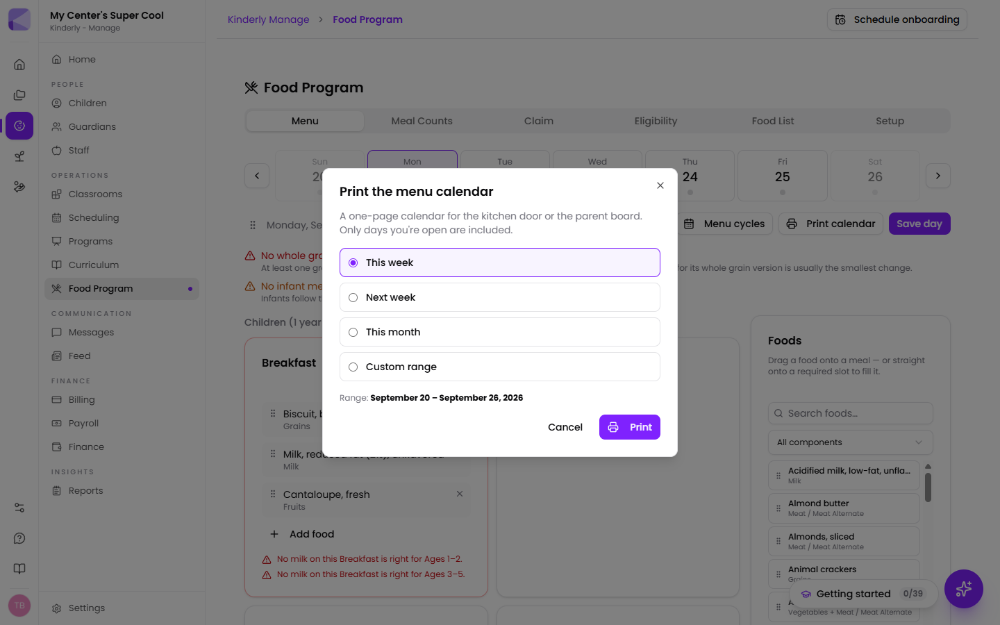

**Manage → Food Program** runs CACFP end to end: plan a menu that's checked
against the USDA meal pattern while you're still typing it, record meal counts
at the point of service, and file a monthly claim.

It works for child care centers and for family child care homes, which claim
differently — by tier, through a sponsor, with the provider's own children under
an extra rule.

## Turning it on

The Food Program is **off until you turn it on**, because a provider who isn't
on CACFP shouldn't have to look at half-filled food screens. Until then, the
page shows only the Setup form.

Setup is where you record what your agreement actually says:

- **Provider type** — child care center, or family child care home. Homes also
  pick a tier, which decides the rate every meal is paid at.
- **Sponsor**, **agreement number**, **state agency** and **licensed capacity**.
- **Meals you're approved to claim.** This is what your agreement covers, which
  isn't always what you serve. A meal you serve but aren't approved for is still
  recorded — it just stays out of the claim.
- **Your meal periods**, mapped onto the USDA meal types. Your "Second Snack" is
  USDA's Evening Snack, and the meal pattern is keyed to the USDA name.
- **Reimbursement rates**, which turn the claim's estimate into a real number.

:::note[Licensed capacity is worth filling in]
A count above your licensed capacity is disallowed in full at review. Kinderly
flags it before you file rather than after.
:::

### Counts and records

- **Lock counts after (hours)** — after this window a count can still be edited,
  but it's recorded as *reconstructed* rather than point-of-service, because
  that distinction is exactly what a reviewer is looking for. Set it to 0 to
  never lock.
- **Post meals to the family feed** — writes a daily note when a count is
  submitted. The note and the claim stay separate records, so a family-facing
  feature can never change what you claim.
- **Share menus with families** — publishes the planned menu to the Parents app.

## Planning a menu

The **Menu** tab plans one operating day at a time, with children and infants
kept apart because they follow different meal patterns.

Add foods to each meal period and Kinderly checks the pattern as you go —
whether every required component is present, whether the grain is whole
grain-rich, whether you've gone over the one-juice-a-day limit. **Menu cycles**
fills a run of days from a menu you reuse.

There are two ways to get food onto a day, and they suit different moments:

- **Click a red slot.** When a meal is missing something, it shows up as a
  dashed **Fruit — required** slot in that meal. Click it and the food picker
  opens already filtered to what fills it.
- **Drag from the food list beside the meals.** Search or filter by component,
  then drag a food onto a meal — or straight onto a red slot, which fills it and
  sets what it counts as in one move.

Once food is on a day you can drag it around: move an item from lunch to snack,
or reorder items within a meal. To reuse a day, drag the grip beside the date
onto another day in the week strip — or use **Copy day to…** for the same thing
without a mouse. Either way the copy lands as a draft on that day for you to
review and save; it never overwrites what's already on the calendar by itself.

:::note[Days you haven't saved are marked]
An amber dot on a date means that day has edits you haven't saved yet. You can
move between days freely — Kinderly keeps the edits — and **Save 3 days** appears
when more than one day is waiting. A day that fails to save stays marked so you
can try again.
:::

:::caution[A meal with no menu of record is the easiest thing to lose at review]
The planner warns when an operating day has no menu, because meals served
without one are commonly disallowed — there's nothing to show the meal met the
pattern.
:::

Infants are handled separately on purpose. Breastmilk or iron-fortified formula
is the only hard requirement; solids are offered as each baby is ready. Infant
meals are recorded, reviewed and disallowed separately from child meals, and the
milk source — breastmilk, center formula or parent-provided — is part of the
record.

### Milk by age

Milk is the item most often served wrong, because the rule depends on the child's age, not the carton:

| Age | Milk that counts |
|---|---|
| Under 1 | No cow's milk. Breastmilk or iron-fortified formula |
| 1-year-olds | Unflavored **whole** milk |
| 2 through 5 | Unflavored **low-fat (1%)** or **fat-free** |
| 6 and up | Low-fat or fat-free. Flavored is allowed within the added-sugar limit |

**Reduced-fat (2%) milk doesn't count for any age group.** The one exception is a one-month switch for children 24–25 months coming off whole milk. If you put 2% on a menu, the planner marks the meal for every age group you serve.

Ones and twos share the **Ages 1–2** group, but they drink different milk. If that room has both, put whole milk *and* 1% (or fat-free) on the menu. If only one of them is there, the planner shows a warning, not an error, so a room of only two-year-olds on 1% milk isn't marked wrong.

### Putting the menu on the wall

**Print calendar** produces a one-page menu calendar for the kitchen door, the
classroom or the parent board, over **this week**, **next week**, **this month**
or a **custom range**. Only days you're open are included.

The printed version is not a picture of the planner. Drag handles, empty slots,
the food palette and the validation findings all come off, leaving what a cook or
a parent actually reads: what's being served, on which day, with the same icons
and component colours as the screen so the milk row is findable across a room.

:::note[Findings are deliberately left off the print]
A printed menu that says "Lunch is missing a fruit" is a menu nobody should be
posting yet. Resolve findings in the planner, then print.
:::

### Reusing a menu: cycles

A **cycle** is a menu you reuse — a four-week rotation, a summer set. Build one
once under **Menu cycles**, then apply it to fill a run of operating days. Cycles skip
your non-operating days as they're laid down, so a five-day cycle stays
Monday-to-Friday instead of drifting through the weekend.

Applied days land as drafts for you to review and save, exactly like a copied
day.

## The food list

580 foods come built in, already checked for the things that actually get meals
disallowed: whole grain-rich, added sugars on cereal and yogurt, juice, and the
milk rules by age.

Every food carries an **icon and a colour for its component** — blue for milk,
pink for fruit, green for vegetables, amber for grains, orange for meat and meat
alternates, violet for combination dishes, teal for infant foods. A menu gets
scanned far more often than it gets read, and a column of shapes is quicker to
check than a column of names.

The badges are the part that decides a claim:

| Badge | What it means |
|---|---|
| **Whole grain-rich** | Meets the whole grain-rich requirement |
| **Whole grain unverified** | Nobody has checked this product's label yet |
| **Juice — 1/day** | Counts against the one-serving-a-day juice limit |
| **Nut/seed — half max** | Credits at most half the meat/meat alternate at lunch and supper |
| **Vegetable or meat alt** | A legume — counts as one or the other in a meal, never both |
| **Not creditable** | Credits toward nothing |
| **Yours** | A food your center added |

:::note[Non-creditable foods are in the list deliberately]
Search "granola bar" and you're told it credits toward nothing. An empty search
result reads as approval, which is the opposite of the truth.
:::

### Adding your own food

**Add a food** when something genuinely isn't in the list. Anything you type
freehand onto a menu can't be checked against the meal pattern at all, so a
real entry is always worth the extra minute.

The **Icon** box defaults to **Automatic**, which reads the name you've typed and
picks the glyph as you go — "Black bean and cheese quesadilla" becomes a
sandwich, "Refried beans, low sodium" becomes a bean. Pick one from the grid only
when you disagree. Leaving it on Automatic is the better answer for most foods:
the icon keeps up if you rename the food later.

:::tip[Editing a built-in food makes your own copy]
Saving a change to one of the 580 built-in foods creates your version, which
replaces it everywhere in your menus. That's how you correct a product a
manufacturer has reformulated without waiting for us to ship a fix.
:::

## Recording meal counts

The **Meal Counts** tab records who actually ate, meal by meal, on the day.

Pick a date and a meal, and you get the children to count. Kinderly marks the
ones who need a second look — a child whose income form has expired, or who
isn't signed in but is being counted for a meal. In a family child care home,
the provider's own children are flagged too, because they're subject to a
separate rule.

:::caution[Count at the point of service, not at the end of the week]
CACFP asks for a point-of-service count: taken as the meal is served. Counts
entered later still work, but they're recorded as reconstructed — and a reviewer
treats those differently.
:::

## What Kinderly tells you without being asked

The largest CACFP review finding isn't a bad menu — it's a missing or
reconstructed count. Four alerts exist to catch the things that are cheap to fix
on the day and expensive to fix at review. None of them need setting up.

| Alert | When | Who gets it |
|---|---|---|
| **A count hasn't been started** | Part-way through a meal window, once per room per meal | The room. Homes and centers without classrooms get one provider-wide nudge |
| **A count was finalized with errors** | The moment it's finalized | Administrators |
| **Income forms need attention** | Weekly, for forms expiring within 30 days or already lapsed | The provider, by email |
| **A claim hasn't been filed** | The 5th and 10th of the following month | Administrators |

A few details worth knowing:

- The count nudge fires **mid-window**, not at the start — a notification that
  arrives while a teacher is plating gets dismissed unread. It stops at the end of
  the window, because after that a count is no longer a point-of-service count and
  telling you to take one would be telling you to record something inaccurate.
- It's gated on **who is actually present**, not who is enrolled. An empty room at
  lunch is a field trip, not a missed count.
- The claim reminder only fires for a month you **actually served meals in**, so a
  center closed in July is never chased for a July claim. Two nudges, not a daily
  drip — most sponsors' real deadline sits inside the first ten days, and a denser
  ladder just trains people to ignore it.

## Eligibility

The **Eligibility** tab is the roster the claim is priced from: each child's
type, what it's based on, and when the form expires.

Six types exist, and the claim breaks meals out by all of them — **Free**,
**Reduced**, **Paid**, **Base**, **Non-Needy** and **No Program**. Centers
normally use the first three and No Program; **Base** and **Non-Needy** are there
for family child care homes, whose claiming works differently.

**Record** adds a determination for a child. A determination is stored as a
**dated period**, not as a field on the child — because a claim for March needs
the eligibility that was in effect *in March*, not whatever is true today.

What the determination is based on matters as much as the type:

| Basis | |
|---|---|
| **Income eligibility form** | The household form. Good for twelve months plus the month received |
| **Categorical — SNAP** | Automatically eligible through SNAP |
| **Categorical — TANF** | Automatically eligible through TANF |
| **Foster child** | |
| **Head Start** | |
| **Area eligible** | Qualifying on the location rather than the household |
| **No determination** | Claimed at the Paid rate |

An expired form doesn't quietly carry over — it shows as expired, the child drops
to Paid, and the roster leads with what's about to expire. This is the failure
worth understanding: nothing visibly breaks when a form lapses. The child is still
served, the counts still record, and the provider keeps claiming at the Free rate
until a reviewer finds it and takes the difference back. That's what the weekly
expiry email exists to prevent.

## Filing the claim

The **Claim** tab builds the month.

At the top: meals claimed, days of service, average daily attendance, and the
estimated reimbursement once you've entered your rates. Below that, meals broken
out by type and eligibility, with a disallowed column.

**Edit checks** is the part worth reading before you file. It runs the checks a
reviewer runs — counts above licensed capacity, meals claimed on days with no
menu, children counted with an expired form, more meals than a child can be
claimed for in a day — and shows either **Ready to file** or the number of things
still to resolve.

### Filing anyway, on the record

An error blocks submission until you either fix it or acknowledge it. Each
finding carries a **File anyway…** link, which asks for a reason before it lets
the claim through.

That is not a way of silencing the check. The finding stays on the claim, your
reason is stored against it with your name and the time, and both appear in the
audit packet.

That's deliberate. Sometimes the software is wrong, or the explanation lives
outside Kinderly — a licensing waiver, a sponsor who has already agreed the
month. A reviewer accepts documented judgment far more readily than a number with
no account of itself.

### Submitting freezes the month

**Submit claim** files the month and freezes the totals and the edit checks onto
the claim as filed.

Afterwards, editing attendance or a count doesn't quietly restate what you
already sent. The change shows up as **drift** against the filed figures, with an
offer to **amend** — so "these are the numbers" and "these were the numbers when
somebody filed" stay separate records. If you've ever been asked why a report
disagrees with a claim you submitted six weeks ago, this is the screen that
answers it.

**Export CSV** gives you the figures for a sponsor who wants them their own way.

### The audit packet

**Audit packet** is the one to know about. It builds a single paginated PDF for
the month — landscape, every section starting a new page — containing the stack
of records a state agency or sponsor asks for at review:

| Section | Why it's asked for |
|---|---|
| **Meal counts** | The point-of-service counts the claim is built from. Everything else supports these. |
| **Menus of record and production records** | What was planned and what was produced, per day and meal. A missing production record is one of the most common findings. |
| **Daily count sheets** | The per-day, per-room roster the counts were taken against. |
| **Eligibility roster** | Each child's type and the determination behind it, expiry column first. |
| **Substitution log** | Every substitution served. An undocumented substitution is a disallowance. |
| **Edit checks** | Every finding raised, resolved or not, with your acknowledgement reasons. |
| **Attendance reconciliation** | Counts against signed-in attendance, both directions — meals counted for an absent child, and meals served but never counted. |
| **Infant feeding records** | Included only if you serve infants; infant meals are reviewed separately. |

The numbers come from the same reports the claim itself is built from, so the
packet can't disagree with the claim it's filed alongside. If one section can't
be produced, it's still in the packet as a page telling you so — rather than
quietly missing from a stack you've already handed over.

:::tip[Generate it at the same time you file]
The packet reflects the month as it stands when you generate it. Producing it
alongside the claim gives you a record that matches what you filed, before any
later edit introduces drift.
:::

## Is the food program paying for itself?

**CACFP Food Cost per Meal**, under [Reports](/manage/reports/#cacfp), is the one
report that answers the question directors actually ask. It puts your food spend
from [Finance](/manage/finance/) next to the meals you recorded and the
reimbursement you earned over the same period.

Two honest limits, both deliberate:

- **There's no per-meal-type cost.** A grocery invoice doesn't say which line
  became Tuesday's lunch and which became Wednesday's snack. Splitting it would
  mean inventing an allocation rule and reporting an assumption as a measurement.
  You get the true figure for the period instead.
- **Matching spend to food is approximate**, because expenses carry a category and
  a vendor rather than commodity codes. So the report lists every expense it
  counted, for you to check its working.

Categorising food spend consistently in Finance is what makes this report worth
running.

## Next

- [Reports](/manage/reports/#cacfp) — the sixteen CACFP reports, including the
  production record and milk audit a reviewer asks for.
- [Children](/manage/children/) — where a child's records, allergies and food
  program fields live.
- [Settings](/manage/settings/) — operating days and your meal schedule, which set
  what counts as a day needing a menu.
- [Finance](/manage/finance/) — food spend, which the food cost report draws on.
