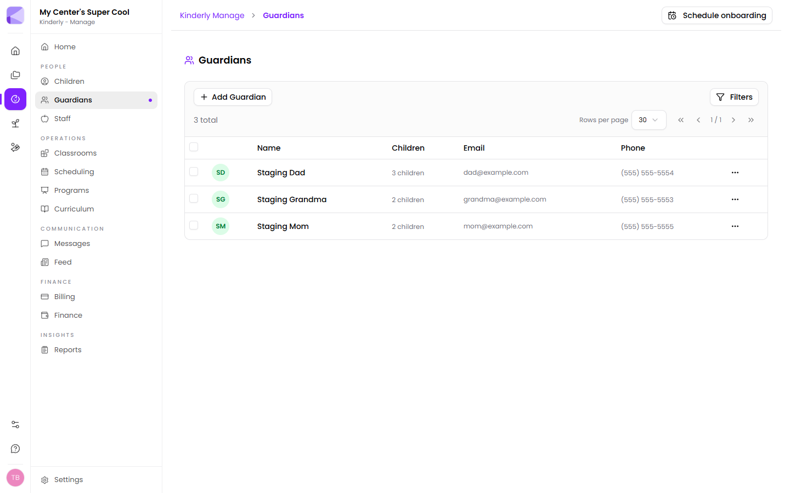

**Guardians & Contacts** holds every adult connected to a child: parents, grandparents, step-parents, childminders, case workers and emergency contacts. Not all of them are guardians, which is why an emergency contact has its own relationship.

**Manage → Guardians & Contacts** lists them with their name, how many children they're attached to, email and phone.

- **Add Guardian ▾** offers **Add Guardian** to type the details in, or **Scan Document** to [scan a paper form](/manage/scan-documents/) and let Ellie add every parent and contact on it, with the child too if the form names one.
- The **search box** filters by name or email as you type, and **Filters** narrows the list further (below).
- Tick several people to upload documents to them or [print a sheet for each](/manage/print-sheets/).

### Filters

| Filter | Shows adults who… |
|---|---|
| **Child's classroom** | have a child in any of the picked classrooms |
| **Relationship** | are linked to a child as, for example, an *Emergency Contact* or *Grandparent* |
| **Role** | are a primary contact, can pick up, or can't pick up |
| **Parent app** | have, or haven't, set up the [Parents app](/mobile/parent-app/) |
| **Billing** | pay a billing account, or don't |
| **Missing information** | have no email, no phone, no address, or no linked children |
| **Status** | are active (the default) or archived |

:::tip[Who can't families reach?]
*Missing information → No email* shows exactly who won't get messages or Parents-app invitations.
:::

## A guardian's page

Alongside their details, a guardian's page has **Print Sheet**, a [one-page sheet](/manage/print-sheets/) about them, and **Scan Document**. Scan Document reads a form about this person and shows what it says next to what's on file, so you can tick which details to update.

## Guardians and children are many-to-many

One guardian can be attached to several children, and one child can have several guardians. That's how siblings and blended families work: a grandparent attached to two children appears once, listed against both.

:::tip[Attach, don't duplicate]
When a second child from the same family enrols, attach the existing guardian rather than creating a new one with the same details. Duplicates mean two copies of a phone number to keep current, two entries in the pickup list, and messages that go to only half the family.
:::

## Per-child settings

The relationship, **Primary** flag and **Can Pick Up** flag are set on the *link* between a guardian and a child, not on the guardian. A grandmother can be authorised for pickup for one grandchild and not another.

- **Relationship**: Mother, Father, Parent, Guardian, Grandparent, Aunt, Uncle, Sibling, Case Worker, **Emergency Contact** or Other.
- **Primary**: the main contact for that child.
- **Can Pick Up**: authorised to collect.

**Can Pick Up is on by default** for everyone you link, whether added by hand, in the staff app, by spreadsheet import or from a scan. Untick it for anyone who mustn't collect the child.

**Every child has exactly one Primary, automatically.** The first adult linked becomes primary. Marking someone else primary moves it to them, and unlinking the primary hands it to the next adult. You never end up with two primaries or none.

:::note[Emergency contacts aren't family]
Two children who share only an emergency contact or a case worker aren't shown as siblings.
:::

## What guardians can do

A guardian's email address is their route into the [Parents app](/mobile/parent-app/), where they can see their child's day, receive [messages](/manage/messages/) and read the [feed](/manage/feed/).

It's also what appears in the recipient picker when you [send a share](/shares/sending/) — the reason picking from your center is safer than typing an address.

:::caution[The email address is load-bearing]
It's the app login, the share recipient, and where notifications go. A typo doesn't produce an error — it produces a parent who quietly never hears from you. Worth checking at enrollment.
:::

## Billing

Guardians can hold a [billing account](/manage/billing/). An account can have more than one holder, so both parents can see and pay the same invoices.

## Next

- [Children](/manage/children/) — the records guardians attach to.
- [Scan a document](/manage/scan-documents/) — add a family from their paperwork.
- [Messages](/manage/messages/) — talking to families.
