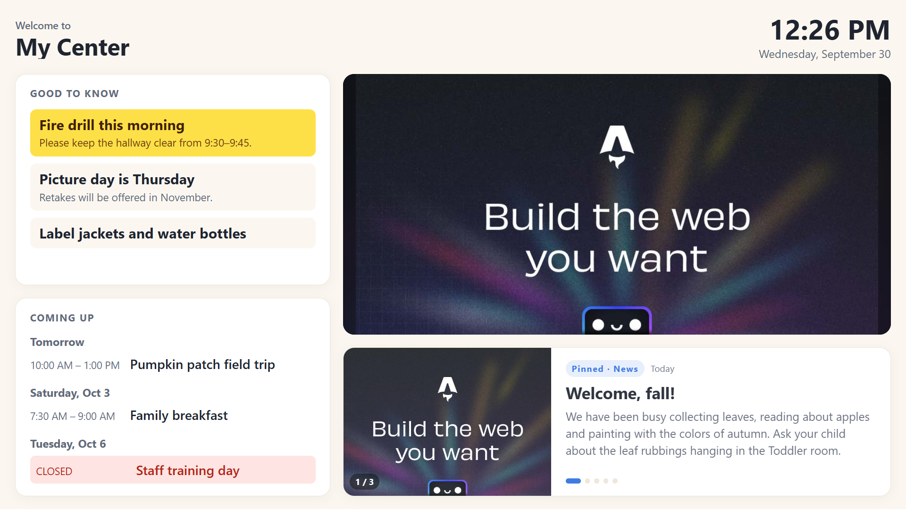
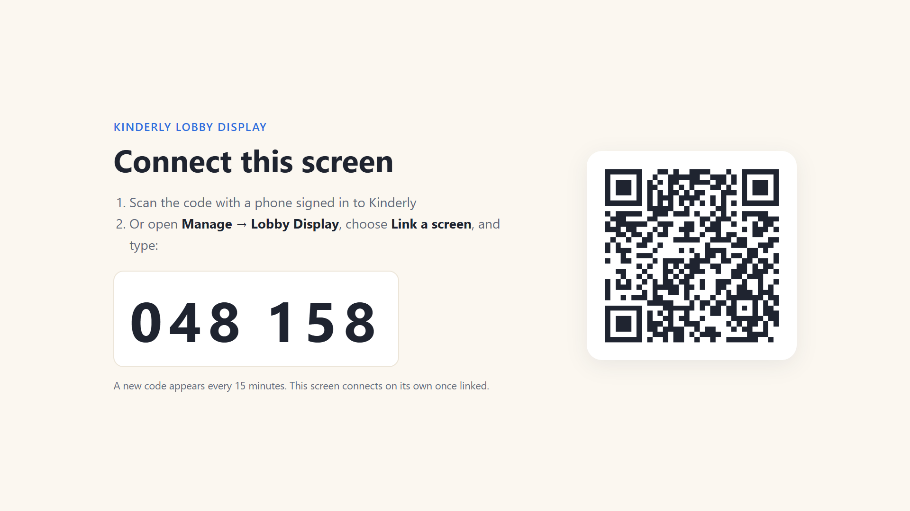

**Lobby Display** turns any TV with a web browser into a noticeboard for your lobby. Families see it as they come and go, so it's built to be read in passing: big type, one thing at a time, nothing to scroll.

A screen shows up to six things:

| Panel | What it shows | Where it comes from |
|---|---|---|
| **Good to know** | Short notices for today or this week, important ones first and highlighted in yellow | The notices you write on the Lobby Display page |
| **Coming up** | Events and closures for the next two weeks, grouped by day. Closures are marked in red | Events and closures on your [Feed](/manage/feed/) |
| **Photo slideshow** | Your photos, one after another | A folder in your [Documents](/documents/overview/) |
| **Latest news** | Your newest Feed posts, one at a time, pinned posts first. A post with several photos steps through each one, and stays up long enough to show them all | Your [Feed](/manage/feed/) |
| **Today's menu** | Today's meals, with the meal being served now highlighted. Meals already served shrink to one line | Your [Food Program](/manage/food-program/) menu, when the Food Program is on and something is planned for today |
| **Sign in & out** | Your parent sign-in QR code, so families can scan the TV instead of a printed poster | **Parent QR sign-in** in [App Settings](/manage/settings/), when it's turned on |

## It keeps itself up to date

You don't have to do anything on the TV after setup. The screen checks in about every 30 seconds and picks up any change: a new post, an edited event, a notice that starts today, a photo you added. Changes usually show up within a minute.

If the internet drops, the screen keeps showing the last information it had, with a small *Reconnecting* note in the corner, and catches up when the connection comes back. Once a night it also refreshes itself, so it always has the latest version of Kinderly.

## Connecting a TV

You need a TV or monitor with a web browser, either a smart TV or a small computer plugged into one.

1. On the TV, open **mykinderly.com/lobby** in the web browser. It shows a 6-digit code and a QR code.
2. Link it, either way:
   - **Scan the QR code** with a phone that's signed in to Kinderly, or
   - go to **Manage → Lobby Display**, choose **Link a screen**, and type the code.
3. Name the screen (for example *Front lobby*), or choose an existing screen if you're replacing a TV.

Within a few seconds the TV switches over to your lobby display. It remembers the link, so after a power cut or a restart it goes straight back to your display.

:::tip[Set the browser to open at startup]
Most smart TVs and small computers can open a web page when they turn on. Set it to open **mykinderly.com/lobby** and make it full screen. That way the display comes back on its own every morning.
:::

Codes last 15 minutes. If one runs out, the TV shows a new one.

## Today's menu

If you run the [Food Program](/manage/food-program/) and have planned meals for today, the screen shows **Today's menu** next to the latest news. Foods use the same icons and colors as your printed menu. The meal being served right now is highlighted, or the next one between meals. Meals already served shrink to one line so families can still see what their child ate.

The screen shows what families need, the food, and nothing else. Meal-pattern checks and portion sizes stay in the Food Program. If a food was swapped on the day, the screen shows what was actually served, marked *(changed)*.

The menu appears on its own when the Food Program is on and disappears on days with nothing planned. It uses your meal names and times from Center Configuration.

## Sign in & out from the TV

If you've turned on **Parent QR sign-in** in App Settings, every lobby screen shows the same QR code as the printed poster, in the bottom corner. Parents open the Kinderly Parent app, tap **Sign in / out**, and scan the TV, so you don't need the paper poster. Turn QR sign-in off and the code leaves the screen within a minute.

The code is safe to show in a public lobby. Scanning it does nothing unless the person is signed in to the parent app as a guardian at your center.

## Choosing what each screen shows

On **Manage → Lobby Display**, each screen has **Settings**:

- **Screen name**, so you can tell your screens apart
- **Which panels to show.** Turn off any of the four. The rest fill the space
- **Seconds per photo** in the slideshow
- **Days of calendar to show**, two weeks by default
- **Photo folder**, the Documents folder the slideshow uses

The dot next to each screen is green when it's on and connected. Otherwise it shows when the screen was last seen, which is handy for spotting a TV that has been unplugged.

## Adding photos

Choose **Photos** on a screen to see its slideshow and **Add photos**. They're saved to the screen's folder in Documents (*Lobby Photos* unless you chose another), so you can also find them there. JPEG, PNG, WebP and GIF photos work.

:::caution[Upload slideshow photos from the Lobby Display page]
Photos you upload through the Documents page are turned into PDFs so they can be signed and shared, and a TV can't show a PDF. Add slideshow photos with **Add photos** on the Lobby Display page, which keeps them as pictures.
:::

The lobby is a public space. Only use photos of children whose families have agreed to them being displayed.

## Notices

**Good to know** notices are for things that matter this week: *Picture day Thursday*, *Please label water bottles*, *Fire drill at 9:30*. Keep them short, because people read them walking past.

- Give a notice **Show from** and **Show until** dates and it appears and disappears on its own. Leave them blank to keep it up until you delete it.
- Mark a notice **Important** to pin it at the top, highlighted in yellow. Important notices always stay in view.
- When there are more notices than fit, the rest scroll slowly down and back up on their own, pausing at each end, so every notice gets its turn on screen.

Notices appear on every screen at your center.

## Disconnecting a screen

**Disconnect** stops a screen straight away. Within a minute the TV goes back to showing a pairing code, and its old link never works again. Use it when you replace a TV, or if a screen's link has been shared somewhere it shouldn't be.

:::note[Who can see a lobby screen]
A lobby screen shows what you already share with every family: your Feed, your events calendar, your notices and the photos in the folder you chose. It never shows anything about an individual child. Anyone with a screen's link can see it, so treat the link like a key and disconnect a screen you no longer use.
:::
