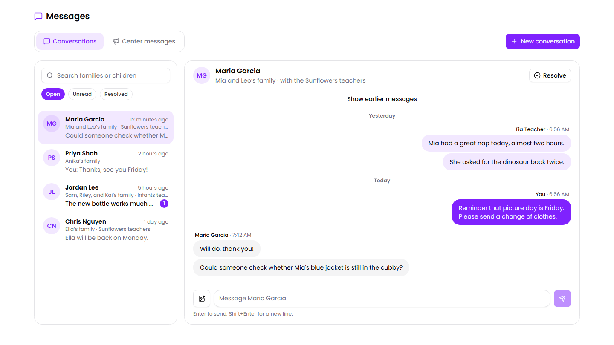

Messages is for talking *to* families. For things everyone should see, use the [Feed](/manage/feed/).

## Conversations

The left-hand panel lists your conversations, newest first. Search by a parent's, child's or classroom's name, or choose **Open**, **Unread** or **Resolved**. **New conversation** starts one. Click a parent's name at the top of a conversation to open their profile.

Families reply from the [Parents app](/mobile/parent-app/), so it's a proper two-way thread rather than a send-only channel. Staff can write here or from the [Teacher app](/mobile/teacher-app/), and it's the same conversation in both.

### Writing a message

Type and press **Enter** to send. **Shift+Enter** starts a new line. The family is notified, and sees your name.

- **Add photos** with the picture button, by dragging them onto the conversation, or by pasting. Up to 10 at once. Your words go with the first photo, and the family gets one notification.
- **Cover a face** before you send: click the smiley button on a photo, pick an emoji and drag it over the face. Use the **Size** slider or your scroll wheel to resize it, then **Save photo**. Only the covered photo is sent.
- If something doesn't send, your message and any photos left stay put so you can try again.
- A message you haven't sent stays with that family while you look at others, and the list shows **Draft not sent**. Leaving Messages discards it.
- You don't need a staff profile to write. Without one, messages carry the name on your login.

:::note[iPhone photos]
Photos saved as HEIC can't be opened by most browsers. Save them as JPEG first, or send them from the Teacher app.
:::

### Letting parents write first

By default staff start every conversation. Turn on **Parents can message teachers** under **Settings → App Settings → Parent App**, and a parent can start one with the teachers in their child's classroom.

- It's one conversation per family per classroom, shown with the classroom, as in **Mia’s family · Sunflowers teachers**. The teachers assigned to that room and the administrators see it. Teachers in other rooms don't.
- Center messages, and conversations a director starts, stay separate from it.
- Family only: emergency contacts and case workers can't start one. A room with no teachers assigned isn't offered.
- Turning it off stops new conversations. Ones a staff member has already answered carry on.

:::tip[Resolve threads you've finished with]
Resolved isn't deleted — it's "dealt with". Working through an inbox of genuinely open conversations is manageable; scrolling past three months of settled ones to find today's question isn't.
:::

## Center messages

The **Center messages** tab broadcasts to multiple guardians at once. Use it for something several families need but not everyone — one classroom, or the children on a particular trip.

:::note[Three ways to reach families, for three different jobs]
- **Conversation** — one family, needs a reply
- **Center message** — some families, no reply expected
- **[Feed](/manage/feed/)** — everyone, stays visible
:::

:::caution[A broadcast is a poor way to ask a question]
Replies to a broadcast come back as individual threads. Send one to sixty families asking them to confirm something and you've made sixty conversations for yourself. For anything needing a response from every family, send a [form](/forms/overview/) instead — the answers arrive collated.
:::

## Choosing the right channel

| You want to… | Use |
|---|---|
| Answer one parent's question | Conversation |
| Tell one classroom about a trip | Center message |
| Announce a closure | [Feed](/manage/feed/) closure post |
| Share photos of the day | [Feed](/manage/feed/) post |
| Collect a reply from every family | [Form](/forms/overview/) |

## Next

- [Feed](/manage/feed/) — the center noticeboard.
- [Parent app](/mobile/parent-app/) — where families read and reply.
