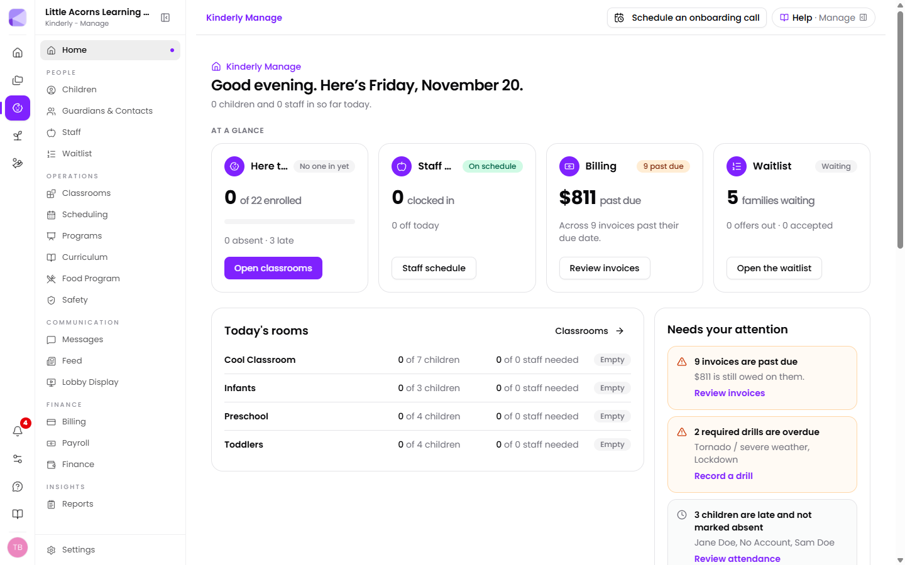
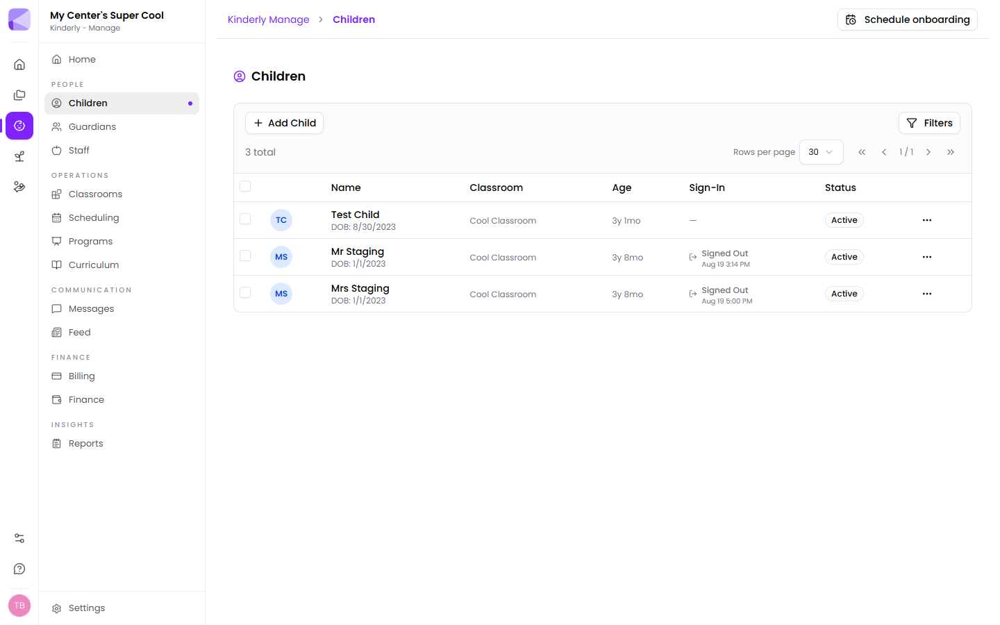

Where [Enroll](/forms/overview/) handles getting families in, **Manage** is everything after: who's in your care, who looks after them, when they're here, what you charge, and what you have to report.

## The Manage home page

**Home**, at the top of the menu, is the day at your center on one screen.

- **At a glance**: four cards. **Here today** (children signed in out of those enrolled, with absences and late arrivals), **Staff working** (who's clocked in and who's off), **Billing** (what's past due, across how many invoices) and **Waitlist** (families waiting, offers out and accepted). Each has a button straight into that screen.
- **Today's rooms**: every classroom with the children signed in and the staff its ratio needs for them right now, so a room that's short shows up before anyone has to count heads.
- **Out today** and **Tours & follow-ups**: who's absent, and the tours and follow-ups on your [pipeline](/grow/pipeline/) coming up.
- **Needs your attention**: the things that need someone to act. Past-due invoices, overdue or upcoming [drills](/manage/safety/), incident reports waiting on a parent or on licensing, staff certifications expired or expiring, children with no immunization records, children late and not marked absent, waitlist offers accepted or about to expire. Each row links to the fix. When there's nothing, it says you're all caught up.
- **Your center**: counts of children, guardians, staff, classrooms and programs, each a link to its list.
- **Pinned reports**: any [reports you've pinned](/manage/reports/), so the numbers you check every week are already open.

## The menu

The left-hand menu groups the rest into five areas.

## People

- **[Children](/manage/children/)** — the child record: demographics, medical, family, billing, documents and attendance.
- **[Guardians & Contacts](/manage/guardians/)** — parents, caregivers, emergency contacts and anyone else attached to a child.
- **[Staff](/manage/staff/)** — your team, their roles and their hours.

All three lists can [scan a paper form](/manage/scan-documents/) to add someone, and [print sheets](/manage/print-sheets/) for anyone you select.

## Operations

- **[Classrooms](/manage/classrooms/)** — rooms, who's in them, and staffing.
- **[Scheduling](/manage/scheduling/)** — staff shifts, children's expected days, and room transitions.
- **[Programs](/manage/programs/)** — what you offer and what it costs.
- **[Curriculum](/manage/curriculum/)** — learning frameworks and observation records.

## Communication

- **[Messages](/manage/messages/)** — conversations with families, in words or photos, and center-wide broadcasts. You can let parents write first.
- **[Feed](/manage/feed/)** — your center's noticeboard: news, announcements, events and closures.

## Finance

- **[Billing](/manage/billing/)** — charging families, invoices and balances, and [holding invoices to review](/manage/billing/#reviewing-invoices-before-they-go-out) before they go out.
- **[Finance](/manage/finance/)** — your own operating spend, receipts and budgets.

:::note[Two different money screens]
**Billing** is money coming *in* from families. **Finance** is money going *out* to run the center. They're deliberately separate and don't feed into each other.
:::

## Insights

- **[Reports](/manage/reports/)** — pre-built and custom reports across attendance, health, curriculum, CACFP and finance.

## Setting up

**Settings** at the bottom of the menu covers the center itself — name, address, hours, ratios, allergy and immunization lists, custom fields. Get these right before adding children; several of them shape what a child's record can hold. See [Settings](/manage/settings/).

:::tip[Set up in this order]
1. **Settings** — center info, hours, ratios, allergy and immunization lists
2. **Classrooms** — the rooms you actually run
3. **Staff** — your team, assigned to rooms
4. **Programs** — what you offer and what it costs
5. **Children and guardians** — last, so there's something to slot them into

Adding children first means going back over every record to assign rooms and programs afterwards.
:::

## Onboarding help

**Schedule an onboarding call**, top-right on every Manage screen, books a session with the Kinderly team. **Settings → Center Configuration → Launch Setup Wizard** walks you back through the basics on your own. See [Setup wizard](/manage/settings/#setup-wizard).

## Next

- [Settings](/manage/settings/) — configure your center first.
- [Children](/manage/children/) — the heart of the system.
