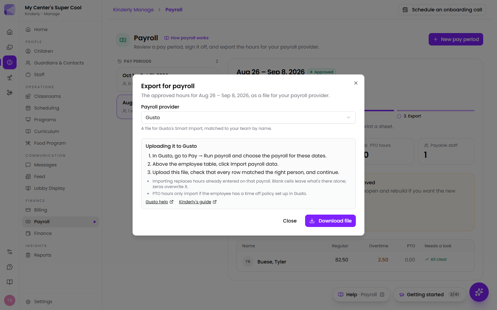

Once a [pay period](/manage/payroll/) is approved, **Export for payroll** downloads
the hours in the format your payroll provider imports, so you don't have to retype
them. Kinderly makes the file. You upload it in your payroll provider.

| Provider | What you get | Matches people by |
| --- | --- | --- |
| [Gusto](#gusto) | A file for Smart Import | Name |
| [QuickBooks Online Payroll](#quickbooks-online-payroll) | A file for **Add from file** | Name |
| [ADP RUN](#adp-run) | A Time Sheet Import file | ADP employee id or time clock id |
| [Paychex Flex](#paychex-flex) | A Standard Payroll Import (SPI) file | Paychex worker id |
| [Square Payroll](#square-payroll) | An entry sheet to type from (Square takes no file) | — |
| [Another provider](#another-provider) | A plain CSV of every figure | Your choice |

## Exporting

1. Open the pay period in **Manage → Payroll** and approve it. The track above
   the figures moves on to **Export**.
2. Click **Export for payroll** at the top of the period and pick your
   **Payroll provider**. Kinderly remembers your choice for next time.
3. For ADP or Paychex, enter your company or client code and each person's id the
   first time. Kinderly remembers them.
4. Click **Download file** (**Download entry sheet** for Square). Above the button,
   the dialog shows your provider's steps, with links to the provider's help and
   to this page. The same steps are below.

:::note[Only approved periods export]
Export appears once a period is approved, and stays available afterwards. The file
holds the hours as you approved them, even if attendance has changed since. If the
"Attendance has changed" banner is showing, reopen the period, rebuild it and
approve it again before exporting.
:::

**Salaried staff are left out of every file.** Their pay isn't based on hours, and
the dialog says how many were left out. Only regular, overtime and PTO hours are
exported. Pay rates, bonuses, tips and deductions stay with your payroll provider.

## Gusto

The file has **First Name**, **Last Name**, **Regular Hours**, **Overtime Hours** and
**PTO Hours** columns, which Gusto's Smart Import matches to your team by name.

1. In Gusto, go to **Pay → Run payroll** and choose the payroll for the same dates.
2. Above the employee table, next to **Filter** and **Columns**, click
   **Import payroll data**.
3. Click **Upload** (or drop the file in), check that each row matched the right
   person, and continue.

Things to know:

- **Importing replaces hours already on that payroll.** A blank cell leaves what's
  there alone, but a zero overwrites it. Kinderly leaves overtime and PTO blank
  when someone has none, so PTO you typed into Gusto yourself isn't wiped.
- **PTO only imports if the employee has a time off policy in Gusto.**
- Names must match Gusto's spelling. If someone doesn't match, fix the name in
  Kinderly or pick the person in Gusto's review step.
- If a date is outside the pay period, or doesn't line up with your Gusto workweek
  settings, Gusto asks you to fix it before importing.

Gusto's guide: [Run payroll with Smart Import](https://support.gusto.com/article/999914471000000/Run-payroll-with-Smart-Import).

## QuickBooks Online Payroll

The file has **Employee**, **Regular Pay**, **Overtime Pay** and **Paid Time Off**
columns. QuickBooks matches each name to an employee and each column to a pay type.

1. In QuickBooks, go to **Payroll → Run payroll**.
2. Choose **Add from file** and upload the file.
3. If QuickBooks asks you to match a name to an employee, or a column to a pay
   type, do that. Then check the draft and finish payroll as usual.

Things to know:

- **Add from file needs QuickBooks Workforce Premium or Elite**, and Intuit is
  still rolling it out. On Core, or if you don't see the option, open the file and
  type the hours into each paycheck.
- The file must only include employees on **one pay schedule**. If you run two
  schedules, export each group's period separately.
- **QuickBooks silently skips employees whose profiles aren't finished.** Check
  that everyone is on the draft before you approve it.
- Deductions, contributions, garnishments and new employees can't be added from a
  file. Enter those in QuickBooks.

Intuit's guide: [Import payroll hours from a spreadsheet](https://quickbooks.intuit.com/learn-support/en-us/help-article/run-payroll/import-payroll-hours-spreadsheet/L4V0J4kCn_US_en_US).

## ADP RUN

The file is ADP's Time Sheet Import layout: a `##GENERIC## V1.0` line, a heading
row, then one row per person for each earnings code with hours (regular, overtime,
PTO), with pay period dates as MM/DD/YYYY.

**Before your first export,** gather:

- **Your company code.** ADP gives you this; it's sometimes called the IID.
- **Each employee's id in RUN** (the file number or employee id). If you've set up
  time clock ids in RUN's **Employee Time Clock ID Entry** page, choose
  **Time clock ids** in the dialog and use those instead.
- **Your earnings codes.** Kinderly starts with REG, OT and PTO. Change them to
  match your company's **Earnings Codes report** in RUN, or those rows won't
  import.
- **Your pay frequency.** One file holds one pay frequency.

To import:

1. In RUN, go to **Payroll Home → Time Sheet Import**.
2. On the **Pay Data Import** page, click **Browse**, choose the file, and click
   **Import Pay Data**.
3. Review the hours on the **Pay Data Approval** page, then click **Approve** to
   open the Payroll Worksheet and finish payroll.

Things to know:

- **ADP has to turn on Time Sheet Import for your company.** If you don't see it,
  ask your ADP representative.
- Finish or delete a pending import before importing another file for the same
  pay frequency.
- Pay rates come from each employee's profile in RUN. The file sends hours only.

Guides: ADP's *Time Sheet Import and RUN Powered by ADP* guide (in RUN's Support
Center, with the template), and a time-clock vendor's
[walkthrough of the RUN import](https://help.payclock.com/Content/Integrations/Setting%20up%20to%20integrate%20and%20export%20to%20ADP%20RUN.htm).

## Paychex Flex

The file is Paychex's Standard Payroll Import (SPI) layout: **Client ID**,
**Worker ID**, **Org**, **Job Number**, **Pay Component**, **Rate**,
**Rate Number**, **Hours**, **Units**, **Line Date**, **Amount**,
**Check Seq Number**, with one row per person per pay component. Rate and Amount
are left blank so Flex uses each employee's rate.

**Before your first export,** gather:

- **Your Paychex client id.**
- **Each employee's worker id**, found under **People** in Flex. Up to 10 letters
  and numbers, and it must match Flex exactly.
- **Your pay component names.** Kinderly starts with Hourly, Overtime and PTO.
  Change them to the names your Flex account uses. Your Paychex specialist can
  give you the list.

To import:

1. In Paychex Flex, start the payroll for the same dates.
2. In the **Import Pay Period** panel, click **Browse Files** and choose the file.
3. Process the file, check the hours, then submit from the **Start Payroll** panel.

Things to know:

- **Your payroll must be set to submit by "Online and Import."** If you don't see
  Import Pay Period, ask your Paychex specialist to turn on Standard Payroll
  Import.
- **One bad row fails that person's whole check**, such as a worker id that
  doesn't match, or a pay component the employee doesn't have. Fix it and import
  again.
- You can import more than one file per pay period, but each must finish
  processing before the next.

Paychex's guide: [Import Pay Period](https://myapps.paychex.com/pngHelp_static/helpHtml/Import_Pay_Period.htm).

## Square Payroll

**Square Payroll doesn't import hours from a file.** It only imports from Square's
own timecards or an approved timecard app. So for Square, Kinderly downloads an
**entry sheet** with the columns in the same order as Square's pay run:
**Team member**, **Reg Hours**, **Overtime**, **PTO**. Open it next to Square and
type the numbers across.

1. In the Square Dashboard, go to **Staff → Payroll → Run payroll**.
2. Select **Pay employees → Regular payroll → Start run**, and confirm the pay
   period and pay date.
3. For each person, type **Reg Hours** and **Overtime** from the sheet.
4. For PTO, click **+** next to **Gross Pay**, choose **PTO**, and enter the hours.
5. Review and submit the run.

:::caution[Don't also click "Import time and wages"]
That button pulls in hours from Square timecards. If your team clocks in with
Kinderly rather than Square, it would add Square's hours on top of the ones you
typed, or replace them.
:::

Square's guide: [Run payroll for W-2 employees](https://squareup.com/help/us/en/article/5608).

## Another provider

**Another provider (CSV)** downloads one row per payable person: **Last Name**,
**First Name**, **Payroll ID**, **Period Start**, **Period End**, **Regular Hours**,
**Overtime Hours**, **PTO Hours** and **Unpaid Hours**. Use it with OnPay,
Paycor, Heartland, a bookkeeper, or anything else that takes a spreadsheet of
hours. Payroll ID is filled in for anyone you've given one, since most providers
match people by id. Map these columns to your provider's import, or send the file
to whoever runs payroll.

## If an import fails

- **A person didn't match.** For Gusto and QuickBooks, check their name is spelled
  the same in both places. For ADP and Paychex, check their id in the export
  dialog against the id in the provider.
- **A code or pay component was rejected.** Change it in the export dialog to the
  one your provider uses and download again.
- **The hours look wrong.** Compare with the period in Kinderly. If attendance has
  changed since you approved, reopen, rebuild and approve again, then export.
- **Your provider changed its template.** The provider's own template, downloaded
  from its import screen, is the final word. If the columns differ from what's
  described here, let us know.

## Next

- [Payroll](/manage/payroll/) for opening, checking and approving a pay period.
- [Reports](/manage/reports/) for the Payroll Hours and Employee Time Card reports.
