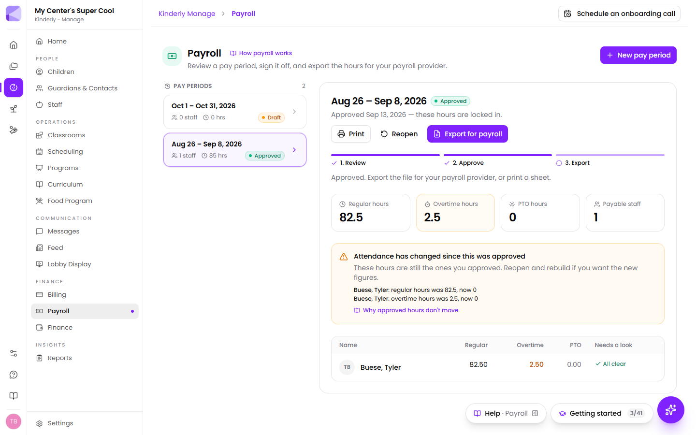
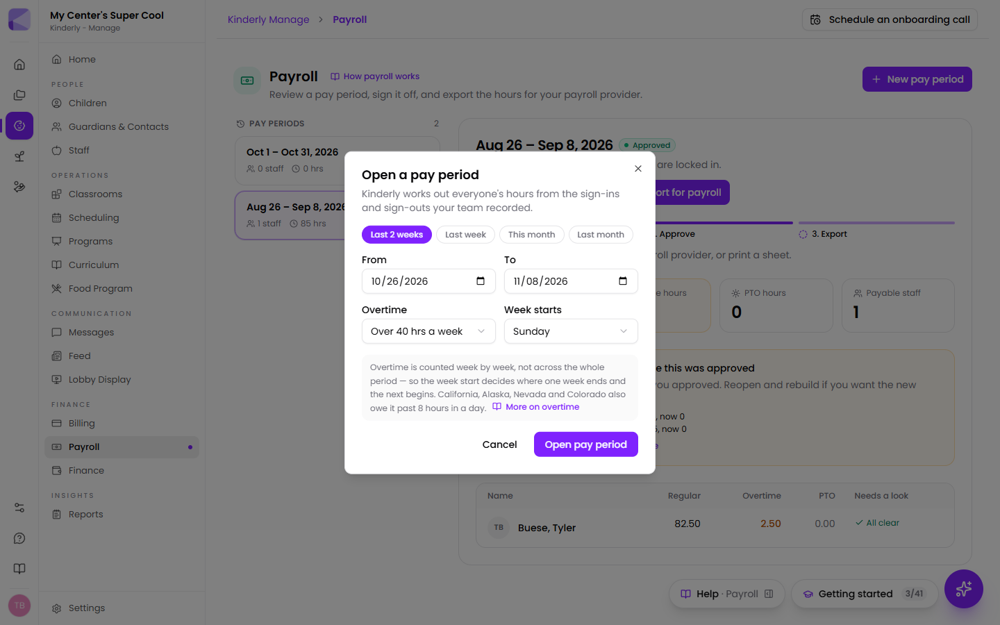

**Manage → Payroll** turns the sign-ins and sign-outs your team already records
into a pay period you can check, approve, and export for whoever runs payroll.

The page has two columns. Your **pay periods** are listed down the left, newest
first. Each card shows the dates, how many staff it covers, the total hours, and a
status: **Draft**, **Approved** or **Sent**. The period you picked opens on the right,
and the most recent one opens on its own when you arrive. On a narrow screen, or
with the help drawer open, the columns stack and the period appears below the list.

## Opening a pay period

1. Click **New pay period** at the top right.
2. Pick a shortcut (**Last 2 weeks**, **Last week**, **This month** or **Last month**)
   or set the **From** and **To** dates yourself.
3. Choose the **Overtime** rule (**Over 40 hrs a week**, or **Also over 8 hrs a day**)
   and the day the **Week starts** on.
4. Click **Open pay period**.

Kinderly works out everyone's hours from attendance and opens the new period.
It remembers the overtime rule and week start for next time.

:::note[Overtime is counted by week, not by pay period]
Two weeks of 30 hours each is 60 hours and no overtime. Counting across the
whole period would invent 20 hours of it. That's why the workweek start day
matters — it decides where one week ends and the next begins.

Federal overtime is over 40 hours a week. California, Alaska, Nevada and
Colorado also owe it past 8 hours in a day: four ten-hour days is exactly 40
hours and still owes 8 hours of overtime there.
:::

## Reading a pay period

At the top of the period are its dates and status, with a line saying where it
stands: a draft's figures still update as attendance changes, while an approved
period's hours are locked in.

Under that, a **Review → Approve → Export** track shows which step you're on, with
a sentence saying what to do next, such as "2 people need a look before you can
approve" or "Everything checks out. Approve to lock these hours in."

Four tiles give the whole period at a glance: **Regular hours**, **Overtime hours**
(highlighted when there is any), **PTO hours** and **Payable staff**.

The table lists each person's **Regular**, **Overtime** and **PTO** hours, with a
**Needs a look** column on the right. People with clean records show **All clear**.
Salaried staff are marked **Salaried — not sent to payroll**: they're listed, but
their pay isn't based on hours, so they're left out of every export.

## Needs a look

Anyone whose records don't add up has the date and the problem listed in the
**Needs a look** column: a missing sign-out, a sign-out with no matching sign-in,
or two sign-ins in a row. Their row is tinted, and a red banner above the table says
how many people need a look before the period can be approved.

**Kinderly counts nothing for these rather than guessing.** A teacher who forgot
to clock out worked an unknown number of hours, and eight is as much a guess as
zero. The difference is that eight looks like a real timecard and gets signed
off.

You have two choices:

1. **Fix the record** in [Attendance](/manage/children/#attendance), then reopen
   the pay period and rebuild it. This is usually right.
2. **Click "I've checked this"** on their row to approve them anyway. A dialog
   lists the problems and asks **What happened?** The note is optional, but use
   it. When you know what happened (someone covered the close and forgot to clock
   out), the note is what you'll be glad of in six months. The row then shows
   **Approved anyway**, with your note beside it.

**Approve** stays greyed out while anyone still needs a look.

## Approving

Once nothing needs a look, click **Approve**. It signs the period off and freezes
the figures. The status changes to **Approved**, with the date, and the track moves
on to **Export**.

:::caution[Approving locks the numbers in — on purpose]
After you approve, editing attendance does **not** change the approved hours.
Instead, an **"Attendance has changed since this was approved"** banner lists each
person whose hours moved, with the approved figure and the new one.

That's deliberate. If the numbers quietly moved after you signed them, what
eventually reached payroll wouldn't be what you approved, and nobody could tell.
If you want the new figures, click **Reopen**, rebuild, and approve again.
:::

Reopening clears the approval — what you signed off was a set of numbers, and
once those can move again the signature doesn't mean anything.

## Getting the hours to payroll

Once a period is approved, **Export for payroll** downloads the hours as a file for
Gusto, QuickBooks Online Payroll, ADP RUN or Paychex Flex, as an entry sheet for
Square Payroll, or as a plain CSV for any other provider. The dialog shows where to
upload it in your provider. See [Payroll exports](/manage/payroll-exports/) for each
provider's steps.

**Print** gives you a sheet of everyone's hours. It works at any stage, including
on a draft you're still reviewing. The **Payroll Hours** report in
[Reports](/manage/reports/) gives you the same figures to key in by hand.

The approval is still worth doing first: it freezes the numbers and records who
checked what, so what reaches payroll is exactly what was signed off.

## Next

- [Payroll exports](/manage/payroll-exports/): the file for your payroll provider, and where it goes.
- [Scheduling](/manage/scheduling/) — where shifts are set.
- [Reports](/manage/reports/) — the Payroll Hours and Employee Time Card reports.
