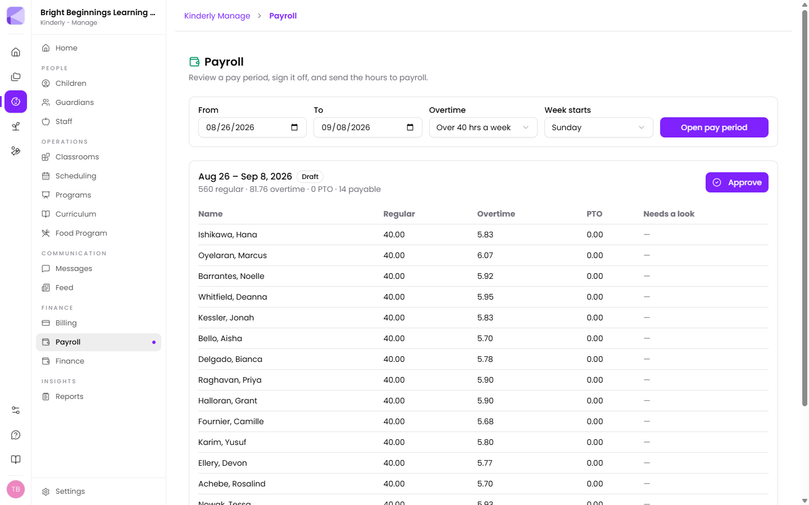

**Manage → Payroll** turns the sign-ins and sign-outs your team already records
into a pay period you can check, approve, and send.

## Opening a pay period

Choose the dates, the overtime rule, and which day your workweek starts on, then
click **Open pay period**. Kinderly works out everyone's hours from attendance.

The summary line under the dates is the whole period at a glance — total regular
hours, total overtime, PTO, and how many people are payable. Each row below is
one person's hours, with anything questionable called out in **Needs a look**.

:::note[Overtime is counted by week, not by pay period]
Two weeks of 30 hours each is 60 hours and no overtime. Counting across the
whole period would invent 20 hours of it. That's why the workweek start day
matters — it decides where one week ends and the next begins.

Federal overtime is over 40 hours a week. California, Alaska, Nevada and
Colorado also owe it past 8 hours in a day: four ten-hour days is exactly 40
hours and still owes 8 hours of overtime there.
:::

## Needs a look

Anyone whose records don't add up appears with a note — a missing sign-out, a
sign-out with no matching sign-in, two sign-ins in a row.

**Kinderly counts nothing for these rather than guessing.** A teacher who forgot
to clock out worked an unknown number of hours, and eight is as much a guess as
zero. The difference is that eight looks like a real timecard and gets signed
off.

You have two choices:

1. **Fix the record** in [Attendance](/manage/children/#attendance), then reopen
   the pay period and rebuild it. This is usually right.
2. **Tick "I've checked this"** to approve anyway, with a note saying why. Use
   this when you know what happened — someone covered the close and forgot to
   clock out — and the note is what you'll be glad of in six months.

You can't approve a pay period while anything is still unchecked.

## Approving

**Approve** signs the period off and freezes the figures.

:::caution[Approving locks the numbers in — on purpose]
After you approve, editing attendance does **not** change the approved hours.
Instead, Kinderly shows you a banner saying what's changed and by how much.

That's deliberate. If the numbers quietly moved after you signed them, what
eventually reached payroll wouldn't be what you approved, and nobody could tell.
If you want the new figures, **Reopen**, rebuild, and approve again.
:::

Reopening clears the approval — what you signed off was a set of numbers, and
once those can move again the signature doesn't mean anything.

## Sending to Gusto

Once a period is approved and [Gusto is connected](/integrations/gusto/),
**Send to Gusto** submits the hours.

Kinderly refuses to send if:

- The period isn't approved, or has already been sent.
- Gusto has already run payroll for those dates. Make that correction in Gusto.
- Anyone hourly isn't matched to a Gusto employee — it names who, and why. It
  won't send everyone else and quietly lose their hours.

Salaried staff appear on the review screen so you can see what they worked, and
are never sent — they aren't paid by the hour.

## What gets sent

Regular hours, overtime hours, and paid leave against a policy you've mapped.
That's all.

Never sent: pay rates, salaries, Social Security numbers, bank details or
addresses. Gusto already holds those and is the right place for them.

Unpaid leave is never sent either — it's absence, not hours worked, and a
payroll system would pay for it.

## Just want the numbers?

If you don't use Gusto, the **Payroll Hours** report in
[Reports](/manage/reports/) gives you the same figures to export or key in
yourself. The approval flow here is still worth using — it's the record of who
checked what.

## Next

- [Gusto](/integrations/gusto/) — connecting it and matching your staff.
- [Scheduling](/manage/scheduling/) — where shifts are set.
- [Reports](/manage/reports/) — the Payroll Hours and Employee Time Card reports.
