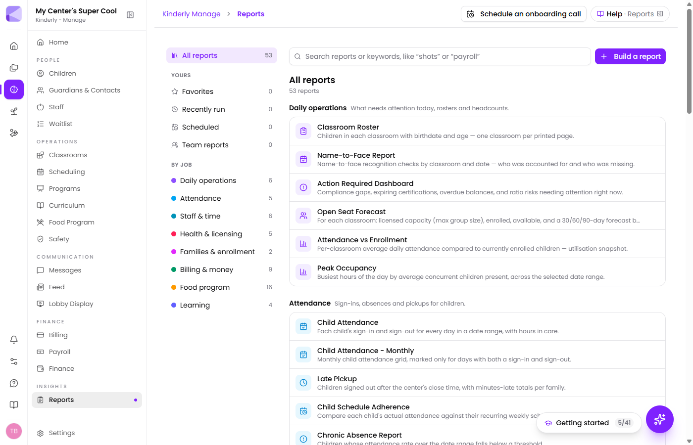

Reports is where the data you've been entering turns into something you can hand to a licensing inspector, a food program auditor, or your accountant.

## Finding a report

The list on the left has two parts.

- **Yours.** **Favorites** are the reports you've starred. **Recently run** is what you opened last, newest first. **Scheduled** lists the reports that arrive by email. **Team reports** are the ones saved for everyone at your center.
- **By job.** Every report sits in one group named after the work it helps with: **Daily operations**, **Attendance**, **Staff & time**, **Health & licensing**, **Families & enrollment**, **Billing & money**, **Food program** and **Learning**.

The search box matches report names and descriptions, and also the words people actually use. "Shots" finds Immunization Compliance, "payroll" finds the time card and hours reports, and "owed" finds Outstanding Billing Balances. When a report turns up because of one of those words, the row says which.

Reports saved from a pre-built report appear in that report's group, marked **Saved from …**. Reports built from scratch appear in the group for what they report on.

## Attendance reports

The largest group. Among them:

| Report | What it gives you |
|---|---|
| **Child Attendance** | One row per child per day: first sign-in, last sign-out and hours in care, with missing sign-outs flagged. Under **Columns** you can add who signed the child in and out, and their signatures |
| **Name-to-Face Report** | Name-to-face checks by classroom and date — who was accounted for, who was missing |
| **Staff Attendance** | One row per staff member per day: first clock-in, last clock-out and hours, with missing punches flagged. **Columns** can add who clocked them in and out |
| **Employee Time Card** | One person's shifts, grouped by week, with regular and overtime totals — the card you print |
| **Payroll Hours** | One line per person for a pay period — regular, overtime and PTO hours, with anything that needs checking flagged |
| **Schedule Adherence** | Actual staff clock times against scheduled shifts, discrepancies flagged |
| **Child Schedule Adherence** | Each child's attendance against their weekly schedule — absences, unscheduled days, off-schedule arrivals |
| **Late Pickup** | Children signed out after close |

:::tip[Name-to-Face is your licensing evidence]
Most inspections want to see that you know which children are physically present, not just enrolled. This report is that evidence, already in the format an inspector expects.
:::

:::note[Overnight shifts now count properly]
If your center runs closing shifts that cross midnight, three reports used to
lose them — **Employee Time Card**, **Staff Hours Summary** and **Overtime
Report**. A 10pm–2am shift showed no hours at all. The Overtime Report was the
worst affected: a week could look like it stayed under the limit purely because
the hours that took it over had gone missing.

That's fixed. A shift now counts in full against the day it started. If you run
closing shifts, re-run any pay period you're unsure about and check it against
what you actually paid.
:::

:::caution[Read Payroll Hours before you run payroll, not after]
It's the report to sign off a pay period from. The **Needs a Look** column is
the point of it: a teacher who forgot to sign out has an unknown number of
hours, so Kinderly counts none and tells you, rather than quietly assuming
eight. Fix those records first, then re-run it.

It also asks which overtime rule you're under. Federal is over 40 hours in a
week. California, Alaska, Nevada and Colorado also owe overtime past 8 hours in
a day — four ten-hour days is exactly 40 hours and still owes 8 hours of
overtime there.
:::

:::tip[Late Pickup is a billing report in disguise]
If you charge late fees, run it monthly and you have the backing for every charge — rather than relying on someone's memory of who was twenty minutes late in the second week.
:::

:::tip[Payment Fees shows where the money went]
**Payment Fees** (under Billing & money) lists every card and bank payment with what the family paid, the payment processor's fee, Kinderly's platform fee and what reached your payout, along with the service fees you collected and the bank discounts you gave. The processor fee is estimated at standard rates; your payout statement has the exact figure. Card and bank payments you recorded yourself appear too, when they carried a service fee.
:::

:::note[Invoice Corrections]
**Invoice Corrections** (under Billing & money) lists every invoice someone [edited by hand](/manage/billing/#editing-an-invoice) in a date range: who changed it, their reason, the total before and after, and any notes recorded on paid invoices. It's the place to review edits, and the only report where notes on paid invoices add up, since they never count toward a balance.
:::

:::tip[Estimated Program Income is your run rate]
**Estimated Program Income** (under Billing & money) shows what your programs bring in each week and each month with the children enrolled today. Each program gets its own section with a row per child, a program total, and a total for all programs at the end. It uses each child's real fees, so discounts, waived fees and custom amounts are counted. Daily and hourly rates are estimated from the last four weeks of attendance.

A child who can't be invoiced (no billing account, a closed account, or no one responsible for paying) is highlighted in red and left out of the totals. The row tells you how much they would add per month. Children who haven't started yet are left out too, with their start date. Tick **Program totals only** for one line per program.
:::

## Health reports

Allergies, immunizations, staff certifications and incidents. **Incident Reports** lists every incident written up on **Manage → Safety** over a date range, with a summary by kind and severity, who still has to sign, and which serious reports haven't been marked as reported to licensing. Filter by classroom, child, kind, severity or status. Click a row to open that report.

## Running a report

Open a report and it runs straight away whenever it can: date ranges start on the current month and filters start on "all". Only a report that must be told something first, like which employees go on a time card, waits for you to press **Run report**. After a run, the settings fold into a single line; press **Change** to open them again.

### Every report looks the same

Whatever the report, the results read the same way, on screen, on paper and in the PDF:

- **The heading** carries your center's name, the report, the period it covers, and who ran it and when.
- **Showing** spells out what it was run for, such as *Classrooms: Toddlers A, Pre-K*, so a printout makes sense on its own.
- **Summary figures** sit above the table: how many children have a severe allergy, how much is past due, how many days are missing a sign-out. Figures that need attention are colored.
- **The table** lines numbers up on the right and shows dates, times and money the same way everywhere. Rows that need a look are highlighted, and statuses show as colored labels.
- **Notes** under the table say how the numbers were counted.
- **The footer** reminds whoever holds the paper when a report contains health, pay or family billing information.

Click a column heading to sort by it (click again to reverse it, a third time to go back). In a report split into sections, such as one classroom per page, rows sort within each section. **Comfortable** and **Compact** change the row spacing. Compact suits the month-long grids.

### Choosing columns

Press **Columns** to tick columns on or off. To reorder them, drag a column by its handle (⋮⋮) or use the up and down arrows. Many reports have more columns than they show at first: a date of birth next to the age, or who signed a child in.

Reports about children or staff also offer **Add a column**, which can bring in anything Kinderly knows about that person. Add the primary guardian's phone and approved pickups to the Classroom Roster for an emergency list. Add a physician to the Allergy report. Add hourly rate or certifications to a staff report.

Your columns are saved for you automatically, so the report opens the same way next time, and **Print**, **Export** and **Schedule** all use them. Columns are personal: arranging them doesn't change the report for anyone else. **Reset to default** puts the report back the way it shipped.

### Saving for your team

Under **⋯**, **Save as team report** saves the settings and columns you're looking at under a name of your choosing. Anyone at your center can run it, schedule it, pin it or delete it. When you change a team report's columns, it shows **Save for everyone** so you can update it for the whole team. **Pin to dashboard** puts the report on your [dashboard](/getting-started/welcome/#the-dashboard) and your [Manage home page](/manage/overview/#the-manage-home-page).

## Custom reports

Beyond the pre-built set there's a **report builder** for questions the standard reports don't answer. Press **Build a report**. It can start from children, guardians, staff, attendance, invoices or expenses; filter on any combination of fields; and group and total the results, with the report redrawing on the same screen as you go. Saved reports appear in the list with everything else and re-run with one click.

See [Building custom reports](/manage/custom-reports/) for a full walkthrough.

:::tip[Save the ones you run monthly]
Board reports, funder returns and licensing packs tend to be the same query every month. Building it once and saving it turns a half-hour job into one click.
:::

## Scheduled reports

Any report — pre-built or one you've saved — can run on its own and arrive by email. Open the report and press **Schedule**, then choose:

- **How often.** Every day, weekdays, weekly on the days you pick, or monthly on a day of the month (or the last day). If you pick the 29th, 30th or 31st, a month too short for it gets its copy on its last day instead.
- **At what time.** In your center's own time zone, in half-hour steps.
- **What each copy covers.** For reports with dates, pick a period such as *Yesterday*, *Last week (Sunday to Saturday)* or *Last month*. It's worked out fresh every time the report runs, so Monday's copy always covers the week that just ended. A new schedule starts on the period that has just finished, which is usually what you want.
- **Who gets it.** Anyone on your team. Reports can't be sent to addresses outside your team.
- **Attach as.** A PDF, a spreadsheet (CSV), or both — the same files **Export** gives you.

Any filters you've set on the report, such as classrooms, are kept for every run, and so are your columns.

Your schedules are listed under **Scheduled** on the Reports screen, with when each runs next. From there you can **Run and send now** to check one, edit it, pause it or delete it. **Past reports** lists every copy a schedule has sent, so you can open last month's again without asking anyone to forward it. Kinderly keeps the most recent 120 copies of each schedule.

:::tip[If a scheduled report doesn't arrive]
The person who set up the schedule gets an email whenever a run fails, saying why — for example, if the saved report it runs was deleted. The failed run also shows in **Past reports**. If whoever set up a schedule leaves your team, it pauses; resume it to take it over.
:::

## Favorites

Hover over a report and press its star to add it to **Favorites**. Team reports can be starred too. Stars are personal: starring a report doesn't change what anyone else sees.

## CACFP

If you claim under the USDA food program, this is the largest group after Attendance — sixteen reports. They draw on the [Food Program](/manage/food-program/) screens and the food program fields on each [child's record](/manage/children/#info), so they're only as good as those: a child without a program type set won't appear correctly.

### The ones a review asks for

| Report | What it gives you |
|---|---|
| **CACFP Meal Counts** | Point-of-service counts by meal type and food program type. This is the claim |
| **CACFP Menu Production Record** | The menu of record for each day and meal, with substitutions and planned servings. Required at review |
| **CACFP Edit Checks** | Every meal-pattern and claim finding for a date range, most severe first. Run it before filing |
| **CACFP Eligibility Roster** | Each child's type, determination basis and income form expiry, soonest first |
| **CACFP Substitutions** | Every substitution served, with its reason — an undocumented substitution is a disallowance |
| **CACFP Attendance Reconciliation** | Counts against attendance in both directions: over-claims, *and* meals served but never counted |
| **CACFP Infant Feeding Record** | Infant meals by child and date with milk source — reviewed and disallowed separately |
| **CACFP Milk Audit** | Milk the counts required against milk bought in Finance. A standard review procedure, and cheap arithmetic to lose a month to |

Most of these are also bound into the one-click [audit packet](/manage/food-program/#the-audit-packet) on the Food Program's Reports & claim tab, which is usually the faster way to produce them together.

### Filing and money

| Report | What it gives you |
|---|---|
| **CACFP Claim Summary** | The month's workbook: meals by type and eligibility, rates applied, amount claimed — what gets keyed into the state portal |
| **CACFP Sponsor Submission** | The monthly package a family child care home sends its sponsor: tier, daily counts, enrollment, eligibility and own-children evidence |
| **CACFP Food Cost per Meal** | Food spend from [Finance](/manage/finance/) against meals served and reimbursement earned. Answers whether the food program pays for itself |

### Day-to-day and paper

| Report | What it gives you |
|---|---|
| **CACFP Daily Meal Count Sheet** | Printable per-child count grid for a month — the paper backup when a tablet fails |
| **CACFP Meal Point of Service** | Per-child meal attendance pivoted by day and meal, grouped by classroom, one classroom per printed page |
| **CACFP Meal Point of Service (Monthly)** | The same pivoted across a month, one row per meal |
| **CACFP Food Program Overview** | Each child's USDA type and income form dates by classroom, with totals by type |

:::caution[One report is an estimate, and says so]
**CACFP Meal Totals (Estimated from Attendance)** infers meals from attendance overlapping each meal window. It's useful for a sanity check or a gap you're reconstructing — it is **not** a substitute for point-of-service counts, and shouldn't be used to build a claim. Use **CACFP Meal Counts** for that.
:::

## Next

- [Children](/manage/children/) — where most report data originates.
- [Food Program](/manage/food-program/) — where the CACFP data comes from.
- [Finance](/manage/finance/) — spend reporting.
