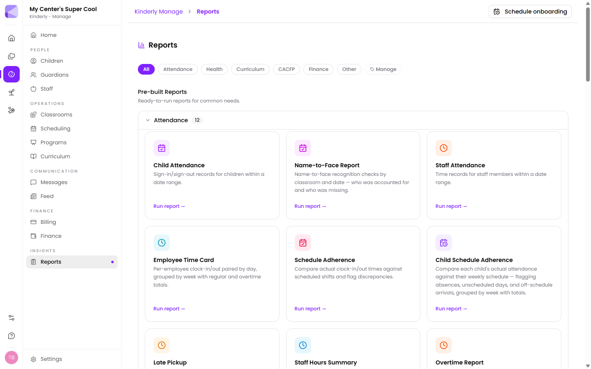

Reports is where the data you've been entering turns into something you can hand to a licensing inspector, a food program auditor, or your accountant.

## Categories

Reports are grouped as **Attendance**, **Health**, **Curriculum**, **CACFP**, **Finance**, **Other** and **Manage**, with **All** showing everything.

## Attendance reports

The largest group. Among them:

| Report | What it gives you |
|---|---|
| **Child Attendance** | Sign-in/sign-out records over a date range |
| **Name-to-Face Report** | Name-to-face checks by classroom and date — who was accounted for, who was missing |
| **Staff Attendance** | Staff time records over a date range |
| **Employee Time Card** | One person's shifts, grouped by week, with regular and overtime totals — the card you print |
| **Payroll Hours** | One line per person for a pay period — regular, overtime and PTO hours, with anything that needs checking flagged |
| **Schedule Adherence** | Actual staff clock times against scheduled shifts, discrepancies flagged |
| **Child Schedule Adherence** | Each child's attendance against their weekly schedule — absences, unscheduled days, off-schedule arrivals |
| **Late Pickup** | Children signed out after close |

:::tip[Name-to-Face is your licensing evidence]
Most inspections want to see that you know which children are physically present, not just enrolled. This report is that evidence, already in the format an inspector expects.
:::

:::note[Overnight shifts now count properly]
If your center runs closing shifts that cross midnight, three reports used to
lose them — **Employee Time Card**, **Staff Hours Summary** and **Overtime
Report**. A 10pm–2am shift showed no hours at all. The Overtime Report was the
worst affected: a week could look like it stayed under the limit purely because
the hours that took it over had gone missing.

That's fixed. A shift now counts in full against the day it started. If you run
closing shifts, re-run any pay period you're unsure about and check it against
what you actually paid.
:::

:::caution[Read Payroll Hours before you run payroll, not after]
It's the report to sign off a pay period from. The **Needs a Look** column is
the point of it: a teacher who forgot to sign out has an unknown number of
hours, so Kinderly counts none and tells you, rather than quietly assuming
eight. Fix those records first, then re-run it.

It also asks which overtime rule you're under. Federal is over 40 hours in a
week. California, Alaska, Nevada and Colorado also owe overtime past 8 hours in
a day — four ten-hour days is exactly 40 hours and still owes 8 hours of
overtime there.
:::

:::tip[Late Pickup is a billing report in disguise]
If you charge late fees, run it monthly and you have the backing for every charge — rather than relying on someone's memory of who was twenty minutes late in the second week.
:::

:::tip[Payment Fees shows where the money went]
**Payment Fees** (under Finance) lists every card and bank payment with what the family paid, the payment processor's fee, Kinderly's platform fee and what reached your payout, along with the service fees you collected and the bank discounts you gave. The processor fee is estimated at standard rates; your payout statement has the exact figure. Card and bank payments you recorded yourself appear too, when they carried a service fee.
:::

## Running a report

Pick a report, set the date range and any filters, and **Run report**.

## Custom reports

Beyond the pre-built set there's a **report builder** for questions the standard reports don't answer. It can start from children, guardians, staff, attendance, invoices or expenses; filter on any combination of fields; and group and total the results. Saved reports re-run from this screen with one click.

See [Building custom reports](/manage/custom-reports/) for a full walkthrough.

:::tip[Save the ones you run monthly]
Board reports, funder returns and licensing packs tend to be the same query every month. Building it once and saving it turns a half-hour job into one click.
:::

## Favorites

The star on a report card pins it to a **Favorites** section at the top of this screen. Stars are personal — starring a report doesn't change what anyone else sees. There's also a search box that looks across both the pre-built and saved reports.

## CACFP

If you claim under the USDA food program, this is the largest group after Attendance — sixteen reports. They draw on the [Food Program](/manage/food-program/) screens and the food program fields on each [child's record](/manage/children/#info), so they're only as good as those: a child without a program type set won't appear correctly.

### The ones a review asks for

| Report | What it gives you |
|---|---|
| **CACFP Meal Counts** | Point-of-service counts by meal type and food program type. This is the claim |
| **CACFP Menu Production Record** | The menu of record for each day and meal, with substitutions and planned servings. Required at review |
| **CACFP Edit Checks** | Every meal-pattern and claim finding for a date range, most severe first. Run it before filing |
| **CACFP Eligibility Roster** | Each child's type, determination basis and income form expiry, soonest first |
| **CACFP Substitutions** | Every substitution served, with its reason — an undocumented substitution is a disallowance |
| **CACFP Attendance Reconciliation** | Counts against attendance in both directions: over-claims, *and* meals served but never counted |
| **CACFP Infant Feeding Record** | Infant meals by child and date with milk source — reviewed and disallowed separately |
| **CACFP Milk Audit** | Milk the counts required against milk bought in Finance. A standard review procedure, and cheap arithmetic to lose a month to |

Most of these are also bound into the one-click [audit packet](/manage/food-program/#the-audit-packet) on the Claim tab, which is usually the faster way to produce them together.

### Filing and money

| Report | What it gives you |
|---|---|
| **CACFP Claim Summary** | The month's workbook: meals by type and eligibility, rates applied, amount claimed — what gets keyed into the state portal |
| **CACFP Sponsor Submission** | The monthly package a family child care home sends its sponsor: tier, daily counts, enrolment, eligibility and own-children evidence |
| **CACFP Food Cost per Meal** | Food spend from [Finance](/manage/finance/) against meals served and reimbursement earned. Answers whether the food program pays for itself |

### Day-to-day and paper

| Report | What it gives you |
|---|---|
| **CACFP Daily Meal Count Sheet** | Printable per-child count grid for a month — the paper backup when a tablet fails |
| **CACFP Meal Point of Service** | Per-child meal attendance pivoted by day and meal, grouped by classroom, one classroom per printed page |
| **CACFP Meal Point of Service (Monthly)** | The same pivoted across a month, one row per meal |
| **CACFP Food Program Overview** | Each child's USDA type and income form dates by classroom, with totals by type |

:::caution[One report is an estimate, and says so]
**CACFP Meal Totals (Estimated from Attendance)** infers meals from attendance overlapping each meal window. It's useful for a sanity check or a gap you're reconstructing — it is **not** a substitute for point-of-service counts, and shouldn't be used to build a claim. Use **CACFP Meal Counts** for that.
:::

## Next

- [Children](/manage/children/) — where most report data originates.
- [Food Program](/manage/food-program/) — where the CACFP data comes from.
- [Finance](/manage/finance/) — spend reporting.
