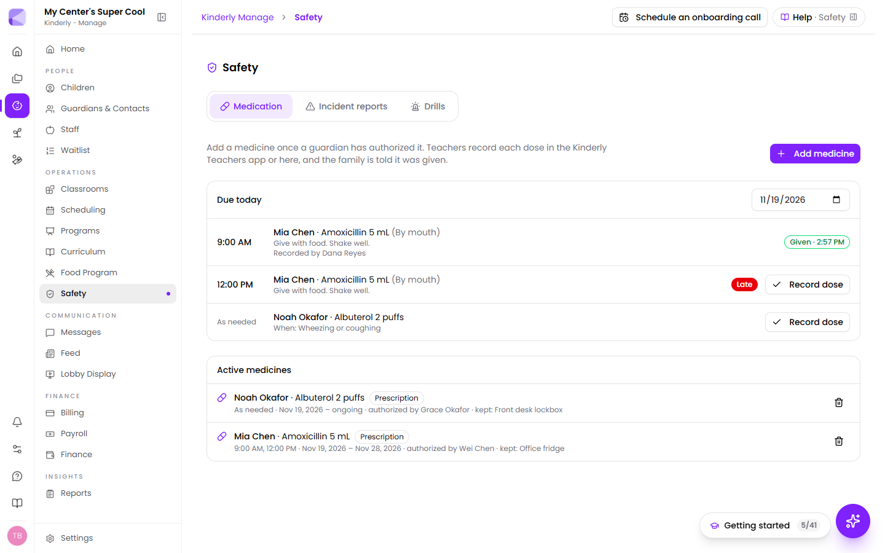
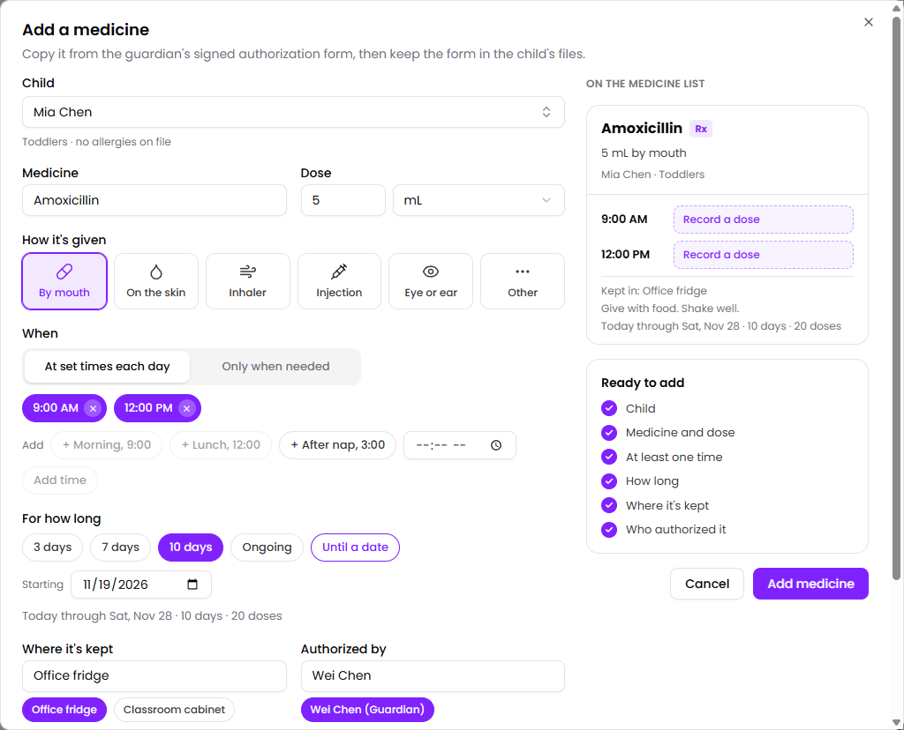
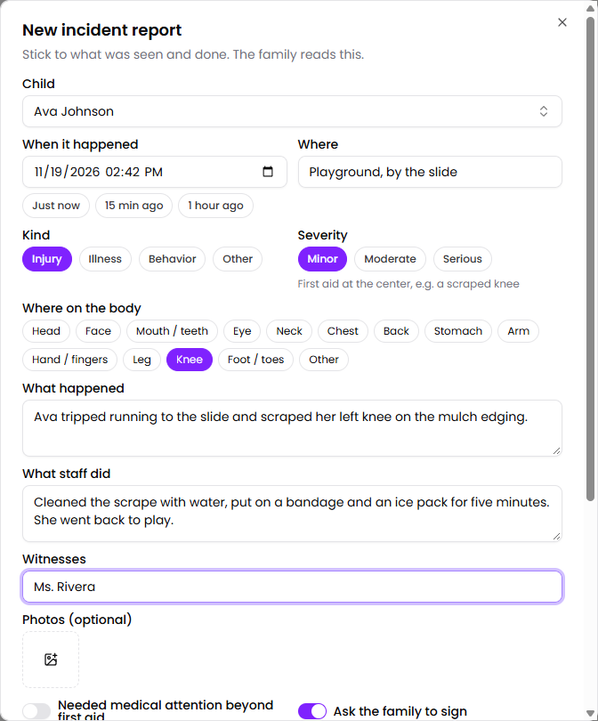
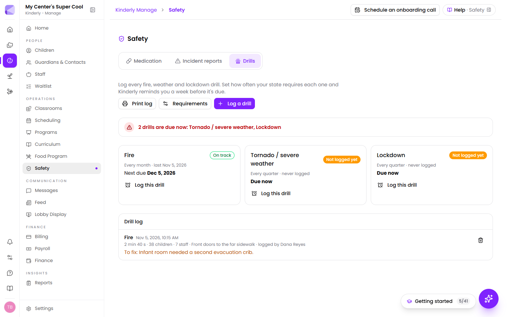

**Manage → Safety** keeps the records a licensing visit asks for first: what medication each child was given, what happened when a child was hurt, and when you last practiced a fire drill. It has three tabs: **Medication**, **Incident reports** and **Drills**. Teachers use the same three in the **Kinderly Staff** app, under **Safety** in the menu.

## Medication

### Adding a medicine

Once a guardian has signed your medication authorization form, choose **Add medicine** and fill in:

- the **child**. Their allergies on file are shown under their name.
- the **medicine** and the **dose**: an amount (*5*, *2.5* or *1/2*) and a unit (mL, mg, tablet, puff, drop or application)
- **how it's given**: by mouth, on the skin, inhaler, injection (such as an EpiPen), eye or ear
- **when**: at set times each day (pick *Morning*, *Lunch* or *After nap*, or add your own time), or only when needed, with a note saying when to give it. Common reasons, such as *Fever over 100.4°F*, are one click away.
- **for how long**: 3, 7 or 10 days, ongoing, or until a date you pick, and the day it starts. Kinderly shows the last day and how many doses that comes to.
- **where it's kept** and **who authorized it**. The child's guardians are offered as choices.
- any instructions, and whether it's a prescription

If the medicine matches an allergy on file, a red warning appears. This includes a drug in the same family, such as amoxicillin for a child allergic to penicillin. Check with the guardian and the prescriber first. The button changes to **Add anyway**.

The panel on the right shows how the medicine will appear on the medicine list and what's still left to fill in. **Add medicine** turns on once everything is filled in.

Keep the signed authorization form in the child's **Files**. Directors can also add a medicine from the **Kinderly Staff** app, under **Safety → Medication → Add medicine**.

A child's own medicines, doses and incident reports are also on the **Medical** tab of their page under **Children**.

To stop a medicine, use the bin icon beside it under **Active medicines**. Its record of doses is kept.

### Recording a dose

**Due today** lists every scheduled dose in time order. Each shows:

- **Upcoming**, until 30 minutes before its time
- **Due now**, from then until 30 minutes after
- **Late**, once it's more than 30 minutes past with nothing recorded
- **Given** or **Refused**, with the time and who recorded it

Choose **Record dose**, say whether it was **Given**, **Refused**, **Missed** or **Held** (not given on purpose), check the dose, and add a witness if your state requires a second staff member. As-needed medicines appear below the schedule with a **Give** button. In the **Kinderly Staff** app, teachers can also record a dose from the child's record with a **Medicine** daily note. It records the same dose and also puts a line in the child's daily feed.

When a dose is given or refused, the family gets a notification in the Parents app, and the dose appears under **Health & safety** there.

When a scheduled dose's time arrives and nothing has been recorded for it yet, every administrator is told straight away: a **Drills, medication & incidents** notification on the web, a **Medication due** push in the **Kinderly Staff** app (tapping it opens **Safety**), and an email listing each child, medicine and dose. This only happens for children who are signed in, and each dose is announced once. Doses for the same time are grouped into one alert. The web notification clears on its own once every dose for that time is recorded. A child who signs in more than 30 minutes after a dose's time isn't announced, but the dose still shows as **Late** on the Medication tab.

Each morning Kinderly checks yesterday's scheduled doses. If any were left unrecorded for a child who was signed in that day, you get a **Drills, medication & incidents** notification listing them, so a missed dose (or a missed record) doesn't go unnoticed.

:::tip[Record the dose when you give it]
A dose recorded at the end of the day reads as given at the end of the day. Teachers can record from the Staff app in a few taps, right after giving it.
:::

## Incident reports

### Writing a report

Choose **New report** and fill in:

- the **child**, **when** and **where** it happened
- the **kind**: injury, illness, behavior or other
- the **severity**: *Minor* (first aid at the center), *Moderate* (more than first aid, or the family was called), or *Serious* (emergency care, a head injury, or anything your licensing office must hear about)
- for an injury, **where on the body**
- **what happened**, **what staff did**, and any **witnesses**
- up to six **photos**

Shortcuts set the time to **Just now**, **15 min ago** or **1 hour ago**, and a time in the future can't be saved. Next to the form, **What the family reads** previews the report as you write it, and a checklist shows what's still missing. Only the child and what happened are required. If a Moderate or Serious report, or one that needed medical attention, isn't going to the family to sign, the form reminds you to tell them another way.

Stick to what was seen and done. The family reads the report.

An **Incident** daily note in the **Kinderly Staff** app files a report too, one per child, with the note's details as **what happened**. The note stays in the day's feed and links to the report.

### Family sign-off

With **Ask the family to sign** on (the default), each of the child's family guardians gets an email with a link to read and sign the report, and a notification in the Parents app. Emergency contacts and case workers aren't asked. Only the child's family can open or sign a report, and only while they're linked to the child: if a guardian is removed from the child or made an emergency contact, their link and their Parents app copy stop working, and the report no longer waits on their signature. Incident and medicine notes in the daily feed are family-only too. The link works for 30 days without an account. Parents sign with their name, and can draw a signature and add a comment.

Open a report to see each guardian's status: sent, opened, or signed (with when, how, and any comment). **Send reminder** asks anyone who hasn't signed yet. By default a report shows as **Signed** once one guardian in the family signs it, and the others aren't asked again: they see it as signed, with who signed. To have every family guardian sign, turn on **Require multiple signatures** at the top of the **Incident reports** tab. The report then shows as **Signed** once everyone has signed. Turning the setting back off marks reports that already have a family signature as signed.

### Serious incidents

A **Serious** report sends a notification to every director straight away, on the web and in the Staff app, and is marked **Report to licensing**. Most states require serious incidents to be reported to licensing, often within 24 hours. Once you've done that, open the report and choose **Reported to licensing, close**.

Teachers can correct their own report on the day they write it. After that, only an administrator can change it.

### Printing a report

Open a report and choose **Print** for a paper copy for the child's file, the family or a licensing visit. It includes the photos, each guardian's electronic signature, and blank lines for staff, parent and director signatures. To look across many incidents at once, run the **Incident Reports** report under **Manage → Reports → Health**.

## Drills

### Requirements

Choose **Requirements** and add each drill your licensing rules require, with how often: every month, every 2 months, every quarter, twice a year or once a year. Most states require a fire drill every month, and many add severe weather and lockdown drills. Check your own state's rules.

Each requirement then shows as **On track**, **Due soon** (within 7 days), **Overdue** or **Not logged yet**, with the date of the last drill and when the next is due. A line above them sums it up: which drills are due now, or which is next and in how many days. Kinderly sends a **Drills, medication & incidents** notification a week before a drill is due, and again once it's overdue.

### Logging a drill

Choose **Log a drill** (or **Log this drill** on a requirement) and record the kind of drill, when it was, how long it took, how many children and staff took part, which exit you used, and anything to fix before next time. The drill log keeps every one, newest first. Teachers can log drills from the Staff app, and only administrators can delete them.

### Printing the drill log

Choose **Print log** to print a report of the drills in a date range, for a licensing visit or your own records. Pick the dates (or a shortcut such as **This month**, **This year** or **Last 12 months**) and tick the kinds of drill to include. The report opens with a summary of each kind: how many were run, the last date, how often it's required, and **None in this period** for any kind that wasn't run. Below that, every drill is listed oldest first and grouped by month, with its icon, the day and time, how long it took, who took part, the exit used, notes and anything to fix. It ends with a line for the director's signature. To keep a copy, choose **Save as PDF** in the print window.

## Next

- [Notifications](/getting-started/notifications/) — muting the safety notifications.
- [Children](/manage/children/) — where signed medication forms go.
