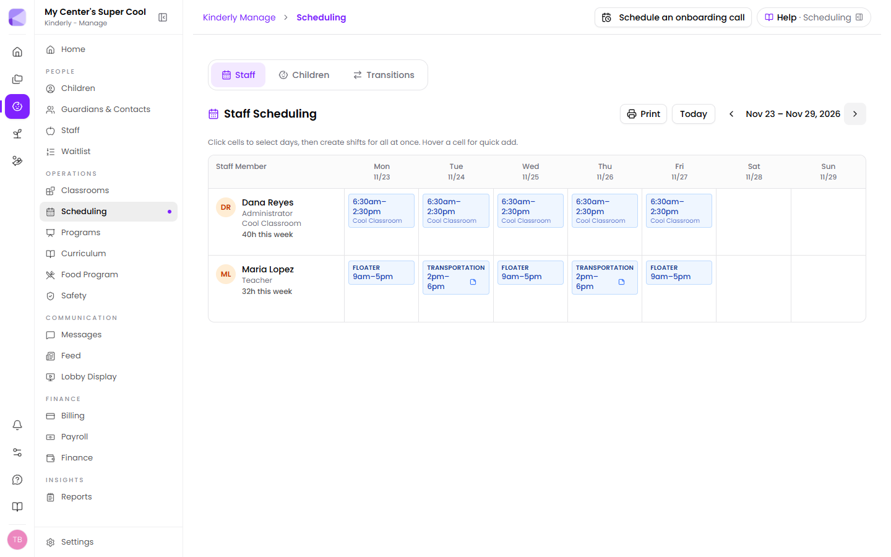

**Manage → Scheduling** has three tabs: **Staff**, **Children** and **Transitions**.

## Staff scheduling

A week grid, staff down the side and days across the top. Each staff member shows their role and classroom.

- Hover a cell for a quick add.
- Click cells to select several days, then create shifts for all of them at once.
- Each cell offers **Shift** or **Time Off**.
- **Today** returns to the current week; the arrows move between weeks.
- **Print** produces a copy for the staff room wall.

:::tip[Select the whole week, then create once]
For someone on a fixed pattern, click all five cells and create the shift in one go rather than five times. Multi-select is the difference between scheduling a team in minutes and in half an hour.
:::

### Out by ratio

The shift dialog has presets for **Opening, 6:30–2:30**, **Mid, 9–5** and **Closing, 10–6**. When you create shifts for several days at once, it shows the total hours. If the staff member has a **max hours / week** set on their Employment tab, it also shows where the week stands with this shift, and flags overtime.

Give a shift a **Label** (Transportation, School Age, Floater, anything you like) and it shows as a heading on the shift in the grid, on the printed schedule and in staff calendar links. The dialog offers the labels your center has used before, so everyone picks the same wording. For a room, use **Classroom** instead: that's what ratios and rosters go by.

A shift with a **note** shows a small note icon on the grid. Hover it to read the note without opening the shift.

An end time earlier than the start is an **overnight** shift: it ends the next morning. The grid marks it **+1**, totals count it in full, staff calendar links end it the next day, and **Schedule Adherence** matches it with the next morning's clock-out. A shift over 16 hours gets a note to check AM and PM.

Some shifts have a set start but no set finish: the teacher stays until enough children have gone home that they're no longer needed for ratio. Turn on **Out by Ratio** in the shift dialog for these.

- The out time shows as **Ratio** on the grid, the printed schedule and the teacher app, so nobody reads the shift as a guaranteed eight hours.
- The end time becomes **No Later Than**, the latest they'd stay. Weekly totals for anyone with a ratio shift read **Up to**.
- In **Schedule Adherence**, leaving before that time isn't flagged as leaving early. Staying past it is still flagged as overtime.
- Staff calendar links mark the shift **(out by ratio)** and say they may be sent home before the end time shown.

## Why shifts matter beyond the schedule

Scheduled shifts are what **Schedule Adherence** compares actual clock-in and clock-out times against. Without them there's nothing to compare to, and the report has nothing to say.

:::tip[Record time off properly]
Marking time off rather than leaving a cell blank is what stops a planned absence looking like a no-show in adherence reporting.
:::

### Time-off requests

Staff ask for time off in the [Staff app](/mobile/teacher-app/#schedule-and-time-off). Administrators get a notification, and the request shows on the grid as **Pending**. Open it and set it to **Approved** or **Denied**, or answer from **Time-off requests** in the Staff app, which also shows who else is off on those days. The person is told either way.

## Children's schedules

The **Children** tab shows each child's expected weekly pattern — the same schedule that appears on their [record](/manage/children/).

This is what powers the **Child Schedule Adherence** report, which flags absences, unscheduled days and off-schedule arrivals.

:::tip[This is your part-time attendance check]
For part-time children the schedule is how Kinderly knows a Tuesday absence matters and a Wednesday one doesn't, because they were never due in. Without it, every non-attendance looks the same.
:::

## Transitions

Planned moves between [classrooms](/manage/classrooms/) — typically children aging up.

Scheduling a transition in advance means the move happens on the right date, and room counts and ratios stay correct without anyone remembering on the morning.

A move can change the child's [program](/manage/programs/) as well, for example from Infant Care to Toddler Care when they move up a room. Pick the new program under **Program** in **Plan a move**. If the child is in more than one program, choose which one they leave. When you **Complete** the move, the child leaves the old program the day before the effective date and joins the new one on it, so billing follows the new program from then. The change is recorded in the program's history. A move that only changes rooms leaves programs and billing as they are.

The **Children** tab lists each child's current programs under their name.

:::tip[Plan transitions at enrollment]
You already know roughly when a child ages out of the infant room. Setting the transition when they join means it happens on time, and your room capacity forecasts are right months ahead.
:::

## Next

- [Staff](/manage/staff/) — the team you're scheduling.
- [Reports](/manage/reports/) — adherence and attendance reporting.
