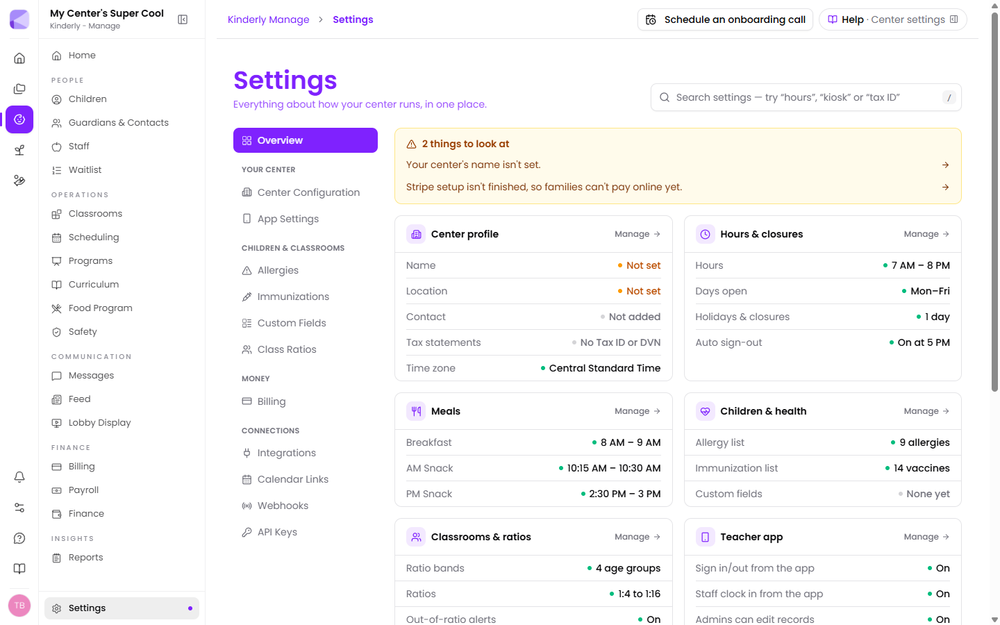
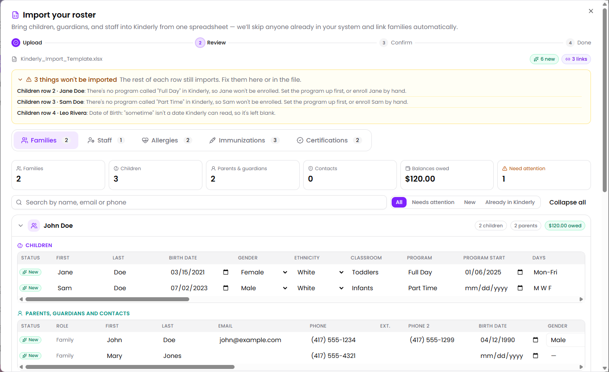
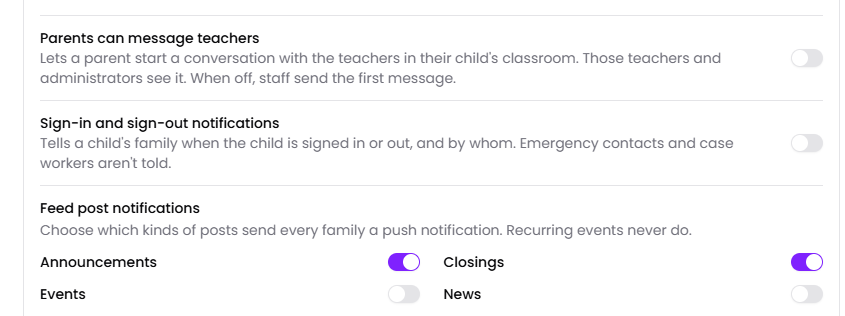

**Manage → Settings** configures the center itself. Worth doing before you add children, since several of these lists shape what a child's record can hold.

Settings opens on an **Overview** that shows what's set up, what's switched on and anything that needs attention. The sections are grouped down the side: **Center Configuration** and **App Settings**; **Allergies**, **Immunizations**, **Custom Fields** and **Class Ratios**; **Billing**; and **Integrations**, **Calendar Links**, **Webhooks** and **API Keys**.

:::tip[Not sure where a setting lives? Search for it]
Type what you're after in the search box at the top — "hours", "kiosk", "tax ID", "snow day" — and pick the result to jump straight to it. Press <kbd>/</kbd> to start typing from anywhere on the page.
:::

## Setup wizard

New accounts land in the setup wizard straight after signup. You can reopen it any time with **Launch Setup Wizard**. It walks you through Kinderly in three parts, starting with the things you can show off soonest:

1. **Get live** — center information, your website (created and published in a minute), your documents, and an enrollment packet: one link to send a family today.
2. **Run the center** — schedule, meals, auto sign-out, billing, integrations and importing your roster. For KinderConnect, pick **3.5** or **4.0**, whichever your state's agency uses; a center runs one, so switching turns the other off.
3. **Grow** — the inquiry pipeline and your funding profile.

Every step is optional. Links to the full editors open in a new tab, so the wizard keeps your place. Steps you've already done, in the wizard or anywhere else in Kinderly, start ticked. It's useful when you're new, and when you've inherited a part-configured center and want to check nothing's missing.

### Bloom steps

Some steps are marked **Bloom**: adding a [map](/grow/page-sections/#contact) to your website, your own colors and domain, handing out documents automatically, the [Food Program](/manage/food-program/), [adding children from paper forms](/manage/scan-documents/), a virtual tour and daily digest, and your funding matches. On a paid plan they're ordinary steps. On the free plan each one shows a preview built from what you've already entered (your map uses your address), and **Upgrade to Bloom** opens checkout right there and brings you back to the same step. Skipping a Bloom step never stops you finishing setup.

### Setup checklist

Until the main steps are done, a **Setup checklist** sits at the top of the dashboard and the Manage overview. Each item opens the wizard at that step. **Hide** tucks it away on that browser. In your first week we also send up to three short emails pointing at what's left.

## Center Information

Name, address, phone, email, website, time zone — plus two that matter more than they look:

- **Tax ID (EIN/TIN)** — printed on the tax statements families download from the [Parents app](/mobile/parent-app/). Left blank, it's omitted.
- **Provider Number (DVN)** — your state-issued childcare provider number, also on family tax statements.

:::tip[Fill in the tax fields now, not in January]
Parents need both for childcare tax credits and they all ask in the same fortnight. Two minutes here saves a month of emails.
:::

## Operating Schedule

Opening and closing time, which days you're open, and **Closed Holidays**.

These define your operating hours, which is when [out-of-ratio alerts](/manage/classrooms/) run and what **Late Pickup** is measured against.

Federal holidays are offered as a checklist. **Custom Closures** covers the one-off days specific to your center — a staff training day, a local holiday, the week between Christmas and New Year. Tick **Every year** on a closure to pick just a month and day (say, "The day before Thanksgiving" on Nov 25); it repeats annually until you remove it.

:::caution[Closed Holidays here is separate from a Feed closure post]
This list is what the system treats as non-operating days. A [Feed](/manage/feed/) closure post is what *tells families*. For a real closure you want both.
:::

## Meal Schedule

Set the meals you serve and when. Turn off any you don't offer, add your own, and drag the handle to reorder them.

:::tip[Get this right if you claim CACFP]
Meal times underpin the food program records that feed your [CACFP reports](/manage/reports/). A center serving an afternoon snack that isn't configured has a gap in its claim.
:::

## Auto Sign-Out

Automatically signs out anyone still signed in at a time you set — with **separate times for children and staff**.

:::tip[This is the fix for the ratio-alert problem]
Forgotten sign-outs are the main reason [out-of-ratio alerts](/manage/classrooms/) go wrong: a staff member who left at 3pm but never signed out makes a room look covered all evening. Auto sign-out closes those off every night, so tomorrow starts from a clean state.
:::

:::caution[Set it after close, not at close]
Sign-out time is when Kinderly gives up waiting, not when you shut. Setting it at your closing time will sign out a child whose parent is running ten minutes late — and that's exactly the pickup you'd want an accurate record of. Leave a margin.
:::

## Data Tools

**Import Data** bulk-imports children, guardians and staff from an Excel spreadsheet or CSV.

### The Kinderly template

**Download Excel template** gives you a workbook with a column for everything Kinderly keeps, and a **How to fill this in** sheet that explains each column and lists the values it accepts. Fill in what you know and leave the rest blank.

- **Children**: name, birth date, gender, ethnicity, classroom, program and start date, weekly schedule (*Mon-Fri*, *7:30 AM*, *5:30 PM*), balance owed, doctor, hospital, insurance, last physical, emergency treatment consent, food program category and income eligibility dates, address and a note.
- **Guardians**: contact details, phone extension and second phone, birth date, employer, address, and which child they belong to and how. Adults who share a child's last name are linked to that child automatically.
- **Staff**: contact details, role and classroom, employment and pay, compliance dates (background check, I-9, E-Verify, TB test, physical), credential, emergency contact, who they report to, address and a note.
- **Allergies**, **Immunizations** and **Certifications** take one row per allergy, dose or certificate, naming the child or staff member. A row can name someone already in Kinderly, so you can bring in immunization records on their own. An immunization row can record an exemption instead of a dose.
- Your center's [custom fields](#custom-fields) each get a **Custom:** column.

The template checks what you type as you go. Columns with a fixed set of answers, such as gender, relationship, employment type or Yes/No, have a dropdown. So do **Classroom**, **Program**, **Vaccine** and **Allergy**, which list the ones your center already has. A classroom, vaccine or allergy that isn't on the list yet gets a warning that you can accept, because the import adds it. A program has to be one you've already set up. Dates, times, amounts, phone numbers and emails are checked too, and clicking a cell shows a hint for its column. Pasted cells skip these checks, but Kinderly checks every row again when you upload. Download a fresh template after you add classrooms or programs, so the dropdowns include them.

A program has to be set up in Kinderly before children can be enrolled in it from the file, and enrolling starts billing on the next billing run. Social Security numbers and W-4 details aren't in the template; add those on each person's record.

If a value can't be read, such as a date written as *sometime in March* or a program Kinderly doesn't have, **Review** lists it and leaves just that value out. The rest of the row still imports. Allergies, doses and certifications already on someone's record aren't added twice.

:::tip[Use the importer when you're moving in]
Typing in 40 children, their guardians and the links between them is a day's work and an invitation to typos. If you're migrating from another system or from spreadsheets, import instead — and do it before you start assigning classrooms and programs.
:::

### Moving from Brightwheel, Procare or Playground

You don't need to reformat another platform's export. Upload their student, family or staff list (CSV or Excel) as it is. Anything that isn't the Kinderly template goes through a **Map** step:

1. Say where the file came from and what each row is: **Children**, **Parents and contacts**, or **Staff**.
2. Check the column matches. Kinderly guesses each one from its name ("Student First Name", "Parent 1 Email", "Room"…), shows an example value, and you can change any of them or choose **Don't import**.
3. Carry on to the usual **Review** and **Confirm** steps.

A children file with *Parent 1* and *Parent 2* columns brings in the parents too, linked to their children. A parent who appears on several rows (siblings) is added once, with all their children. A contacts file links each adult to the child or children named in their row. If the platform exports children and parents as separate files, import the children first, then the parents.

**Review** shows everything that will be imported, family by family. A family is everyone linked to the same children, whatever their last names, so a mom with a different surname stays with her kids and two unrelated families who share a last name stay apart. For each family you can see and change:

- **Children**: every column from the file, including each child's balance from the old platform.
- **Parents, guardians and contacts**: names, email, phone and address. Emergency contacts and case workers are shown with the family but are never billed.
- **Relationships**: who is linked to which child, as what, who is primary, and who can pick up.
- **Billing account**: the account that will be set up, with the responsible parent at 100% and the other parents as holders, and the opening balance. **Make responsible** changes who is billed. The responsible parent is the one who is primary for the most of the family's children.

Search, and the **Needs attention** filter, help with a long roster. Adults not linked to any child, and staff, have their own lists.

On **Confirm**, choose whether to:

- **Set up a billing account for each family**, as shown on Review. Families that already have an account in Kinderly keep it.
- **Import opening balances**, as one *Opening balance* invoice per family, as of the date you pick. Credit balances aren't imported. They're listed for you to add by hand, so last year's payments don't show up on this year's tax statements.

When the import finishes, **Send invitations** gives every imported guardian with an email the Parents app and emails them a link to set their password.

## Allergies and Immunizations

Define the lists your [child records](/manage/children/) pick from.

:::tip[Set both up before adding children]
These are pick-lists for a reason. Left to free text, one child has "Peanut", another "peanuts", a third "nut allergy" — and no filter or report can reliably tell you which children in the room have a nut allergy. That's a question you want answered correctly.
:::

## Custom Fields

Extra fields on the child record for whatever your center tracks that Kinderly doesn't have out of the box — a bus route, a locker number, a cultural or dietary note.

:::tip[Custom fields, not notes, for anything you'll filter on]
Notes are fine for prose. If it's something you'll want to search, filter or report on, it needs to be a field.
:::

## Class Ratios

Required staff-to-child ratios, usually by age group to match licensing. These drive ratio calculations and [out-of-ratio alerts](/manage/classrooms/).

:::caution[Enter your licensing ratios, not your aspirations]
These generate real-time alerts to staff. Setting them tighter than your license requires produces alerts your team learns to dismiss — which is exactly what you don't want when a genuine one arrives.
:::

## Billing

Center-level billing configuration, including [review periods](/manage/billing/#reviewing-invoices-before-they-go-out) that hold automatic invoices, and [late fees](/manage/billing/#late-fees). See [Billing](/manage/billing/).

## App Settings

Controls for what families and staff see in the [Parents](/mobile/parent-app/) and [Teachers](/mobile/teacher-app/) apps. Three of them decide what families hear and whether they can write first:

- **Parents can message teachers** lets a parent start a conversation with the teachers in their child's classroom. Off to begin with. See [Messages](/manage/messages/#letting-parents-write-first).
- **Sign-in and sign-out notifications** tells a child's family when the child is signed in or out, and by whom. Off to begin with, because who picked up is sensitive in some families. The person who signed the child isn't notified, and neither are emergency contacts or case workers.
- **Feed post notifications** chooses which kinds of posts notify every family. Announcements and closings to begin with. Recurring events never do.

Each parent can also turn kinds of notifications off for themselves. Incident reports and medication always come through.

In the **Teacher App** section, **Teachers can set the time of a note** lets staff choose when a [daily note](/mobile/teacher-app/) happened, up to 7 days back. Off to begin with.

## Integrations

Connections to other systems, each with a status showing whether it's working:

- **KinderConnect** and **KinderConnect 4.0** — send attendance to state subsidy agencies, on a schedule you choose. See [KinderConnect](/integrations/kinderconnect/).
- **QuickBooks** — accounting. See [QuickBooks](/integrations/quickbooks/).

## Next

- [Classrooms](/manage/classrooms/) — set rooms up next.
- [Children](/manage/children/) — once the lists exist.
