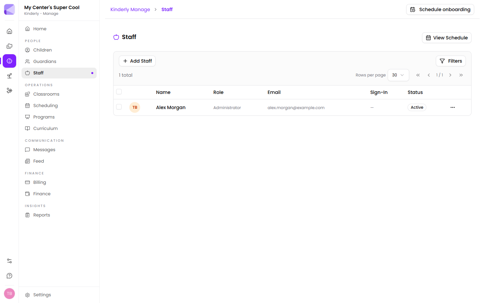

**Manage → Staff** lists your team with role, email, sign-in state and status. **View Schedule** jumps to [Scheduling](/manage/scheduling/).

- **Add Staff ▾** offers **Add Staff** to type their details in, or **Scan Document** to [scan their application or new-hire paperwork](/manage/scan-documents/) and let Ellie fill it in. Either way, they're emailed a sign-in for the [Kinderly Staff app](/mobile/teacher-app/).
- The **search box** filters by name or email as you type, and **Filters** narrows the list further (below).
- Tick several people to clock them in or out, upload documents, assign a classroom, or [print a sheet for each](/manage/print-sheets/).

### Filters

| Filter | Shows staff who… |
|---|---|
| **Role** | are a Teacher, Lead Teacher, Administrator or Other |
| **Classroom** | are assigned to any of the picked classrooms, or to none |
| **Employment** | are full-time, part-time, floaters, substitutes, on-call, seasonal, interns, volunteers or contractors |
| **Employment status** | are active, on probation, on leave or terminated |
| **Hired** | started in the last 30 days, 90 days or year |
| **Certifications** | have an expired certification, one expiring within 30, 60 or 90 days, or none on file |
| **Compliance checks** | have an expired background check, TB test, physical or work authorization, one expiring within 30, 60 or 90 days, or no background check, TB test or I-9 on file |
| **Staff app** | have, or haven't, set up the staff app |
| **Missing information** | have no phone, address, birth date, classroom or emergency contact |
| **Status** | are active (the default) or archived |

:::tip[Stay ahead of expiring certifications]
*Certifications → One expires within 30 days* is a ready-made renewal list. Tick everyone and use **Print Sheets** with a layout that shows certifications to hand them out.
:::

## A staff member's page

Alongside **Clock In** and **Change Classroom**, a staff member's page has **Print Sheet**, a [one-page sheet](/manage/print-sheets/) about them, and **Scan Document**. Scan Document reads a form about this person and shows what it says next to what's on file, so you can tick which details to update.

Under **Documents → Shared Documents**, **Send** emails this staff member a form, packet or document, such as a policy acknowledgment, and files it on their page.

## Employment details

A staff member's **Employment** tab holds four sections. Save them all with **Save Employment Details**.

- **Employment**: employment type and status, hire, probation and termination dates, and the termination reason and whether they're eligible for rehire. It also has department, who they report to, FLSA classification, standard and maximum weekly hours, and whether they're benefits eligible.
- **Compensation**: pay type and pay schedule, hourly rate and overtime multiplier or annual salary, shift differential, a stipend, and a staff childcare discount.
- **Compliance**: background check type, date cleared and expiration, TB test, physical, I-9, E-Verify, work authorization expiration and credential level. An expiration that has passed or is within 30 days is flagged here, and an expired check also shows as a red badge at the top of their page.
- **Tax Withholding (W-4)**: filing status, work state and W-4 steps 2–4, or exempt from withholding. Contractors fill out a W-9 instead, so this section has nothing to record for them.

Their emergency contact is on the **Info** tab.

:::note[Two settings that change other numbers]
- **Counts toward ratio**: turn this off for volunteers, interns or anyone else who can't be counted in your state's ratios. They stay in their classroom, but the classroom's ratio, the dashboard's out-of-ratio panel and the staff app's ratio alerts leave them out.
- **FLSA classification**: staff marked **Exempt** get no overtime in [Payroll](/manage/payroll/). All their hours count as regular. Leave it unset or **Non-exempt** for anyone owed overtime.
:::

## Dashboard access

Staff sign in to the [Kinderly Staff app](/mobile/teacher-app/) by default. To let someone sign in to Kinderly on the web as well, give them dashboard access:

- **When adding them** — turn on **Give Dashboard Access** in the Add Staff form. It's off unless you turn it on.
- **Later** — use **Give Dashboard Access** on their page, next to **Scan Document**. Once they have it, the same button reads **Revoke Dashboard Access**, in red.

Dashboard access comes with administrative privileges, so the staff member becomes an **Administrator**. They join your team and are emailed a link to set their password; they sign in with the same email they use for the staff app. Revoking it removes them from your team on the web and leaves their staff app access alone.

Only the team owner can give or revoke dashboard access, and the owner's own access can't be revoked.

## Roles

A staff member's role sets what they can do. **Administrator** is full access. Give people the narrowest role that lets them do their job.

:::tip[Not everyone needs to be an Administrator]
It's the fastest way to set someone up and the easiest to regret. Administrators can change billing, delete records and alter center settings. A room lead needs none of that.
:::

## Staff and classrooms

Staff are assigned to [classrooms](/manage/classrooms/). This drives:

- **Ratio calculations** — who counts toward staffing in a room.
- **Out-of-ratio alerts** — Kinderly watches rooms during operating hours and alerts staff in the [Teachers app](/mobile/teacher-app/) when a room drops below its required ratio. It counts who is actually *signed in*, not who's on the roster.
- **Scheduling** — shifts are set per staff member and shown by room.

:::caution[Ratio alerts count sign-ins, not assignments]
Assigning someone to a room isn't enough — they have to be signed in to count. A staff member who forgets to sign in makes the room look understaffed, and one who forgets to sign out makes it look covered when they've gone home.
:::

## Attendance and hours

Staff sign in and out like children do, and those records feed the [reports](/manage/reports/):

- **Staff Attendance** — time records over a date range
- **Employee Time Card** — clock-ins paired by day, grouped by week, with regular and overtime totals
- **Schedule Adherence** — actual times against scheduled shifts, with discrepancies flagged

:::tip[Time Card is the one for payroll]
It's already grouped by week with overtime separated out, which is usually what payroll wants. Staff Attendance is the raw record — better for answering "was she here on the 14th?".
:::

## Removing someone

Set a departing staff member to inactive rather than deleting them. Deleting takes their attendance history with it, and that history is what your time records and ratio evidence rest on.

## Next

- [Classrooms](/manage/classrooms/) — assigning staff to rooms.
- [Scheduling](/manage/scheduling/) — shifts and time off.
- [Scan a document](/manage/scan-documents/) — add staff from their paperwork.
