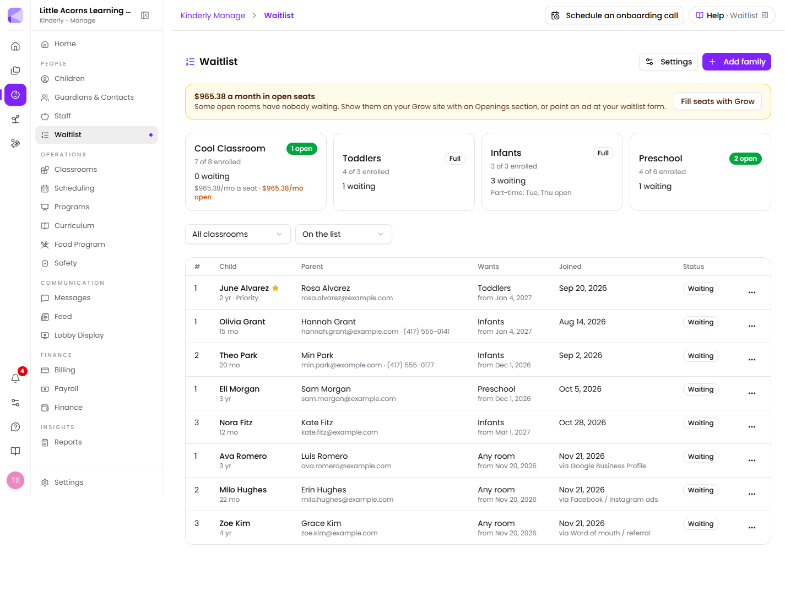

**Manage → Waitlist** holds the families waiting for a seat, in the order you'll offer seats to them. It tells you when a seat opens, and turns an accepted offer into an enrolled child without retyping anything.

## Seats

Give each classroom a **Licensed capacity** on its **Classrooms** page. The waitlist then shows a card for each room with:

- how many children are enrolled out of its capacity, and any seats already offered
- **open** seats right now
- when the **next seat** is likely to open, worked out from what Kinderly already knows: planned classroom moves, children aging into the next room, and program enrollments that end

Click a room's card to see only the families waiting for it.

### What an open seat costs

Each room's card also shows what one seat brings in a month. Set it yourself with **Monthly tuition for one seat** on the classroom's page, or leave that blank and Kinderly estimates it from the last 90 days of invoices: the typical recurring tuition per child in that room. Registration fees, late fees and one-off charges don't count.

When seats are open, a banner adds up what they're costing you each month.

### Part-time openings

A room can be full by headcount and still have room on some days, when some children only come part of the week. If the children in a room have [schedules](/manage/scheduling/), a full room's card shows the days that still have a spot (for example, *Part-time: Tue, Thu open*).

### Open seats nobody is waiting for

When a seat is open, or opens within about six weeks, and no family on the list wants that room (or any room), you get a **Waitlist** notification. That's a seat to market: add an [Openings section](/grow/page-sections/#manage) to your Grow site, or point an ad at your waitlist form. The notification clears once a family is waiting for the room.

## Adding families

Choose **Add family**. Only the child's name and birth date (or due date, if they're expecting), the parent's first name and an email or phone that works are needed. The parent's last name is taken from the child's if you leave it blank.

As you fill it in, Kinderly:

- shows the child's age today and on the start date, and marks the classroom whose ages fit (from the classroom's ratio bands). If you pick a room the child is too young or too old for, it says so and offers to switch.
- warns you if the child, or a family with the same email or phone, is already on the waitlist
- checks that the email looks complete and that the phone number has 10 digits
- shows where the family will land in line for the room you chose, and moves them up if you give them priority. Siblings of enrolled children and staff families still get priority automatically when you add them.

Start-date shortcuts cover *As soon as possible*, *1st of next month* and *Next fall*.

**How did they hear about you?** records where a family who phoned or walked in came from. It counts toward [Grow → Analytics → Where families come from](/grow/analytics/#where-families-come-from). Families who join through an online form have their source recorded automatically, and the **Joined** column shows it.

Families can also add themselves. Build an online waitlist form and add an **Add to Waitlist** step to its packet (see [Actions](/actions/overview/)). Each completed form puts the family on the list, matched to a classroom by name. Submitting the form twice doesn't add the family twice.

## The order

Families are ranked:

1. **Priority** families first. A family gets priority automatically when the parent's email or phone matches a guardian of a child already enrolled (**Sibling**), or a member of your staff (**Staff**). You can also give any family priority yourself.
2. Then everyone in the order they joined.

The **#** column is each family's place in line for the classroom they want. Sibling and staff priority can each be switched off under **Settings**.

## Offering a seat

From a family's menu, choose **Offer a seat**, check the classroom and start date, and choose how many days they have to answer. With an email on file, the family gets a message with a link to **accept** or **decline**, and you get a **Waitlist** notification (and a Staff app push) when they answer.

An offer nobody answers in time is marked **Offer expired**, and the seat is free to offer to the next family. **Withdraw offer** takes an offer back, and the family keeps its place.

Turn on **Offer open seats automatically** under **Settings** and Kinderly does this for you each morning: when a room with a capacity has an open seat, the next family waiting for it gets the offer email. Left off, you get a notification that a seat is open and who's next, and you decide.

## Enrolling

When a family accepts, choose **Enroll now**. Kinderly creates the child and the guardian (or reuses a guardian already on file with that email), links them, and puts the child in the offered classroom. From there, enroll them in a [program](/manage/programs/) to start billing, and send their enrollment packet.

## Waitlist fees

Set a **Waitlist fee** under **Settings** and it's recorded on each new family. Mark it paid from the family's menu when they pay. To collect it online, add a payment field to your waitlist form.

## Next

- [Classrooms](/manage/classrooms/) — setting each room's capacity.
- [Pipeline](/grow/pipeline/) — inquiries before they join the waitlist.
