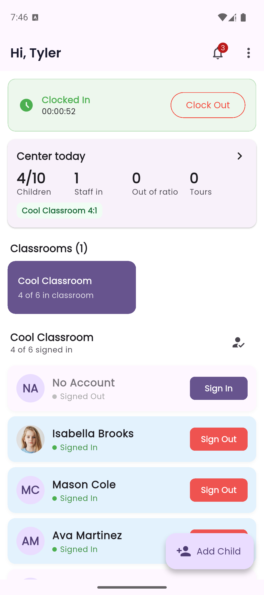
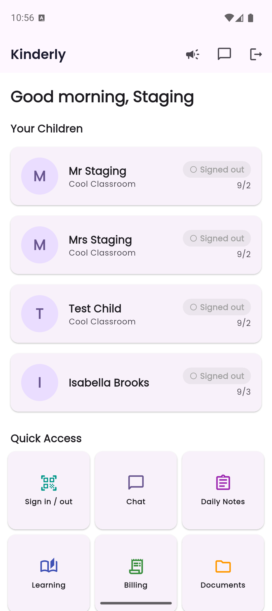

Kinderly has two mobile apps that work alongside the web dashboard:

- **[Teacher app](/mobile/teacher-app/)** — for staff to clock in, check children in and out, run the daily log and nap timers, see allergies and what families said about today, and message families. Directors can also answer time-off requests and send held invoices.
- **[Parent app](/mobile/parent-app/)** — for families to see their child's day and photos, say a child is out, late or being picked up by someone else, message the center, do paperwork, and pay tuition.

Both apps sign in with your Kinderly account.
