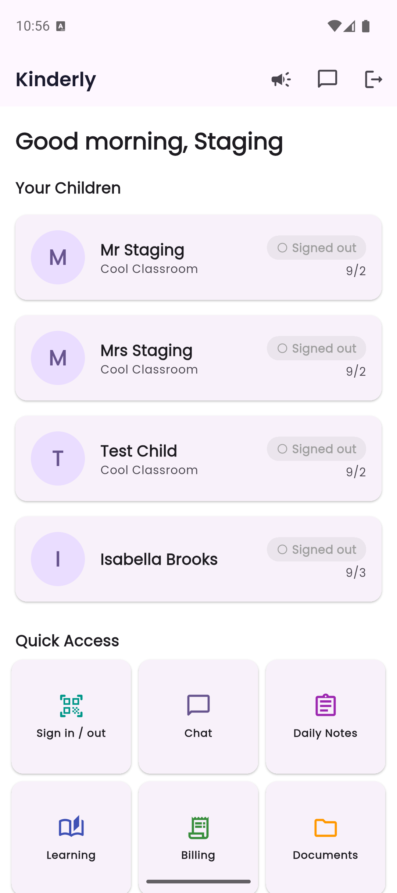
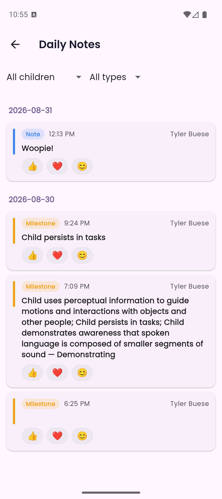
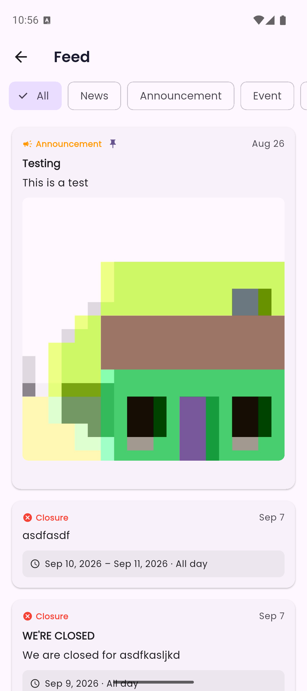
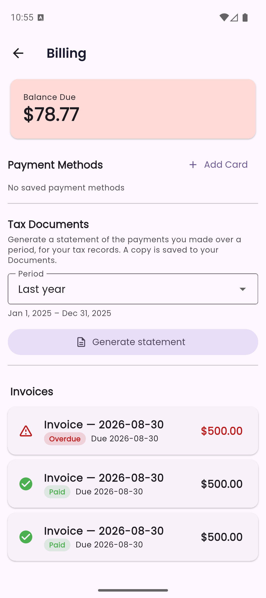
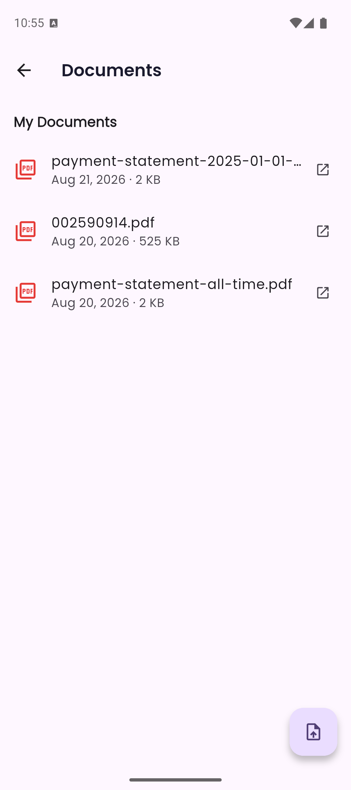

The **Parent app** is the companion app for families.

## Your children

- See every child linked to you with their current **signed-in / signed-out** status and classroom.
- Open a child's profile for full details.

## Absences and pickup

**Absences & pickup** on the home screen tells the center ahead of time:

- **Out**: choose the day or days, and a reason if you like.
- **Running late**: choose about what time to expect you.
- **Someone else is picking up**: their name, and optionally their relationship, phone number and a time. Ask them to bring a photo ID.

Your child's teachers and the directors are notified straight away, and it shows on the classroom roster. You can see when the center has seen it, and cancel it. Staff still record attendance themselves.

Below that is who is on each child's **pickup list**. The center keeps the list, so ask them to add or remove someone for good.

:::note[Family only]
Emergency contacts and case workers linked to a child can't send these or see the pickup list.
:::

## Daily feed

- Scroll a feed of everything that happened: diaper changes, naps, food, photos, milestones, notes. Keep scrolling for older notes, or tap the calendar to choose a day.
- React to entries with 👍 ❤️ 😊. Teachers see who reacted.

## Photos

**Photos** on the home screen gathers every photo teachers have shared of your children, newest first. Choose one child or see them all. Tap a photo to see it full screen and save it to your phone.

To save several at once, tap **Select** (or hold a photo), choose the ones you want or **Select all shown**, then **Download**. Scroll first to bring in older photos. Any that don't download stay selected so you can try again.

## Posts

Read center announcements — closures, events, news — posted by admins. You get a notification for new announcements and closings, unless your center chose otherwise. Posts can carry **photos and video**; video plays inline in the feed, with a still frame showing while it loads. Pinned posts appear first.

Recurring events show as a single entry with their cadence — *"Occurs every Tue & Fri"* — rather than filling the feed with one row per date.

## Center info

Your center's name, address, contact details, operating hours, days open, closed holidays, and logo.

## Paperwork

Forms, documents and packets your center sends through [Shares](/shares/overview/) appear at the top of **Documents**, under **To fill out**. That covers anything filed on you, and anything filed on a child you're a parent or family member of. The **Documents** tile on the home screen shows how many are waiting, and you get a push notification when a new one arrives.

Tap **Start** to fill it out and sign it inside the app. You're already signed in, so there's no PIN to type. You can stop partway and pick up where you left off later.

Once you submit, it moves to **Submitted**. Tap it to review what you sent: your answers, and a copy of each document as you signed it. If your center lets you change answers after submitting, the row says **Can still be changed**.

Some documents need a fresh copy every year. These show the day they're due and an **Update** button. Forms open with your last answers, so you only change what's different and sign. If your center has a copy of a document on file, you can update and sign that copy instead of sending a new one. A PDF you sign every year opens as the same copy, with your earlier answers and signatures on it. If your center asks for a change, the row says what to fix. An overdue one is marked in red. See [Renewals](/documents/renewals/).

A form whose link has expired is marked as expired. Ask your center to send it again.

:::note[Case workers and emergency contacts]
Paperwork filed on a child is shown to the child's family, not to case workers or emergency contacts linked to the child.
:::

## Billing

- See every invoice, including line items and balance due. The list shows five at a time. Use the arrows to see more, or choose 10 or 25 per page.
- Tap **Filter** to narrow the list by status, due date or amount, search by invoice number or item, or change the order.
- Tap **Pay** to pay by card (full or partial down to $0.50 — subject to your center having Stripe Connect enabled).
- Save a card for faster payments next time. The first one saved becomes the **Default**.
- Remove a saved card. The default can't be removed until another card is made the default.

### Auto-pay

Once a card or bank account is saved, the **Auto-pay** switch appears under
**Payment Methods**. When it's on, each new invoice is charged to the default
payment method as soon as it's issued, including any service fee your center
adds. Invoices the family already has aren't included, so they pay those as usual.
The family confirms before it turns on, and can switch it off at any time.

### Tax documents

Under **Tax Documents**, pick a period — last month, last 3 or 6 months, this
year, last year, all time, or **Custom range** to choose any two dates — and tap
**Generate statement**. Kinderly builds a PDF listing every payment recorded
against that billing account in the period, with the total paid, and opens it in
your device's PDF viewer so you can save, print or email it.

Each statement is also filed automatically into your **Files** list, so you can
come back to it later without regenerating. Re-generating the same period
replaces that copy rather than adding a second one; different periods are kept
as separate documents. Delete one like any other file — generating it again
brings it back.

The statement lists **payments**, not invoices — an unpaid invoice won't appear
until a payment is recorded against it. Only *fulfilled* payments count,
including ones a staff member recorded manually (cash, check), so the statement
works even if your center doesn't take card payments in the app. State subsidy
paid on your behalf is excluded, since it isn't your expense to claim.

Payments are shown for the whole billing account, so if two guardians share an
account both of their payments appear, and the statement names each payer. The statement carries the center's name, address and
phone number, plus its **Tax ID (EIN/TIN)** and **Provider Number (DVN)** when
the center has filled those in — that's what a tax preparer needs for IRS Form
2441. If they're missing, ask your center to add them under Center Settings.

## Health & safety

The **Health & safety** tile shows:

- **Incident reports** the center has asked you to sign. Open one to read what happened and what staff did, then sign with your name and add a comment if something doesn't match what you were told. You'll also get a notification, and an email with the same link.
- **Medication** your child was given (or refused) in the last 60 days, with the dose, the time and who gave it. You get a notification each time a dose is recorded.

## Light or dark

The palette button at the top of the home screen opens **Appearance**: **Match phone** (the default) follows the phone's own light or dark setting, or choose **Light** or **Dark** to keep it that way. It changes straight away and stays set after you sign out.

## Messaging

Two-way chat with your center's staff, in words or photos. You'll get a **push notification** on new replies.

If your center allows it, **Message teachers** starts a conversation with the teachers in your child's classroom. With children in more than one room, you choose which. Those teachers and the center's administrators can see it. Without that button, your center writes first and you reply.

## Notifications

Tap your picture on the home screen, then **Notifications**, to choose which kinds you want: messages, daily notes, sign-in and sign-out, announcements and closings, learning, billing, and forms. **Incident reports and medication always notify you.** Turning one off only stops the notification; everything still shows in the app.

If your center has turned it on, you're told when your child is **signed in or out** and by whom. You aren't told about the ones you do yourself.

## Files

- See files linked to you or your children.
- See documents your center gives every family automatically, such as the handbook or a feeding plan. These are marked **From your center** and can be opened but not removed — see [Auto-apply documents](/documents/auto-apply/).
- Upload a file directly from your phone.
- Remove a file you uploaded.
