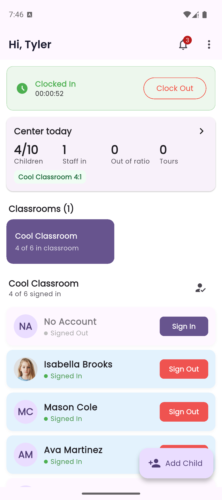
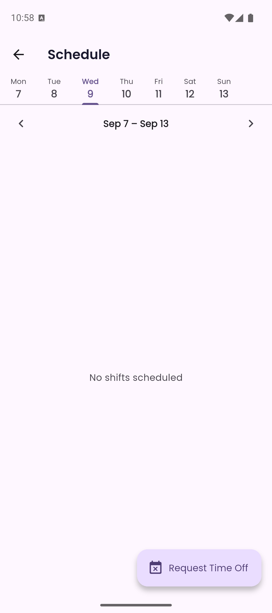
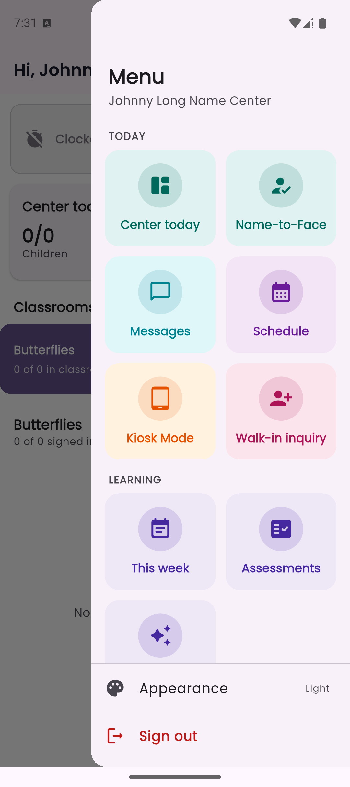
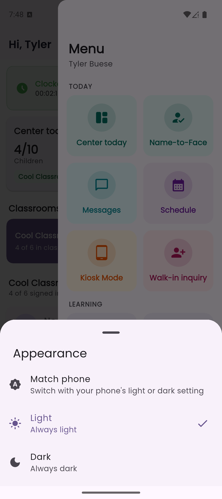
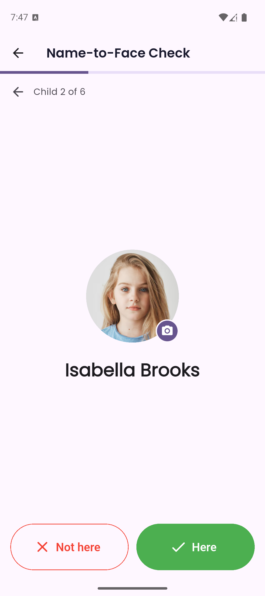
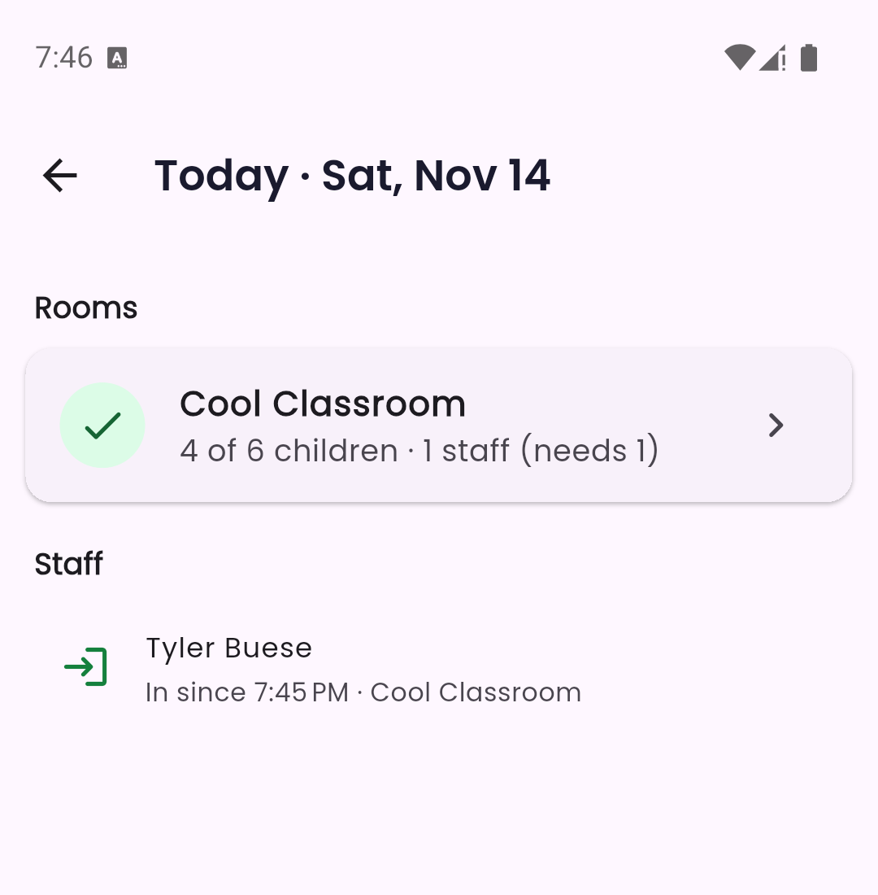
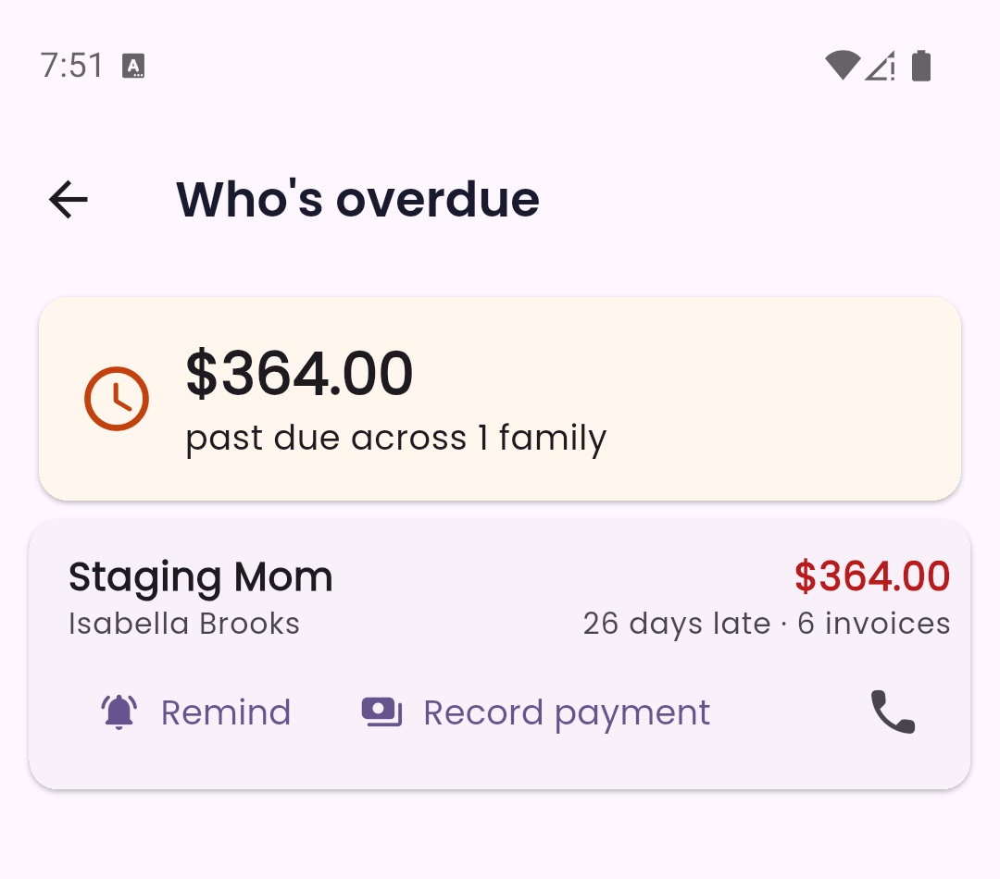
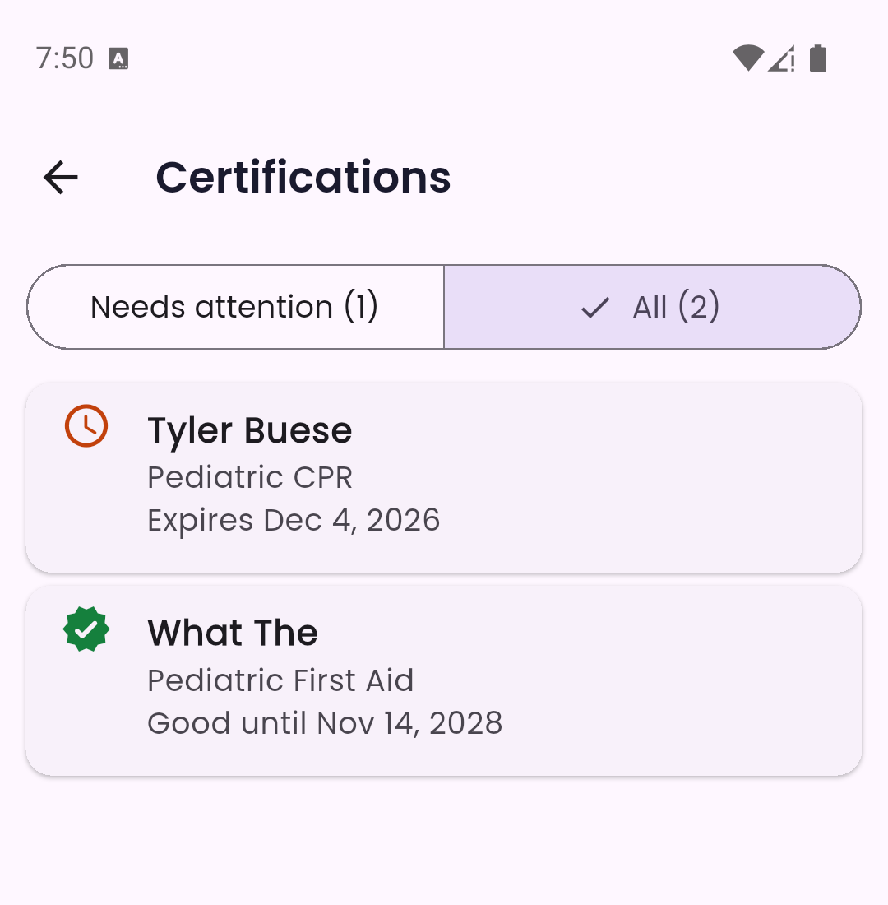
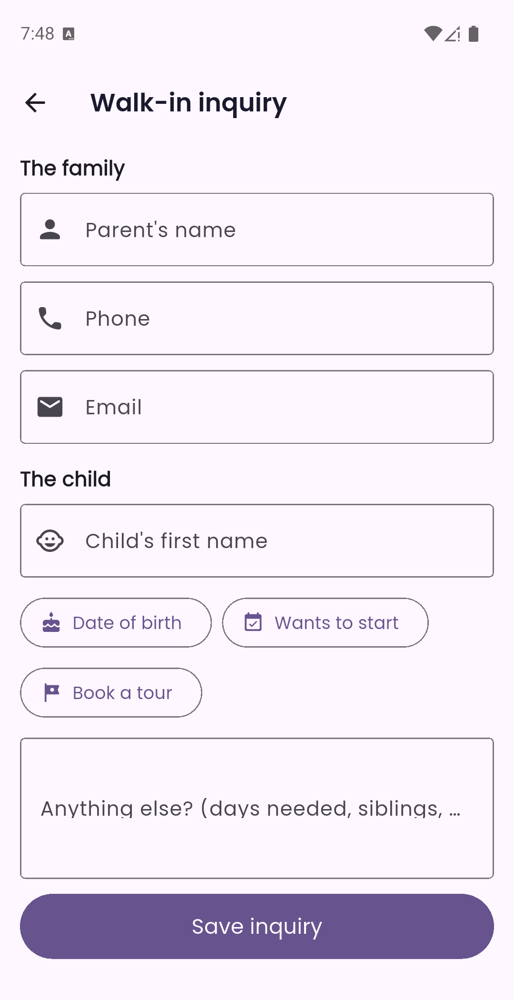

The **Teacher app** is the on-the-floor companion for staff.

## Signing in and out

- **Clock in** and **clock out** with one tap.
- **My hours** (the clock icon beside the clock-in button, or in the menu) shows your week: each day's shifts, the total, overtime and paid time off, counted the way [payroll](/manage/payroll/) counts them. Move back a week at a time. A missing clock-out is pointed out so you can ask your director to fix it.

Clock-in is per day. If you forgot to clock out yesterday, the app shows you as clocked out this morning, so clock in again when you arrive.

### Requiring the kiosk

A center can switch off clocking in from personal phones under **Manage → Settings → App Settings → Teacher App → Staff clock in / out from the app**. With it off, the app still shows whether you're clocked in, but the button is replaced by "Clock in at the kiosk", and staff clock in and out on the center's shared **Kiosk Mode** device instead.

### Recent ins and outs at the kiosk

After a parent or staff member enters their phone number in **Kiosk Mode**, the kiosk lists their most recent entries: under each child, the last sign-ins and sign-outs; on the staff clock screen, the last clock-ins and clock-outs. It goes back across days, so a parent arriving in the morning can see last night's pick-up was recorded.

The kiosk shows the last **3** by default. Change it under **Manage → Settings → App Settings → Recent ins and outs at the kiosk** — anywhere from 1 to 7, or **Don't show** to hide the list. The change applies to the next phone number entered; no one needs to restart the kiosk.

### Picking up setting changes

The app re-reads your center's settings (kiosk PIN, attendance and clock-in switches) whenever you pull down to refresh or come back to the app, so a change made in Manage reaches phones without anyone restarting the app. A kiosk also re-checks the PIN with the server before rejecting it.

## Classroom and roster

- See every non-archived classroom with its enrolled count, current sign-in count, staff count, and a simple ratio indicator.
- Open a classroom roster to see every child's **signed-in / signed-out** status for today.
- Each child's **allergies** show on the roster and in the name-to-face check, with what the family said about today: **Out**, **Late**, or someone else picking up.
- Sign a child in or out on behalf of a parent.
- Move a child to a different classroom.

## Naps and care

**Naps & care** (the moon on the roster, or in the menu) shows every child signed in to a room with how long it's been since their last bottle, meal and diaper, and who is asleep.

- **Start nap** starts the timer, for one child or everyone awake. **End nap** stops it. Any staff member can end a nap, whoever started it.
- Tap a child to add a note for them.

It's the same daily notes families see, so there's nothing to record twice. A nap reaches the family's feed when it starts, and any nap notification goes out when it ends.

## From families

**From families** in the menu lists what parents sent from their app: children who will be out, running late, and other people picking up, today and coming up. Tap the check mark to show the family you've seen it, or the phone to call the person picking up. The child's teachers and the administrators are notified when one arrives or is canceled.

:::caution[A notice isn't attendance, or permission]
Mark an absent child absent as you always have. Check photo ID before letting a child go with someone who isn't on their pickup list.
:::

## Out-of-ratio alerts

Kinderly watches your rooms during operating hours and alerts staff when one drops below its required staff-to-child [ratio](/manage/classrooms/).

It counts who is **actually signed in** — not who is enrolled or rostered.

Each alert says how short the room is and why. For example, it might say that nobody in the room is clocked in, or name the staff assigned to the room who haven't clocked in yet. It might say that everyone assigned is already in, which means someone needs to come over from another room. Or it might say the room has no qualified lead or is over its maximum group size.

If **no** staff assigned to a room have clocked in today, Kinderly can't tell who is on the floor, so it doesn't send ratio alerts until someone clocks in. Opening an alert doesn't make it repeat sooner: while a room stays out of ratio, it repeats on the schedule set in **App Settings**.

:::caution[The alerts depend on people signing in]
A staff member who forgets to sign in makes a properly staffed room look short. One who forgets to sign out makes an empty room look covered. If your team is casual about signing in and out, the alerts will be wrong in both directions — and false alarms teach people to ignore the real one.
:::

## Daily log

Record what happened today, one or many children at a time. Supported entry types:

**Note · Diaper · Potty · Food · Nap · Mood · Incident · Medicine · Photo · Milestone**

- A **Medicine** note records a dose. Open a child's record, add a note, and choose **Medicine**. You'll see the child's doses still to give today (marked **Due now** or **Late**) and their as-needed medicines. Pick one, say whether it was **Given**, **Refused**, **Missed** or **Held**, check the dose, and add a witness if your state requires one. Saving records the dose in the medication log, the same record as **Safety → Medication**, and tells the family. The note goes in the day's feed. Medicine is offered when you're logging for one child.
- An **Incident** note also files an [incident report](/manage/safety/#incident-reports). Pick the kind and severity, describe what happened, and save: the note goes in the day's feed, and the report goes under **Safety**, where the family is asked to sign it. A **Serious** one alerts the directors straight away. Editing the note later changes only the note; open the report from the note to change the report.
- A **Potty** note has a **Potty / Diaper** switch. It starts on **Diaper** when every child you're logging is under 18 months old, and on **Potty** otherwise. A diaper change is labelled "Diaper" for parents, and follows the **Diaper changes** setting for parent notifications.
- Edit or delete an entry within **30 minutes** of creating it. Admins can edit at any time.
- Set **when** it happened, if your center allows it: pick the day and time when you write a note, or when you edit one. You can go back up to 7 days, but not into the future. Families see the time you set; staff also see when the note was really written. Setting an earlier or later time doesn't change how long you have to edit it. A **Nap** takes the day and keeps its own start and end. A **Medicine** note follows its dose, and once an incident report is filed, its note's time can't be changed. Administrators turn this on under **Settings → App settings → Teachers can set the time of a note** on the web, or **Set the time of a note** in the app's Settings. It's off until you do.
- Upload photos straight from the phone's camera.
- See which parents reacted to a note.

### The Learning row

If your center has [Curriculum](/manage/curriculum/) enabled, notes carry a **Learning** row. Tagging an observation to a learning outcome takes one tap.

That's the whole curriculum documentation workflow: teachers write the notes they'd write anyway, and the evidence against your frameworks accrues on its own.

:::tip[Tag as you write, not in a catch-up session]
The tag takes a second in the moment and is far more accurate than trying to remember on Friday which observation showed what. It's also the difference between curriculum documentation being invisible work and being a separate chore staff resent.
:::

## Schedule and time off

- See your shifts for the current week. A shift whose out time shows as **Ratio** has no set finish: you may be sent home once you're not needed for ratio, and no later than the time shown underneath.
- Submit a PTO request. Administrators are notified, and you're notified of their answer.
- Cancel a pending PTO request.

## Posts

Read center announcements (Announcements, Events, Closures, News). Pinned posts are sorted first. Admins can create, edit, and archive posts.

Posts take **video as well as photos** — up to 20 attachments per post, 200 MB per clip. Record one straight from the app and families see it play in their feed. See [Feed](/manage/feed/).

:::tip[A short video beats five photos]
Thirty seconds of a room doing something ordinary tells a parent more about their child's day than a carefully framed photo does — and takes less effort to capture.
:::

## Safety

**Safety** in the menu has three tabs, for every staff member:

- **Medication**: the doses due today for your classroom (or the whole center), marked **Due now** or **Late**. Tap **Record** after giving one, or **Give** for an as-needed medicine. The family is told. Directors also see **Add medicine**, for adding one from a guardian's signed authorization.
- **Incidents**: write an incident report, with where on the body, what staff did and photos, and see which families have signed. A **Serious** report alerts the directors straight away.
- **Drills**: whether each required drill is on track, due or overdue, and **Log a drill** right after you run one.

Directors also get **Waitlist** (open seats, who's next, offer and enroll), **Review invoices** (adjust, send or leave out automatic invoices [held for review](/manage/billing/#reviewing-invoices-before-they-go-out)) and **Late fees** (approve or waive fees waiting to be invoiced). Drill requirements and late-fee rules are set up on the web. See [Safety](/manage/safety/), [Waitlist](/manage/waitlist/) and [Billing](/manage/billing/#late-fees).

## Finding everything else

The **⋮** menu in the top right is the app's hub — everything that isn't the roster lives here.

### Light or dark

**Appearance**, at the bottom of the menu, sets how the app looks on this phone: **Match phone** (the default) follows the phone's own light or dark setting, or choose **Light** or **Dark** to keep it that way. It changes straight away and stays set after you sign out.

### Name-to-Face check

A guided headcount. Kinderly walks you through the children signed into your room one at a time — showing each child's photo and name — and you tap **Here** or **Not here**. A progress bar tracks how far through the room you are.

:::tip[This is the check that catches a miscount]
Signing children in and out tells you who *should* be in the room. A name-to-face check tells you who actually is. Running one at each transition — after outdoor time, before a walk, at shift change — is what turns your sign-in list from a record into a safety check.
:::

## Scanning paper forms

Administrators on the **Bloom plan and above** can turn paper forms into Kinderly records from their phone. It works the same way as [Scan a document](/manage/scan-documents/) on the web.

**Starting a scan**

- **Scan a document** in the **⋮** menu. Choose what you're adding: **Child** (and their family), **Parents** (parents, guardians and emergency contacts, with the child optional) or **Staff**.
- **Scan a paper form instead** at the top of the **Add child**, **Add guardian** and **Add staff** screens opens the scanner already set to that choice.
- **Scan a document for this child** on a child's profile scans for that child.

**Several documents, no waiting**

Photograph up to six pages per document. **Add another document** queues more, and **Read N documents** sends them all. Ellie reads them in the background (usually 20 to 60 seconds each) while you keep using the app. A small **Ellie is reading…** pill shows while she works. As each one finishes, a **Ready to review** notice appears; tap **Review** to open it. **Recent scans** lists every scan and where it's up to.

**Reviewing**

The sections follow what you're adding: the child, adults, health, schedule, address and anything left over; adults first for parents' forms; or just the staff member. Amber fields are ones Ellie wasn't sure of, with the other likely readings one tap away. **View pages** shows the photos. Tap **Apply to Kinderly** to save.

:::tip[Grandparents and emergency contacts keep their relationship]
Relationships read from the form, such as *Grandparent*, *Aunt* or *Emergency Contact*, are kept as written. Everyone added can pick up unless the form says otherwise, and the child always ends up with exactly one primary contact.
:::

:::note[You can close the app]
Ellie reads on Kinderly's servers, so locking your phone or closing the app doesn't stop her. When she's done you get a push notification (**Ready to review**, or **Ellie couldn't read…** with the reason); tapping it opens the scan.
:::

## Running the center from your phone

These are for **administrators**. Everything here uses the same records as the web, so whatever you do on your phone shows up on the laptop and the other way round.

### Center today

Above your classroom on the home screen, **Center today** shows the whole center at a glance: children here out of children enrolled, staff clocked in, rooms out of ratio and today's tours. Each room is a chip, green when it's covered and red when it isn't. Tap the card for the full view:

- **Rooms**: who's here in each room, how many staff it has and how many it needs. Tap a room to open its roster.
- **Children**: who is **late** (their schedule says they should be here by now, with 15 minutes' grace, and they haven't been signed in), who is marked **absent**, and how many are still expected later. A family's **Out** notice counts as absent, and a later time they gave replaces the scheduled one.
- **Staff**: who's clocked in and since when, who's late for a scheduled shift, and who's off today.
- **Tours & follow-ups**: pipeline cards due today, tours first.

Late arrivals are only worked out for children with a schedule under Manage → Scheduling.

### Time-off requests

**Time-off requests** in the menu lists what's waiting, with who else is already off on those days. **Approve** or **Deny**, and the person is told. Each request can be answered once; change an answer later under **Manage → Scheduling** on the web.

### Approving a returned packet

When a family finishes a packet, you get a push: **Packet ready to approve** if the packet waits for your approval, otherwise **Packet returned**. Tap it to see their answers and signed documents. **Approve** lists what approving will do (add the child, add the guardians, put the child in a room...) and does it, exactly as approving on the web would. A packet can only be approved once, from either place.

### Forms from a photo of your paper form

**Enroll → Forms → New form** offers three starting points:

- **From a photo of your paper form**: photograph the enrollment form you already hand out (up to six pages). Ellie reads its printed questions, choices and section headings, ignoring anything handwritten, and turns them into a form. This is part of **Bloom and above** and uses Ellie tokens, like scanning.
- **From a template**: the same templates as the web.
- **Blank form**.

Each one opens the form editor. Tap a question to rename it, change its type, mark it required, edit its choices or move it into the section above; drag the handle to reorder; **Add question** for more. The phone offers the common types: short and long answers, email, phone, date, checkbox, multiple choice, dropdown, signature, section, heading and paragraph. **Save**, then send it from **Send to a family**.

Payments and questions that only show after certain answers are built on the web. A form that uses them opens read-only on the phone, so nothing is lost by opening it there.

### Who's overdue

**Who's overdue** (in the menu, or the clock on the Billing screen) lists every family with a past-due balance, longest overdue first, with how much, how late and when they were last reminded.

- **Remind** emails the family a friendly reminder and sends it to their parent app. Each family can be reminded once a day.
- **Record payment** is for the check or cash a parent hands you at drop-off. It pays their oldest invoices first, keeps anything extra as account credit, and emails them a receipt. Add the check number if you like.
- The phone icon calls them.

On a family's billing account, **Refund** on a paid invoice gives money back: to their card when they paid by card, or recorded as handed back in cash or by check.

### Staff certifications

**Certifications** lists everyone's CPR, first aid, background checks and other credentials, with anything **expired** or **expiring in the next 60 days** first. **Add** lets you pick the staff member, choose the certificate (common ones are one tap), set its dates and photograph the card. Tap a certificate to view the card, add a photo, or record a **renewal**, which saves the new one and archives the old. A week before a certificate expires, the staff member and the directors get a push and the bell shows it.

### Lesson ideas

**Lesson ideas** (under Learning) asks Ellie to draft two or three activities from a sentence, optionally for one room's ages. Each draft shows its materials, steps and the learning outcomes it covers. **Save to library** adds it to your activities, ready to plan; **Discard** throws it away. It uses the same daily allowance as drafting activities on the web.

### Settings lists

Under **Settings → Lists** you can keep the lists you set up once, without the laptop:

- **Ratios**: children per staff member for each age group, and an optional group-size cap. Classrooms, ratio alerts and Center today all check against these.
- **Allergies** and **Immunizations**: what you can pick on a child's profile. For each vaccine, add its doses and the age window (in months) when each is due.
- **Custom fields**: extra details you keep on each child, as text, a number, a date, yes/no or a choice from a list.
- **Calendar links**: create a link for your center's events and closures, or for one person's shifts, then copy or email it. **Revoke** stops a link working.

Removing an allergy, immunization, ratio or field takes it off the list for new records; children who already have it keep it. Webhooks and API keys are still on the web.

### Walk-in inquiries

**Walk-in inquiry** is for the front-desk tablet, and any staff member can use it. Take the parent's name and a phone number or email, the child's name and date of birth, when they'd like to start, and book a tour if they want one. Saving puts the family on your pipeline (in **Tour Scheduled** when a tour was booked) and tells the directors. The form clears itself for the next family.

## Messaging

Two-way chat with families, in words or photos, with push notifications.

- Teachers see their own classroom's conversations, and those that don't belong to a classroom. Only the staff who can see a conversation are notified of it.
- Admins, and staff with no assigned classroom, see every conversation.
- Parents can start a conversation with their child's teachers if your center turns on **Parents can message teachers** (Settings → App Settings). It shows under the classroom's name. When a parent writes in a resolved conversation, it opens again.
