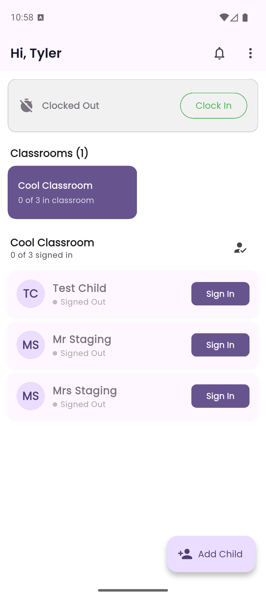
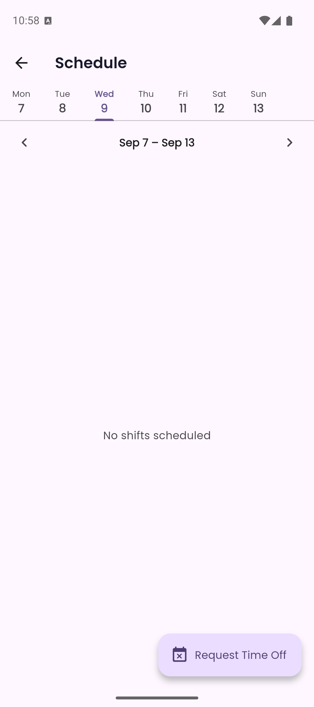
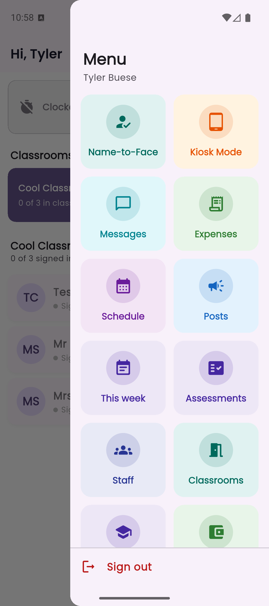
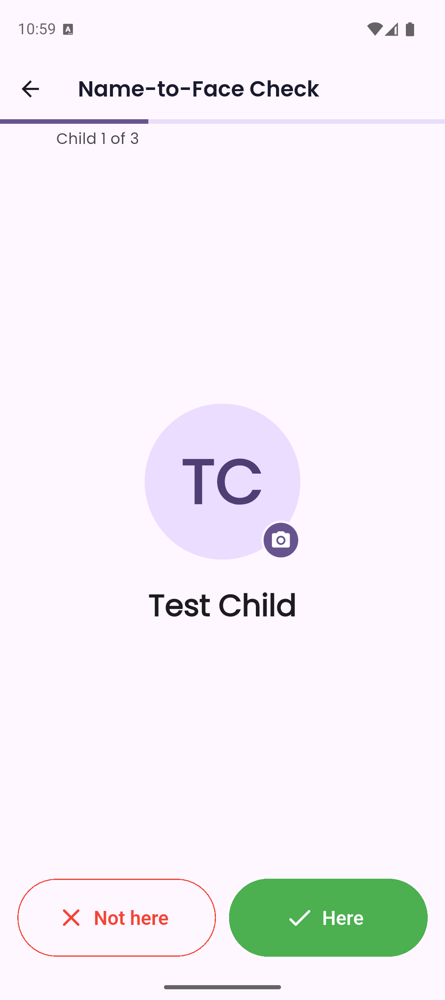

The **Teacher app** is the on-the-floor companion for staff.

## Signing in and out

- **Clock in** and **clock out** with one tap.
- See your own **time history** — a log of every clock-in and clock-out.

Clock-in is per day. If you forgot to clock out yesterday, the app shows you as clocked out this morning, so clock in again when you arrive.

### Requiring the kiosk

A center can switch off clocking in from personal phones under **Manage → Settings → App Settings → Teacher App → Staff clock in / out from the app**. With it off, the app still shows whether you're clocked in, but the button is replaced by "Clock in at the kiosk", and staff clock in and out on the center's shared **Kiosk Mode** device instead.

### Picking up setting changes

The app re-reads your center's settings (kiosk PIN, attendance and clock-in switches) whenever you pull down to refresh or come back to the app, so a change made in Manage reaches phones without anyone restarting the app. A kiosk also re-checks the PIN with the server before rejecting it.

## Classroom and roster

- See every non-archived classroom with its enrolled count, current sign-in count, staff count, and a simple ratio indicator.
- Open a classroom roster to see every child's **signed-in / signed-out** status for today.
- Sign a child in or out on behalf of a parent.
- Move a child to a different classroom.

## Out-of-ratio alerts

Kinderly watches your rooms during operating hours and alerts staff when one drops below its required staff-to-child [ratio](/manage/classrooms/).

It counts who is **actually signed in** — not who is enrolled or rostered.

Each alert says how short the room is and why. For example, it might say that nobody in the room is clocked in, or name the staff assigned to the room who haven't clocked in yet. It might say that everyone assigned is already in, which means someone needs to come over from another room. Or it might say the room has no qualified lead or is over its maximum group size.

If **no** staff assigned to a room have clocked in today, Kinderly can't tell who is on the floor, so it doesn't send ratio alerts until someone clocks in. Opening an alert doesn't make it repeat sooner: while a room stays out of ratio, it repeats on the schedule set in **App Settings**.

:::caution[The alerts depend on people signing in]
A staff member who forgets to sign in makes a properly staffed room look short. One who forgets to sign out makes an empty room look covered. If your team is casual about signing in and out, the alerts will be wrong in both directions — and false alarms teach people to ignore the real one.
:::

## Daily log

Record what happened today, one or many children at a time. Supported entry types:

**Note · Diaper · Potty · Food · Nap · Mood · Incident · Photo · Milestone**

- A **Potty** note has a **Potty / Diaper** switch. It starts on **Diaper** when every child you're logging is under 18 months old, and on **Potty** otherwise. A diaper change is labelled "Diaper" for parents, and follows the **Diaper changes** setting for parent notifications.
- Edit or delete an entry within **30 minutes** of creating it. Admins can edit at any time.
- Upload photos straight from the phone's camera.

### The Learning row

If your center has [Curriculum](/manage/curriculum/) enabled, notes carry a **Learning** row. Tagging an observation to a learning outcome takes one tap.

That's the whole curriculum documentation workflow: teachers write the notes they'd write anyway, and the evidence against your frameworks accrues on its own.

:::tip[Tag as you write, not in a catch-up session]
The tag takes a second in the moment and is far more accurate than trying to remember on Friday which observation showed what. It's also the difference between curriculum documentation being invisible work and being a separate chore staff resent.
:::

## Schedule and time off

- See your shifts for the current week.
- Submit a PTO request (admins approve or deny).
- Cancel a pending PTO request.

## Posts

Read center announcements (Announcements, Events, Closures, News). Pinned posts are sorted first. Admins can create, edit, and archive posts.

Posts take **video as well as photos** — up to 20 attachments per post, 200 MB per clip. Record one straight from the app and families see it play in their feed. See [Feed](/manage/feed/).

:::tip[A short video beats five photos]
Thirty seconds of a room doing something ordinary tells a parent more about their child's day than a carefully framed photo does — and takes less effort to capture.
:::

## Finding everything else

The **⋮** menu in the top right is the app's hub — everything that isn't the roster lives here.

### Name-to-Face check

A guided headcount. Kinderly walks you through the children signed into your room one at a time — showing each child's photo and name — and you tap **Here** or **Not here**. A progress bar tracks how far through the room you are.

:::tip[This is the check that catches a miscount]
Signing children in and out tells you who *should* be in the room. A name-to-face check tells you who actually is. Running one at each transition — after outdoor time, before a walk, at shift change — is what turns your sign-in list from a record into a safety check.
:::

## Scanning paper forms

Administrators on the **Bloom plan and above** can turn paper forms into Kinderly records from their phone. It works the same way as [Scan a document](/manage/scan-documents/) on the web.

**Starting a scan**

- **Scan a document** in the **⋮** menu. Choose what you're adding: **Child** (and their family), **Parents** (parents, guardians and emergency contacts, with the child optional) or **Staff**.
- **Scan a paper form instead** at the top of the **Add child**, **Add guardian** and **Add staff** screens opens the scanner already set to that choice.
- **Scan a document for this child** on a child's profile scans for that child.

**Several documents, no waiting**

Photograph up to six pages per document. **Add another document** queues more, and **Read N documents** sends them all. Ellie reads them one after another in the background (usually 20 to 60 seconds each) while you keep using the app. A small **Ellie is reading…** pill shows while she works. As each one finishes, a **Ready to review** notice appears; tap **Review** to open it. **Recent scans** lists every scan and where it's up to.

**Reviewing**

The sections follow what you're adding: the child, adults, health, address and anything left over; adults first for parents' forms; or just the staff member. Amber fields are ones Ellie wasn't sure of, with the other likely readings one tap away. **View pages** shows the photos. Tap **Apply to Kinderly** to save.

:::tip[Grandparents and emergency contacts keep their relationship]
Relationships read from the form, such as *Grandparent*, *Aunt* or *Emergency Contact*, are kept as written. Everyone added can pick up unless the form says otherwise, and the child always ends up with exactly one primary contact.
:::

:::note[Keep the app open while it reads]
Reading happens while the app is open. If you close it, the scan picks up again the next time you open it.
:::

## Messaging

Two-way chat with families — with push notifications.

- Non-admin staff see threads for their assigned classroom only.
- Admins see every thread.
