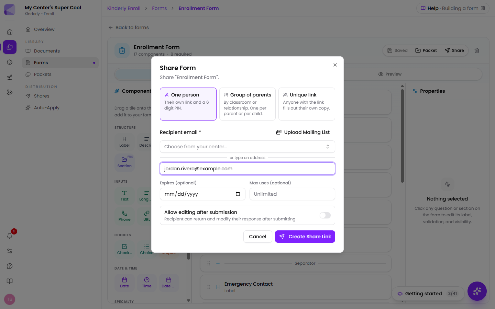
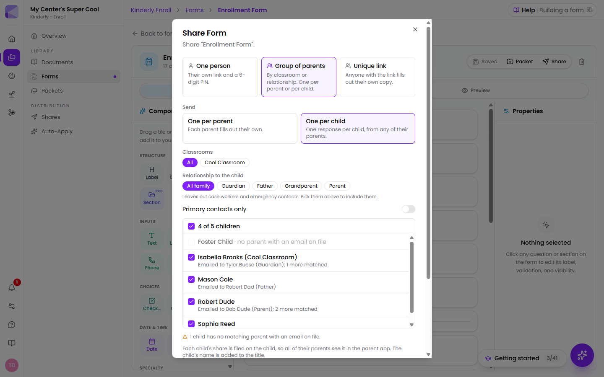
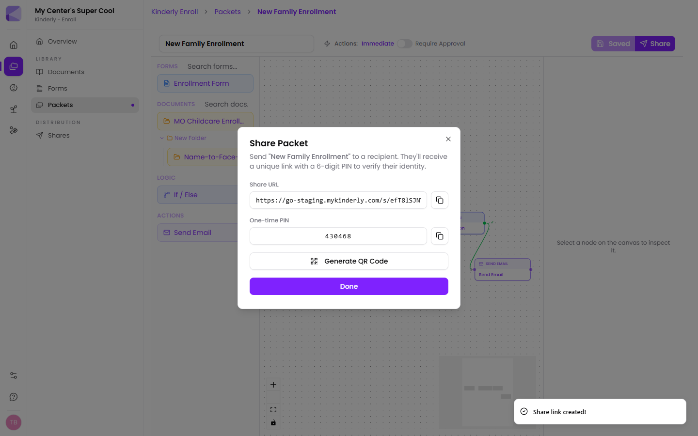
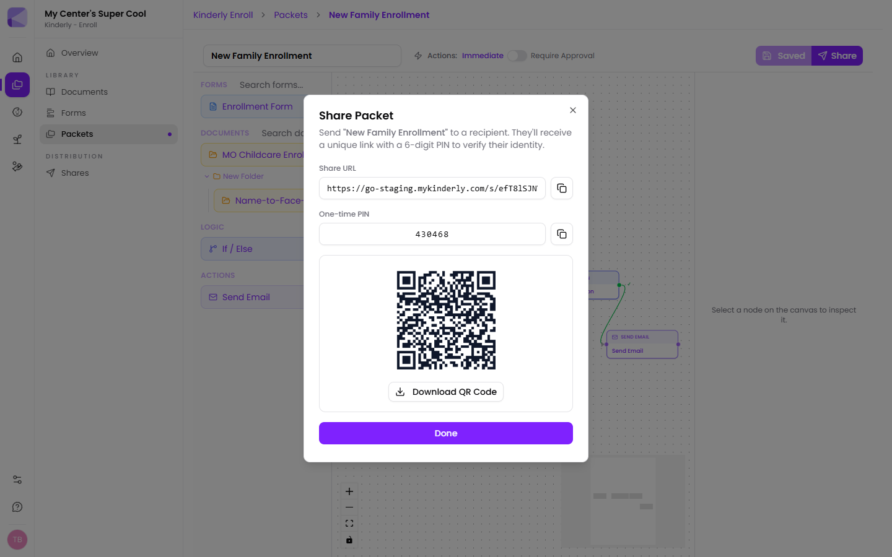

## Creating the share

Open the form, document or packet you want to send and click **Share**. To send to one specific person, you can also start from their page: see [Sending from someone's page](#sending-from-someones-page).

First choose who it's for:

- **One person** — a link and a 6-digit PIN for a single recipient. Everything below about recipients and PINs applies.
- **Group of parents** — the same item to many families at once, picked by classroom and relationship: one per parent, or one per child. See [Sending to a group of parents](#sending-to-a-group-of-parents).
- **Unique link** — one link you can send to as many people as you like. Each person who opens it gets their own copy, with their own answers (and their own payment, if the form takes one). See [Unique links](#unique-links).

### Recipient

Two ways to set this:

- **Choose from your center…** — pick an existing guardian from [Manage](/manage/guardians/). Fewer typos, and the share is tied to a person you already have on file.
- **Or type an address** — for anyone not yet in your system, like a prospective family.

There's also **Upload Mailing List**, for pasting a list of addresses that aren't in Kinderly. For families you already have, use **Group of parents** instead: it files each share on the parent's record and puts it in their parent app.

:::tip[Pick from your center wherever you can]
A mistyped email is the single most common reason a family "never got the form". Choosing an existing guardian removes that risk, and keeps the share linked to their record.
:::

### Expires (optional)

A date after which the link stops working.

:::tip[Set an expiry on anything time-bound]
Field trip permission for a trip on the 12th shouldn't still be accepting submissions in March. An expiry also gives families a gentle deadline, which gets things back faster.
:::

### Max uses (optional)

How many times the link can be opened. Leave it blank for unlimited. On a unique link this is **Max people** instead: how many different people can start a copy. Someone who already has a copy can always come back to finish it.

:::caution[Don't set this too tight]
It's tempting to set max uses to 1 for security. Families routinely open a link, get interrupted, and come back later — and each open counts. If you're going to limit it, leave some headroom.
:::

### Unique links

A unique link needs no PIN, and it isn't tied to one recipient. Post it on your website, put it in a newsletter, or print the QR code. Share it with 100 people and you get 100 separate responses on the share's page, which counts how many people have started and finished.

Each person's copy is tied to the browser they opened it in, so they can leave and come back on the same device to finish. On a different phone or computer they start a fresh copy. See the warning in [Shares overview](/shares/overview/#unique-links).

### Sending to a group of parents

Choose **Group of parents**, then pick how many copies go out:

- **One per parent** — every matching parent fills out their own. Use it for anything each adult signs for themselves, like a handbook acknowledgment.
- **One per child** — one copy for each matching child, filled out by any one of their parents. Use it when you want one answer per child, like a field trip permission slip.

Then narrow down who gets it:

- **Classrooms** — parents of children in the rooms you pick. **All** means every room.
- **Relationship to the child** — for example **Mother** and **Father** only. **All family** leaves out case workers and emergency contacts. To include them, pick them by name.
- **Primary contacts only** — just each child's primary contact.

The list below the filters shows exactly who will get it: each parent and which child and room they matched, or, for one per child, each child and which parent it's emailed to. Untick anyone you want to leave out. Anyone who can't be reached by email is shown greyed out and can't be picked.

If some already have a live share of the same item, you'll see **Skip … who already have this**. It's on by default, so sending the same form to the Toddler room again only reaches the families who don't have it yet.

**One per parent:** each parent gets their own link and PIN by email. The share is filed on their record under **Shared Documents** and appears under **To fill out** in the [parent app](/mobile/parent-app/#paperwork), with a push notification. A parent with two children in the room gets one share, not two.

**One per child:** each child gets one share, with the child's name added to the title, such as *Field trip permission — Ada Lovelace*. It's emailed to one parent: the child's primary contact if they matched your filters, otherwise a mother, father or guardian who did. The share is filed on the child, so every parent of that child sees it in the parent app and gets a push notification, and whoever gets to it first fills it out. A parent with two children in the room gets two, one for each child.

When it's done, the dialog says how many were sent, skipped, or couldn't be emailed.

Sending to a group is a Pro feature, like **Upload Mailing List**.

### Sending from someone's page

On a guardian's, child's or staff member's page, the **Documents** tab has a **Send** button under **Shared Documents**. Pick a form, packet or document, and the share dialog opens already addressed to that person. The search box finds forms and packets by name, and documents by file name or folder. Every word you type has to match, so *trip permission* finds *Field Trips/Permission slip.pdf*. Clear the search to browse folders instead. A child's share goes to their primary guardian, or to another guardian with an email on file if the primary has none. Either way, the share is filed on that page.

### Allow editing after submission

Off by default. When on, a family can come back and change what they submitted.

- **Leave it off** for anything you'll treat as a signed record.
- **Turn it on** for information that legitimately changes — contact details, a pickup list — where you'd rather they correct it than email you.

This can also be toggled later from the share's detail page.

## Passing on the link

Once created, you get the link and the one-time PIN.

Kinderly has already emailed both to the recipient. The copy buttons are there for when you need to send them another way.

### QR code

**Generate QR Code** turns the link into a scannable code you can download.

:::tip[QR codes are excellent at pickup]
Put the QR code on a sign at the door or on a printed handout. Parents scan it with their phone camera and go straight to the form — no typing a long link, no hunting for the email. It works especially well for open-day inquiry forms and consent slips.
:::

## After sending

The share appears in **Enroll → Shares**. See [Managing shares](/shares/admin/).

## Next

- [Managing shares](/shares/admin/) — reviewing submissions.
- [What families see](/shares/for-parents/) — the recipient's experience.
